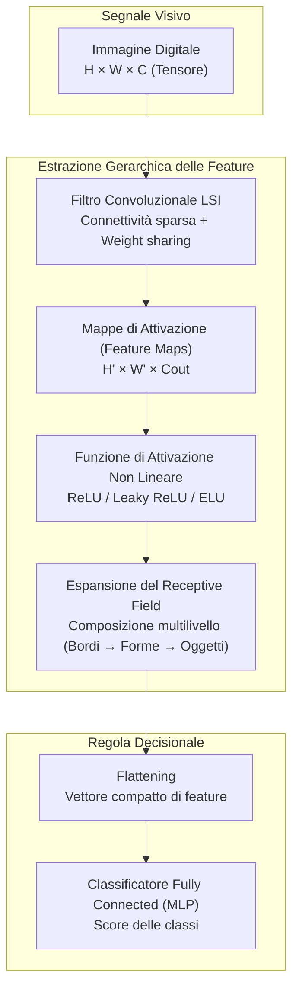
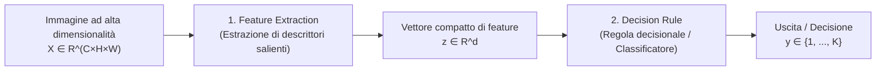
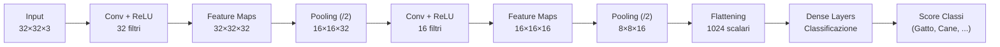
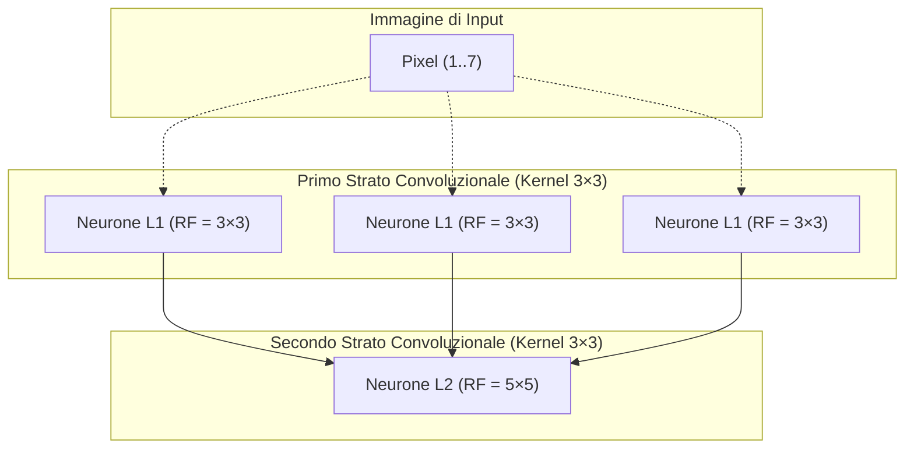
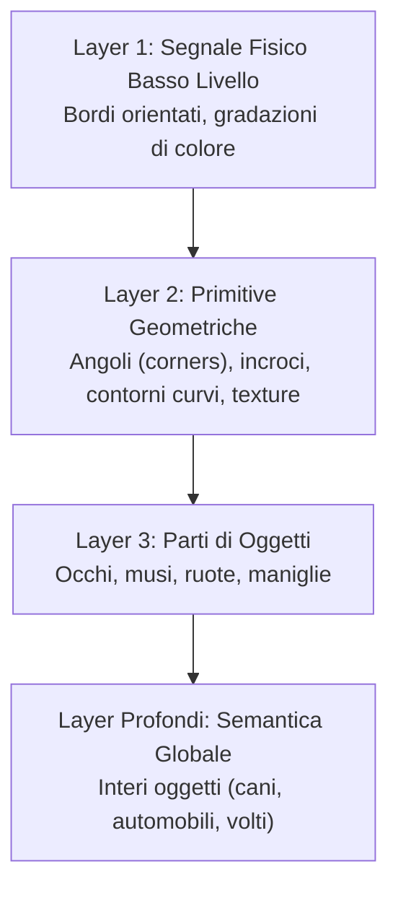
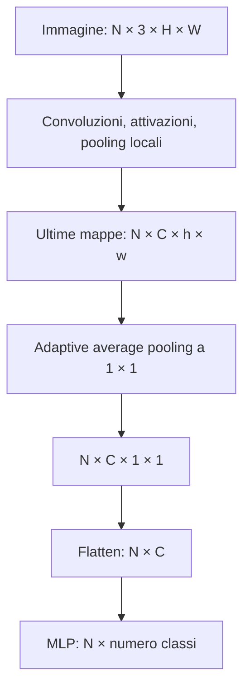
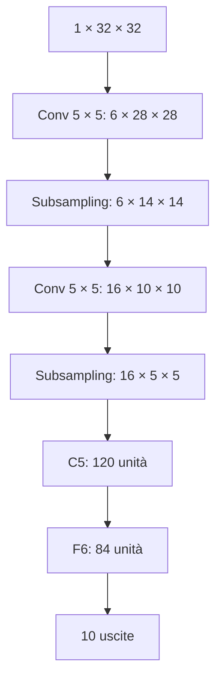
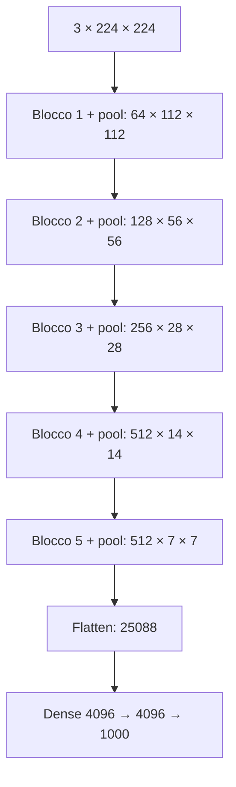
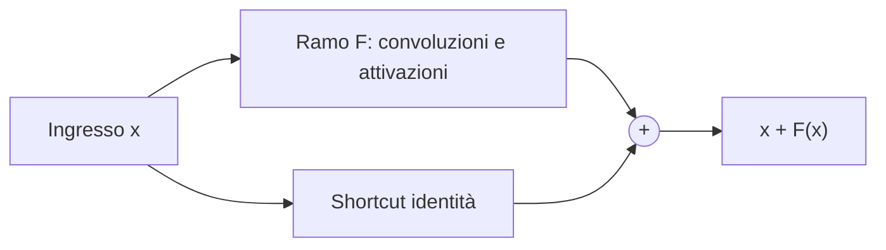
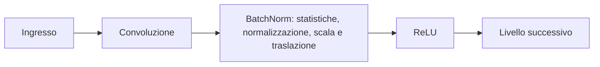

# Reti Neurali Convoluzionali (CNN)

**Convenzione dei riferimenti:** i numeri «slide» indicano la posizione della pagina nel PDF a 93 pagine e il suffisso delle immagini. Il contatore stampato in basso può differire a causa delle pagine di animazione.

**Agenda (slide 2):** Rappresentazione delle immagini → Paradigmi di Computer Vision → Introduzione ed evoluzione da MLP a CNN → Architettura dei blocchi convoluzionali (filtri LSI, connettività sparsa, condivisione dei pesi, feature maps, receptive field, iperparametri) → Visualizzazione dei filtri e gerarchia dei concetti → Funzioni di attivazione (ReLU, Leaky ReLU, ELU) → Pooling e classificatore → LeNet, AlexNet e VGG → ResNet → Batch Normalization fino all’inferenza.

---

## 1. Rappresentazione Digitale delle Immagini nel Calcolatore (slide 3–6)

Un'immagine reale è la manifestazione visibile di un fenomeno fisico continuo: la luce riflessa dagli elementi di una scena tridimensionale attraversa il sistema ottico di una fotocamera e incide su una superficie fotosensibile bidimensionale. Il calcolatore, tuttavia, è un dispositivo discreto sia nello spazio sia nei valori numerici che può memorizzare. Il passaggio da un segnale ottico continuo alla sua rappresentazione binaria interna esige pertanto due trasformazioni fondamentali, formalizzate nella Slide 4:

1. **Campionamento spaziale (Sampling)**: la scena continua viene discretizzata spazialmente proiettandola su una griglia bidimensionale uniforme composta da $H \times W$ campioni discreti chiamati **pixel** (*picture elements*), dove $H$ denota l'altezza (numero di righe) e $W$ la larghezza (numero di colonne).
2. **Quantizzazione (Quantization)**: l'intensità luminosa continua misurata da ciascun fotosensore in corrispondenza del singolo pixel viene approssimata e mappata su un insieme discreto di $2^m$ livelli numerici, corrispondenti a una codifica su $m$ bit per campione.

Nella quasi totalità delle applicazioni digitali standard si adotta una profondità di quantizzazione pari a $m = 8$ bit per canale. Lo spazio dei valori discreti associabili a ogni campione comprende dunque $2^8 = 256$ intensità distinte, convenzionalmente indicizzate nell'intervallo chiuso:

$$
\mathcal{I} \in \{0, 1, 2, \dots, 255\}
$$

dove il valore $0$ corrisponde all'assenza totale di segnale luminoso (nero assoluto) e il valore $255$ corrisponde alla massima intensità di saturazione del sensore (bianco assoluto).

### 1.1 Immagini in Scala di Grigi (Grayscale)

Nel caso di un'immagine monocromatica (in scala di grigi), ciascun pixel memorizza unicamente l'intensità scalare della radianza luminosa. Un'immagine in scala di grigi di risoluzione $H \times W$ è a tutti gli effetti una matrice numerica:

$$
\boxed{I \in \{0, 1, \dots, 255\}^{H \times W}}
$$

in cui l'elemento $I(i, j)$ rappresenta il livello di grigio del pixel posizionato alla riga $i$ (con $1 \le i \le H$) e alla colonna $j$ (con $1 \le j \le W$). La Slide 5 illustra questo concetto mostrando una porzione rettangolare (patch) di $6 \times 8$ pixel estratta da una fotografia di un gatto: ciò che l'occhio umano percepisce come contorni morbidi e sfumature di pelo corrisponde, per la memoria del calcolatore, a una pura tabella bidimensionale di interi compresi tra 0 e 255.

### 1.2 Immagini a Colori: Canali e Spazio RGB

La percezione cromatica umana è tricromatica: la retina dispone di tre tipologie distinte di coni fotosensibili, sintonizzati su differenti lunghezze d'onda dello spettro visibile. Nel calcolatore, la sintesi del colore viene implementata attraverso lo spazio **RGB (Red, Green, Blue)**, basato sul principio della sintesi additiva della luce. 

A differenza della sintesi sottrattiva tipica delle miscele di pigmenti materiali (dove i colori primari tradizionali insegnati nella scuola dell'infanzia sono rosso, giallo e blu), i dispositivi digitali generano immagini emettendo radiazione luminosa direttamente da pixel composti da fosfori o LED colorati. La sovrapposizione delle tre lunghezze d'onda primarie alla massima intensità genera il bianco puro:

$$
(R, G, B) = (255, 255, 255)
$$

mentre l'azzeramento di tutte le sorgenti produce il nero:

$$
(R, G, B) = (0, 0, 0)
$$

Un'immagine a colori non può essere descritta da una singola matrice bidimensionale: essa si articola in **tre matrici spaziali parallele sovrapposte**, denominate **canali** (*channels*), ciascuna di dimensioni $H \times W$, che registrano individualmente il contributo di intensità del rispettivo spettro cromatico nell'intervallo $[0, 255]$. Ciascun pixel è identificato da una terna ordinata $(R, G, B)$.

Nel framework formale del Deep Learning e in librerie come PyTorch, un'immagine RGB viene rappresentata mediante un **tensore tridimensionale** di dimensioni:

$$
\boxed{X \in \mathbb{R}^{C \times H \times W}}
$$

dove $C = 3$ indica il numero di canali, $H$ l'altezza e $W$ la larghezza (notazione *channels-first*, standard per PyTorch, a differenza della convenzione *channels-last* $H \times W \times C$ utilizzata storicamente da altre librerie). Ad esempio, una minuscola immagine RGB di dimensioni $32 \times 32$ (come quelle del benchmark CIFAR-10) è formata da:

$$
3 \times 32 \times 32 = 3072 \text{ valori scalari}
$$

---

## 2. Paradigmi di Computer Vision ed Evoluzione Storica (slide 7–11)

La disciplina della **Computer Vision (CV)** si colloca all'intersezione tra l'analisi del segnale e l'intelligenza artificiale, ponendosi l'obiettivo formale di estrarre conoscenza e descrizioni semantiche esplicite a partire da flussi visivi ("elaborare immagini per ottenere dati comprensibili e decisioni operative").

Nella tassonomia accademica dei sistemi visivi si distingue rigorosamente tra due livelli gerarchici di elaborazione:

* **Image Processing (Elaborazione delle immagini)**: trasforma immagini di ingresso in altre immagini modificate o raffinate (ad esempio aumentando il contrasto, sopprimendo il rumore di acquisizione o correggendo aberrazioni cromatiche). Opera sui pixel trattandoli come entità numeriche astratte, senza comprendere in alcun modo il significato semantico degli oggetti rappresentati o la geometria tridimensionale della scena.
* **Computer Vision propriamente detta**: opera a un livello di astrazione semantica superiore. Il suo fine non è alterare i pixel, bensì interpretare cosa quei valori numerici rappresentino nel mondo reale (compiti di riconoscimento, misurazione volumetrica, guida di veicoli autonomi, videosorveglianza e controllo qualità industriale).

### 2.1 La Scomposizione Classica in Due Stadi (slide 9)

Poiché lo spazio delle configurazioni di pixel grezzi presenta una dimensionalità astronomica, la visione artificiale classica ha storicamente frammentato il problema in due stadi sequenziali disaccoppiati:

1. **Feature Extraction (Estrazione delle caratteristiche)**: riduce la dimensionalità grezza dell'immagine calcolando una rappresentazione compatta ed espressiva (il vettore di *feature*), progettata per trattenere le informazioni salienti per lo specifico compito (es. profili dei contorni, orientamento dei gradienti, consistenza della trama) scartando le variazioni irrilevanti (come cambi di luminosità globale).
2. **Decision Rule (Regola decisionale)**: prende in ingresso il vettore di feature compatto e formula il verdetto finale (assegnazione della classe, regressione delle coordinate o stima di parametri).

### 2.2 Le Tre Ere Paradigmatiche della Visione Artificiale (slide 10–11)

L'evoluzione della Computer Vision dagli anni '70 a oggi è scandita da tre paradigmi metodologici:

| Periodo Storico | Feature Extraction | Decision Rule | Caratteristiche del Modello |
| :--- | :--- | :--- | :--- |
| **Fino al 2000** | Progettata a mano (*Handcrafted*) | Progettata a mano (*Handcrafted*) | Regole euristiche basate su soglie fisse, allineamento di maschere rigide e modelli geometrici analitici formulati dall'esperto umano. |
| **Anni 2000 – 2012** | Progettata a mano (*Handcrafted*) | Appresa statisticamente (*Learned*) | Descrittori ingegnerizzati complessi (es. SIFT, HOG, SURF) combinati con classificatori statistici di Machine Learning (SVM, Random Forest, AdaBoost). |
| **2012 – Oggi** | **Appresa congiuntamente dai dati** | **Appresa congiuntamente dai dati** | **Deep Learning End-to-End**: reti neurali convoluzionali profonde (spartiacque storico: **AlexNet**, 2012). Estrazione delle feature e classificazione sono unificate e ottimizzate simultaneamente mediante differenziazione automatica. |

L'esempio emblematico mostrato nella Slide 11 riguarda il compito di **rilevamento di pedoni (People Detection)**:
* **Prima del 2000**: si disegnavano a mano delle sagome geometriche standard (*template* stilizzati del corpo umano) e le si faceva scorrere sull'immagine, verificando mediante correlazione visiva se la sovrapposizione superava una certa soglia arbitraria.
* **Negli anni 2000**: si calcolavano i descrittori **HOG (Histogram of Oriented Gradients)** per catturare le direzioni dominanti dei gradienti lungo la silhouette della persona, e si addestrava un classificatore Support Vector Machine (SVM) per discriminare tra la classe pedone e lo sfondo.
* **Con l'avvento di AlexNet nel 2012**: si alimenta l'immagine direttamente a una rete convoluzionale profonda; il modello apprende dai dati grezzi sia i filtri per riconoscere la sagoma sia i pesi per la classificazione finale, superando nettamente ogni prestazione manuale precedente.

---

## 3. Limiti del Multilayer Perceptron per Dati Visivi (slide 12–18)

Le reti neurali convoluzionali non ripudiano la matematica del Multilayer Perceptron ([[mlp_appunti_completi]]), bensì ne condividono l'impalcatura teorica fondamentale (Slide 13):

* Sono costituite da strati di neuroni artificiali dotati di pesi e bias apprendibili.
* Ciascun neurone calcola una trasformazione lineare (prodotto scalare tra pesi e input) seguita da una funzione di attivazione non lineare.
* L'intera architettura definisce una **funzione continua e differenziabile a tratti**, addestrabile end-to-end tramite l'algoritmo di retropropagazione del gradiente (**Backpropagation**).

Tuttavia, l'applicazione diretta di un MLP alle immagini svela immediatamente limiti rilevanti, sia di natura computazionale sia di compatibilità geometrica.

### 3.1 Esplosione Parametrica e Inefficienza Computazionale (slide 14–16)

Nelle slide 14 e 15 vengono poste due domande fondamentali:

> **Domanda 1:** Come rappresentiamo un'immagine in modo da poterla fornire in ingresso a un MLP?  
> **Domanda 2:** Di quanti parametri ha bisogno l'MLP per elaborarla?

La risposta alla Domanda 1 impone l'operazione di **appiattimento (Flattening)**: poiché i neuroni di uno strato denso (Fully Connected) accettano unicamente ingressi monodimensionali, la matrice o il tensore dell'immagine deve essere "srotolato" in un unico vettore colonna $x \in \mathbb{R}^D$. Per una matrice RGB $32 \times 32$:

$$
x \in \mathbb{R}^{3 \cdot 32 \cdot 32} = \mathbb{R}^{3072}
$$

La risposta alla Domanda 2 svela la drammatica esplosione del numero di parametri. Consideriamo un MLP dotato di un singolo strato nascosto estremamente modesto, composto da soli $M = 512$ neuroni:

La matrice dei pesi dello strato è $W \in \mathbb{R}^{512 \times 3072}$ e il vettore dei bias è $b \in \mathbb{R}^{512}$. Il conteggio esatto dei parametri liberi risulta:

$$
\text{Parametri} = (512 \times 3072) + 512 = 1.572.864 + 512 = \mathbf{1.573.376}
$$

Oltre un milione e mezzo di parametri per un'immagine giocattolo di appena $32 \times 32$ pixel! Se consideriamo una risoluzione comune per la visione artificiale moderna (come lo standard ImageNet da $224 \times 224$ pixel RGB), il vettore di ingresso contiene:

$$
D = 3 \times 224 \times 224 = 150.528 \text{ componenti}
$$

Collegando questo ingresso agli stessi 512 neuroni nascosti, il numero di parametri lievita a:

$$
\text{Parametri} = (512 \times 150.528) + 512 = 77.070.336 + 512 = \mathbf{77.070.848}
$$

Uno strato singolo richiede oltre **77 milioni di pesi**. Per un'immagine ad alta definizione ($1000 \times 1000$ pixel) e uno strato nascosto proporzionato, si supererebbe ampiamente il miliardo di parametri per un solo livello. Questa mole di pesi ha un costo elevato di calcolo e memoria e può rendere più difficile generalizzare con pochi dati; il numero dei pesi da solo non dimostra overfitting.

### 3.2 Criticità Strutturali dell'MLP sulle Immagini (slide 17)

Al di là del costo computazionale, l'MLP denso non incorpora esplicitamente la struttura geometrica intrinseca dei dati visivi:

1. **Perdita della struttura topologica spaziale (*Loss of spatial information*)**: Lo srotolamento è invertibile e non elimina i valori dei pixel; è il livello denso a non imporre esplicitamente la geometria della griglia. In un vettore piatto, la distanza tra il pixel $(0, 0)$ e il suo vicino adiacente $(0, 1)$ è trattata con la medesima neutralità della distanza tra il pixel $(0, 0)$ e l'angolo opposto $(31, 31)$. Se applicassimo a tutte le immagini di addestramento una permutazione casuale fissa di pixel, l'immagine risulterebbe incomprensibile per un essere umano, ma la capacità di apprendimento di un MLP rimarrebbe esattamente invariata.
2. **Mancanza di invarianza/equivarianza alla traslazione (*No translation robustness*)**: in un MLP, a ogni indice del vettore di ingresso corrisponde un peso distinto. Se un pattern visivo (ad esempio il volto di un gatto) si sposta dall'angolo superiore sinistro a quello inferiore destro dell'immagine, esso attiverà componenti del vettore e pesi completamente diversi. L'MLP non impone la condivisione spaziale dei pesi: apprendere lo stesso pattern in posizioni diverse può richiedere più esempi.
3. **Assenza di una gerarchia locale imposta dall’architettura**: il mondo visivo naturale è strutturato secondo una gerarchia compositiva (i pixel formano contorni, i contorni si combinano in forme geometriche, le forme compongono parti di oggetti e le parti formano l'oggetto intero). La connettività densa e uniforme di un MLP non fornisce alcun vincolo architetturale che guidi la rete verso questa progressiva astrazione.

### 3.3 Le Proprietà Fisiche delle Immagini e l'Inductive Bias (slide 18)

I dati visivi naturali possiedono due regolarità utili in molti compiti:

1. **Proprietà del segnale: Località e Continuità Spaziale (*Spatial Locality*)**: la luce riflessa dagli oggetti del mondo fisico varia nello spazio in modo continuo. Di conseguenza, i pixel spazialmente vicini presentano una **fortissima correlazione statistica**: il valore di intensità di un pixel $I(x, y)$ fornisce un'enorme quantità di informazione sul valore del pixel contiguo $I(x+1, y)$, mentre pixel a grande distanza hanno correlazione via via decrescente.
2. **Proprietà semantica: Indipendenza del contenuto dalla posizione (*Translation Invariance*)**: l'identità semantica di un oggetto è invariante rispetto alla sua collocazione nel fotogramma. Un'automobile rimane un'automobile sia che si trovi al centro, a destra o a sinistra dell'inquadratura.

Il grafico mostrato nella Slide 18 traccia la correlazione empirica tra $I(x, y)$ e $I(x+d, y)$ in funzione della distanza euclidea $d$ in pixel: per distanze minime ($d \to 0$) la correlazione è quasi unitaria, per poi decadere rapidamente al crescere di $d$.

L'integrazione di queste due evidenze nella struttura di una rete neurale costituisce un potente **Inductive Bias** (bias induttivo): anziché costringere l'algoritmo a cercare una funzione predittiva nell'intero e sterminato spazio di tutte le funzioni astratte possibili (spazio delle ipotesi dell'MLP), restringiamo a priori l'architettura alle sole funzioni che rispettano la località spaziale e l'invarianza traslazionale. Ciò abbatte la complessità di calcolo e può favorire la generalizzazione quando queste ipotesi sono appropriate.

---

## 4. Principi Architetturali e Ispirazione Biologica (slide 19–23)

Le CNN riprendono un'intuizione della visione biologica: combinare risposte locali in rappresentazioni via via più complesse. Il campo recettivo descrive la porzione di ingresso che può influenzare un'unità. L'analogia fra elaborazione locale e riconoscimento globale motiva l'architettura, ma non significa che la rete riproduca esattamente il sistema visivo.

### 4.1 I Tre Blocchi Costruttivi della CNN (slide 20–22)

Per emulare artificialmente questo principio di calcolo, una rete convoluzionale standard combina tre blocchi architetturali (Slide 21):

1. **Livelli Convoluzionali (Convolutional Layers)**: applicano banchi di filtri locali lineari che scorrono sull'immagine per estrarre mappe di feature, sfruttando la connettività sparsa e la condivisione dei parametri.
2. **Funzioni di Attivazione (Activation Functions)**: introducono non linearità puntuali indispensabili per impedire il collasso algebrico degli strati e consentire l'apprendimento di funzioni complesse.
3. **Livelli di Pooling (Pooling Layers)**: operano un sottocampionamento spaziale progressivo, riducendo la risoluzione geometrica delle mappe e allargando il campo recettivo per gli strati successivi.

Lo schema complessivo di una classica architettura convoluzionale (Slide 22) si struttura secondo la seguente sequenza:

Un tensore di ingresso (es. $32 \times 32 \times 3$) viene elaborato dal primo strato convoluzionale: le dimensioni spaziali rimangono controllate mentre il numero di canali viene espanso (es. a 32 canali). Il livello di pooling dimezza la risoluzione spaziale (portandola a $16 \times 16$), mantenendo inalterata la profondità dei canali. Una seconda convoluzione rielabora i canali (portandoli a 16), e un successivo pooling riduce la griglia a $8 \times 8 \times 16$. 

Al termine dello stadio estrattivo, il volume compatto risultante viene appiattito in un vettore monodimensionale di feature ad alto livello ($8 \times 8 \times 16 = 1024$ elementi), che viene infine classificato da uno strato denso standard (MLP). **Il sistema è continuo e differenziabile a tratti**: il gradiente della funzione di perdita fluisce a ritroso lungo tutti i livelli, aggiornando simultaneamente sia i pesi del classificatore sia i parametri di ciascun filtro convoluzionale.

---

## 5. Operatori su Immagini e Sistemi Lineari Traslazione-Invarianti (LSI) (slide 24–34)

Per formalizzare matematicamente il funzionamento del livello convoluzionale occorre comprendere la natura degli operatori bidimensionali del processamento numerico dei segnali visivi (Slide 24):

* **Operatori puntuali (Point operators)**: il valore del pixel di uscita $o(x, y)$ dipende esclusivamente dal valore assunto dal pixel di ingresso nella medesima coordinata $i(x, y)$. Esempi tipici sono la correzione di contrasto/luminosità e la correzione gamma con parametri fissati.
* **Operatori locali o filtri spaziali (Local operators)**: il valore del pixel di uscita $o(x, y)$ viene determinato elaborando congiuntamente un insieme compatto di pixel appartenenti a un intorno geometrico (un vicinato locale) circostante la coordinata $(x, y)$.

Una classe fondamentale di operatori locali è costituita dagli **operatori lineari e invarianti alla traslazione** (**LSI - Linear Shift-Invariant operators**, Slide 25). Un operatore locale $\mathcal{T}$ si dice LSI se soddisfa due condizioni:
1. **Linearità**: $\mathcal T(aX+bY)=a\mathcal T(X)+b\mathcal T(Y)$. L'annotazione della slide 25 che collega «linear» al movimento lungo righe e colonne non è corretta: la linearità riguarda la sovrapposizione dei segnali. Un filtro massimo scorre allo stesso modo ma non è lineare. Un bias non nullo rende la trasformazione affine.
2. **Invarianza alla traslazione (Shift-Invariance)**: applica **la medesima identica funzione** a ogni posizione spaziale dell'immagine, indipendentemente dalla posizione della finestra.

Applicare un operatore LSI a un'immagine equivale algebricamente a eseguire la **convoluzione** tra l'immagine e la risposta impulsiva dell'operatore, denominata **kernel** (o filtro).

Tra gli operatori LSI classici ampiamente impiegati nella Computer Vision pre-deep learning figurano (Slide 26):
* **Filtro di media (Mean filtering)**: calcola la media aritmetica non pesata dei pixel nel vicinato, producendo un effetto di sfocatura (*smoothing*).
* **Filtro gaussiano (Gaussian filtering)**: assegna pesi decrescenti a campana gaussiana in base alla distanza dal centro, riducendo il rumore ad alta frequenza preservando meglio i contorni.
* **Filtri derivativi (es. Sobel, Prewitt)**: calcolano le differenze discrete di intensità tra pixel adiacenti. Poiché la derivata prima spaziale evidenzia le discontinuità repentine di intensità, questi filtri estraggono i contorni (*edges*) degli oggetti.

### 5.1 Esempio Calcolato a Mano: Filtro di Media $3 \times 3$ (slide 27–31)

Nelle slide 27–31 viene illustrata l'applicazione di un filtro di media con kernel $3 \times 3$ su una porzione di immagine reale in scala di grigi.

Il kernel del filtro di media è una matrice quadrata $3 \times 3$ i cui coefficienti sommano a 1:

$$
K = \begin{bmatrix}
1/9 & 1/9 & 1/9 \\
1/9 & 1/9 & 1/9 \\
1/9 & 1/9 & 1/9
\end{bmatrix}
$$

Alla coordinata spaziale iniziale $(x_0, y_0) = (13, 10)$, i pixel dell'immagine coperti dalla finestra del filtro sono:

$$
P_{(13, 10)} = \begin{bmatrix}
147 & 77 & 44 \\
110 & 128 & 135 \\
112 & 116 & 115
\end{bmatrix}
$$

L'operazione locale consiste nel moltiplicare elemento per elemento ciascun pixel per il corrispondente coefficiente del kernel e sommare i 9 prodotti risultanti:

$$
\begin{aligned}
\text{Output} &= \frac{1}{9}(147) + \frac{1}{9}(77) + \frac{1}{9}(44) + \frac{1}{9}(110) + \frac{1}{9}(128) + \frac{1}{9}(135) + \frac{1}{9}(112) + \frac{1}{9}(116) + \frac{1}{9}(115) \\
&= \frac{147 + 77 + 44 + 110 + 128 + 135 + 112 + 116 + 115}{9} \\
&= \frac{984}{9} \approx 109.33 \longrightarrow 109
\end{aligned}
$$

Il valore scalare risultante (109) viene trascritto nella mappa di uscita. Il filtro viene quindi traslato linearmente di un pixel verso destra lungo la riga:

* Alla coordinata $(14, 10)$ (Slide 28): la finestra copre un nuovo set di pixel con somma 895, producendo un'uscita di $\frac{895}{9} \approx 99.4 \to \mathbf{99}$.
* Alla coordinata $(15, 10)$ (Slide 29): la finestra copre il nuovo vicinato con somma 867, producendo $\frac{867}{9} \approx \mathbf{96}$.
* Alla coordinata $(16, 10)$ (Slide 30): la finestra copre il vicinato con somma 998, producendo $\frac{998}{9} \approx \mathbf{111}$.

Ripetendo l'operazione per tutte le coordinate si ottiene la mappa filtrata (Slide 31). In assenza di accorgimenti per i bordi, l'immagine risultante subisce una lieve riduzione di dimensioni (da $32 \times 24$ a $30 \times 22$).

### 5.2 Chiarimento Didattico: Dove Viene Collocato il Valore Calcolato?

Durante la spiegazione dell'operatore a finestra mobile emergono spesso dubbi sul significato dell'uscita e sul suo posizionamento:

1. **Un filtro locale modifica l'immagine sovrascrivendo i pixel coperti?**  
   No. L'immagine di uscita è inizialmente una matrice vuota. L'applicazione del kernel su un'intera finestra di $3 \times 3$ pixel non produce 9 valori, bensì **un singolo valore scalare**. Questo valore viene inserito in una coordinata specifica della nuova immagine di output, mentre i pixel originali rimangono intatti per i calcoli successivi.
2. **In quale cella dell'output viene inserito lo scalare calcolato?**  
   Dipende dalla convenzione adottata per il sistema di coordinate del filtro:
La scelta del centro o dell'angolo superiore sinistro è una convenzione di indicizzazione. Non distingue convoluzione e correlazione: la convoluzione ribalta il kernel lungo entrambi gli assi, mentre la correlazione lo applica senza ribaltarlo. Per un kernel simmetrico i risultati coincidono. Con patch $[1,2]$ e pesi $[3,4]$, la correlazione dà $1\cdot3+2\cdot4=11$, l'applicazione ribaltata dà $1\cdot4+2\cdot3=10$. Limiti interi inclusivi da $-3$ a $3$ comprendono **7**, non 6, posizioni.

3. **Quante volte viene utilizzato ciascun pixel dell'input?**  
   Un pixel interno viene condiviso e riutilizzato tante volte quante sono le posizioni del filtro che lo includono all'interno della propria finestra. Per un kernel $3 \times 3$ con passo unitario, ogni pixel interno entra nel calcolo di **9 finestre distinte**, garantendo un'altissima ridondanza e coerenza spaziale nel segnale estratto.

### 5.3 Formalizzazione Matematica dell'Operatore LSI (slide 32–34)

Data un'immagine discreta di ingresso $i(x, y)$, l'uscita $o(x, y)$ prodotta da un operatore LSI $\mathcal{T}$ con kernel discreto $K(x, y)$ è formalmente definita da una doppia sommatoria (Slide 32):

$$
\boxed{o(x, y) = \mathcal{T}\{i\}(x, y) = \sum_{m} \sum_{n} i(m, n) \cdot K(x - m, y - n)}
$$

dove $K(x, y) = \mathcal{T}\{\delta\}(x, y)$ rappresenta la **risposta all'impulso** dell'operatore applicato alla delta di Kronecker bidimensionale $\delta(x, y)$.

Le due proprietà algebriche fondamentali enunciate nella Slide 34 sono:

1. **Linearità**:
   $$
   \mathcal{T}\{a \cdot i_1 + b \cdot i_2\} = a \cdot \mathcal{T}\{i_1\} + b \cdot \mathcal{T}\{i_2\}, \quad \forall a, b \in \mathbb{R}
   $$
2. **Invarianza alla traslazione (Shift-Invariance / Translation Equivariance)**:  
   Sia $S_{(x_0, y_0)}$ l'operatore di traslazione spaziale definito da $(S i)(x, y) = i(x - x_0, y - y_0)$. Allora:
   $$
   \boxed{\mathcal{T}\{S i\} = S \mathcal{T}\{i\}}
   $$

In termini discorsivi: **traslare l'immagine e poi applicare il filtro produce lo stesso identico risultato che applicare il filtro e successivamente traslare la mappa di uscita**.

#### L'Intuizione Fisica: Risposta Massima e Sovrapposizione di Forme

Il significato profondo del prodotto di convoluzione tra un segnale e un kernel può essere compreso analizzando la risposta in 1D o 2D: il valore di uscita misura il grado di somiglianza locale (allineamento per prodotto scalare) tra il profilo del filtro e la porzione di segnale sottostante.

L’analogia delle forme a incastro aiuta a interpretare un filtro come rilevatore di pattern. Un buon allineamento può produrre una risposta alta, ma il prodotto scalare dipende anche dall’intensità e dai segni: non è una misura normalizzata di somiglianza e non genera in generale un unico impulso con zero altrove. La delta di Kronecker definisce invece l’impulso usato per identificare la risposta del sistema.

Se il pattern si sposta all'interno dell'immagine, la proprietà di shift-invariance garantisce che anche il picco della risposta si sposterà esattamente della medesima quantità, senza alterare la propria intensità o conformazione.

---

## 6. Il Nucleo della Convoluzione nel Deep Learning (slide 35–39)

Il passaggio rivoluzionario dalla Computer Vision classica al Deep Learning risiede in un cambio di paradigma fondamentale (Slide 35): **i coefficienti del kernel non vengono più progettati a mano da un esperto umano, ma vengono trattati come parametri liberi da apprendere direttamente dai dati mediante Backpropagation**.

### 6.1 La Convoluzione 2D come Percettrone Locale Scorrevole (slide 36)

Si consideri l'operazione di filtraggio locale su una porzione di matrice $3 \times 3$ con un filtro $2 \times 2$ (Slide 36):

$$
\text{Input} = \begin{bmatrix} a & b & c \\ d & e & f \\ g & h & i \end{bmatrix}, \qquad \text{Filtro} = \begin{bmatrix} w & x \\ y & z \end{bmatrix}
$$

L'uscita nelle quattro posizioni spaziali è:

$$
\text{Output} = \begin{bmatrix}
a \cdot w + b \cdot x + d \cdot y + e \cdot z & b \cdot w + c \cdot x + e \cdot y + f \cdot z \\
d \cdot w + e \cdot x + g \cdot y + h \cdot z & e \cdot w + f \cdot x + h \cdot y + i \cdot z
\end{bmatrix}
$$

Se appiattiamo i 4 coefficienti del filtro in un vettore pesi $w = [w, x, y, z]^T \in \mathbb{R}^4$ e i 4 pixel della prima finestra locale in un vettore $x_{(1)} = [a, b, d, e]^T \in \mathbb{R}^4$, l'operazione calcolata coincide con:

$$
\text{Out}_{(1, 1)} = w^T x_{(1)} + b
$$

Questa formulazione dimostra che **un'operazione convoluzionale non è altro che un piccolo percettrone lineare (un micro-MLP) dotato di pochissimi pesi, che viene fatto scorrere linearmente su tutte le coordinate dell'immagine**.

### 6.2 I Due Principi Fondamentali: Connettività Sparsa e Condivisione dei Pesi (slide 37–39)

Le CNN modificano radicalmente l'approccio dell'MLP densamente connesso attraverso due regole di progettazione (Slide 37):

1. **Connettività Sparsa (Sparse Connectivity, Slide 38)**: ogni neurone dello strato convoluzionale non è connesso a tutti i pixel dell'immagine di ingresso, ma interagisce unicamente con una piccola regione spaziale locale e contigua. Questa regione delimitata costituisce il **Receptive Field** (campo recettivo) del neurone.
2. **Condivisione dei Pesi (Weight Sharing / Parameter Sharing, Slide 39)**: il medesimo insieme di coefficienti numerici (il kernel) e lo stesso termine di bias vengono riutilizzati per calcolare le risposte in **tutte** le posizioni spaziali dell'immagine. Tutti i neuroni che concorrono alla generazione di una specifica mappa di feature condividono identici pesi.

### 6.3 Risoluzione del Punto Aperto: Il Concetto e la Crescita del Receptive Field (slide 38)

Nella slide 38 compare una riflessione didattica lasciata aperta:

> *"Questo è importante: più mi sposto in profondità, maggiore è ... "*

La risposta analitica e concettuale è: **il Receptive Field (campo recettivo teorico) cresce progressivamente all'aumentare della profondità della rete**.

Si analizzi la meccanica di composizione su più strati successivi:
* Un neurone appartenente alla prima mappa di feature possiede un campo recettivo limitato, pari all'estensione spaziale del primo filtro (ad esempio $3 \times 3$ pixel dell'immagine di input).
* Un neurone del secondo strato convoluzionale elabora una finestra $3 \times 3$ della mappa di feature prodotta dal primo strato. Ciascuno di questi 9 elementi, a sua volta, sintetizza l'informazione di una propria finestra $3 \times 3$ sull'immagine originaria.
* Attraverso la sovrapposizione geometrica delle finestre, il singolo neurone del secondo strato "vede" indirettamente un'area considerevolmente più ampia dell'immagine originale (un patch di $5 \times 5$ pixel).
* Procedendo verso strati via via più profondi (specialmente in presenza di stride o pooling), il campo recettivo teorico si espande a ventaglio fino a coprire decine o centinaia di pixel, arrivando a comprendere l'intero fotogramma.

Questa proprietà risolve un dilemma fondamentale: come può una rete neurale riconoscere oggetti di grandi dimensioni (come un'intera automobile o un volto umano) se i suoi filtri elementari sono minuscoli matrici $3 \times 3$? La risposta risiede proprio nella **crescita del campo recettivo**: non è necessario costruire filtri giganteschi (che comporterebbero troppi parametri), ma basta impilare strati con filtri piccoli per comporre gerarchicamente le informazioni locali in rappresentazioni globali.

---

### 6.4 Crescita del campo recettivo: risposta al dubbio della slide 38

Il campo recettivo teorico è l'insieme delle posizioni dell'immagine che possono influenzare un'uscita. Non coincide con l'importanza effettiva di ciascun pixel, che dipende dai pesi. Indicando con $r_\ell$ la sua ampiezza e con $j_\ell$ la distanza fra due uscite adiacenti misurata sull'immagine iniziale, per kernel di ampiezza $k_\ell$ e stride $s_\ell$, senza dilatazione:
$$
\boxed{r_\ell=r_{\ell-1}+(k_\ell-1)j_{\ell-1},\qquad j_\ell=s_\ell j_{\ell-1}.}
$$
Si parte da $r_0=j_0=1$. Una finestra unisce $k_\ell$ campi del livello precedente, i cui centri sono distanti $j_{\ell-1}$: dal primo all'ultimo si aggiungono $k_\ell-1$ intervalli. Con due convoluzioni $3\times3$ a stride 1 si ottiene $r_1=3$, $r_2=5$.

L'esempio orale parte da una griglia $4\times4$. Un kernel $2\times2$ a stride 2 produce una griglia $2\times2$: ogni uscita riassume quattro pixel. Un altro kernel $2\times2$ unisce le quattro uscite in un solo valore: $r_2=2+(2-1)\cdot2=4$, quindi può dipendere dall'intera immagine. Si compongono pattern piccoli in pattern estesi senza apprendere fin dall'inizio un filtro grande quanto l'immagine. Non si può concludere che un filtro grande diretto sia più preciso: i modelli hanno parametrizzazioni differenti e, con attivazioni intermedie, non sono equivalenti.

## 7. Convoluzione Multicanale e Feature Maps (slide 40–42)

Nelle applicazioni reali le immagini di ingresso non sono scalari monodimensionali (possiedono $C_{in} = 3$ canali cromatici RGB), e gli strati intermedi operano su volumi composti da decine o centinaia di canali di feature.

### 7.1 Il Filtro Tridimensionale ($C_{in} > 1$, slide 40)

Quando il volume di ingresso ha forma $H \times W \times C_{in}$, un filtro convoluzionale **non è una matrice bidimensionale, bensì un volume tridimensionale (un parallelepipedo parametrico)** di dimensioni:

$$
\boxed{K \times K \times C_{in}}
$$

Il filtro si estende per l'intera profondità dei canali di ingresso. Esso è composto da una pila di $C_{in}$ fette bidimensionali distinte di parametri, ciascuna di dimensione $K \times K$:

$$
(K_1, K_2, \dots, K_{C_{in}})
$$

La formula formale per il calcolo del valore nella mappa di feature $F(i, j)$ alla coordinata spaziale $(i, j)$ è (Slide 40):

$$
\boxed{F(i, j) = b + \sum_{c=1}^{C_{in}} \sum_{m} \sum_{n} I(i + m, j + n, c) \cdot K_c(m, n)}
$$

dove $I(i+m, j+n, c)$ denota il pixel dell'input nel canale $c$, $K_c(m, n)$ rappresenta il peso corrispondente nella fetta $c$ del filtro, e $b \in \mathbb{R}$ è l'unico termine scalare di bias associato al filtro.

Il calcolo procede dunque secondo tre passi:
1. Si calcola la convoluzione 2D tra il canale di ingresso $c$ e la rispettiva fetta di kernel $K_c$.
2. Si sommano i contributi scalari ottenuti attraverso **tutti** i $C_{in}$ canali di ingresso.
3. Si aggiunge il bias scalare $b$.

Il risultato dell'applicazione di questo filtro tridimensionale $K \times K \times C_{in}$ è **una e una sola mappa di feature bidimensionale** di dimensioni $H' \times W'$.

### 7.2 Generazione di Più Canali di Uscita ($C_{out} > 1$, slide 41)

Se un singolo filtro tridimensionale produce sempre un'unica mappa 2D, come è possibile espandere la profondità del tensore (ad esempio trasformare un ingresso $32 \times 32 \times 3$ in un volume $32 \times 32 \times 32$, come visto nella Slide 22)?

A questo proposito è utile richiamare una metafora didattica efficace: se un pescatore prende una trota ogni volta che getta la canna da pesca, per ottenere 32 trote non può pretendere che una sola canna catturi magicamente 32 pesci insieme: deve compiere l'azione di pesca 32 volte distinte. 

Allo stesso modo, **per ottenere $C_{out}$ mappe di feature distinte dobbiamo applicare $C_{out}$ filtri tridimensionali indipendenti**:

Ciascuno dei $C_{out}$ filtri possiede un proprio set esclusivo di pesi di dimensione $K \times K \times C_{in}$ e un proprio bias $b_k$. Ciascun filtro scorre sull'intero volume di ingresso e genera la propria mappa bidimensionale $H' \times W'$. Impilando (*stacking*) le $C_{out}$ mappe di attivazione lungo l'asse della profondità si ottiene il volume di uscita:

$$
\boxed{Y \in \mathbb{R}^{H' \times W' \times C_{out}}}
$$

Ad esempio, nell'illustrazione della Slide 41:
* Ingresso: $32 \times 32 \times 3$ ($C_{in} = 3$).
* Strato convoluzionale: $C_{out} = 6$ filtri indipendenti di dimensione $5 \times 5 \times 3$.
* Uscita: volume di 6 mappe di feature di dimensione $28 \times 28$, ovvero forma complessiva $28 \times 28 \times 6$.

---

## 8. Iperparametri del Livello Convoluzionale: Kernel, Stride e Padding (slide 43–46)

La configurazione operativa di uno strato convoluzionale è governata da quattro iperparametri cardinali (Slide 43–44):

1. **Numero di filtri ($C_{out}$)**: determina la profondità del volume di uscita, ovvero quante feature maps distinte vengono estratte in parallelo.
2. **Dimensione spaziale del kernel ($K \times K$)**: l'ampiezza geometrica del campo di vista locale dei filtri (generalmente quadrati e dispari: $3 \times 3$, $5 \times 5$, $7 \times 7$). La terza dimensione coincide per definizione con il numero di canali di ingresso $C_{in}$.
3. **Passo di scorrimento (Stride $S$)**: il numero di pixel di cui la finestra del filtro si sposta a ogni passo lungo l'asse orizzontale e verticale.
4. **Padding spaziale ($P$)**: il numero di pixel fittizi aggiunti attorno al perimetro dell'immagine di ingresso.

### 8.1 L'Effetto dello Stride ($S$)

* Con **$S = 1$**, il filtro trasla di una singola unità di pixel adiacente alla volta, scandendo capillarmente ogni coordinata.
* Con **$S > 1$** (tipicamente $S = 2$), il filtro salta pixel intermedi. L'effetto immediato è una decisa riduzione spaziale delle dimensioni della mappa prodotta (un sottocampionamento diretto): con $S = 2$ le dimensioni spaziali dell'uscita risultano approssimativamente dimezzate rispetto all'ingresso.

La Slide 44 mostra un input $7 \times 7$ elaborato con filtro $3 \times 3$:
* Con $S = 1$ e nessun padding: il filtro trasla di 1 pixel producendo una griglia $5 \times 5$.
* Con $S = 2$ e nessun padding: il filtro compie salti di 2 pixel (posizioni alle coordinate 1, 3, 5), generando una mappa ridotta $3 \times 3$.

### 8.2 Il Fenomeno dell'Erosione dei Bordi e il Ruolo del Padding ($P$)

Quando un kernel di ampiezza $K \times K$ scorre su un'immagine senza uscire dai bordi, le coordinate periferiche non dispongono di un numero sufficiente di vicini per centrare il filtro. Questo comporta due gravi inconvenienti:
1. **Erosione spaziale (*Border eating phenomenon*)**: a ogni strato convoluzionale privo di padding le dimensioni dell'immagine si restringono forzatamente. In reti profonde con decine di livelli, le dimensioni spaziali collasserebbero a $1 \times 1$ dopo pochissimi strati.
2. **Sotto-rappresentazione dei bordi**: i pixel situati sugli angoli e lungo le cornici dell'immagine vengono inclusi in un numero di finestre molto inferiore rispetto ai pixel centrali, subendo una perdita ingiustificata di informazione.

Per ovviare a questo problema si introduce il **Padding ($P$)**, ovvero una cornice di pixel sintetici aggiunta attorno all'immagine prima del filtraggio (Slide 45–46).

Le modalità principali di padding sono:
* **Zero Padding (Constant Padding)**: i pixel di bordo vengono impostati a zero. Rappresenta la scelta di gran lunga prevalente e predefinita nel Deep Learning per via della sua semplicità computazionale.
* **Reflect Padding**: i valori di bordo vengono riempiti specchiando specularmente i pixel interni verso l'esterno, attenuando la formazione di discontinuità artificiali ad alto contrasto sui bordi.
* **Replicate Padding**: copia e ripete l'ultimo valore valido di riga o colonna fino al limite del bordo.
* **Circular Padding**: assume una topologia toroidale periodica, ricopiando il margine opposto dell'immagine.

#### Le Convenzioni "Valid" e "Same"

* **Padding "valid"**: corrisponde a $P = 0$. Il filtro elabora unicamente posizioni in cui è interamente contenuto nell'immagine originaria; la mappa di uscita risulta più piccola dell'ingresso.
* **Padding "same"**: dimensiona $P$ in modo tale che, impostando uno stride unitario ($S = 1$), **le dimensioni spaziali della mappa di uscita siano esattamente identiche a quelle dell'ingresso** ($H' = H, W' = W$). Per un kernel quadrato di lato dispari $K$, la quantità di padding necessaria per ciascun lato è determinata analiticamente da:

$$
\boxed{P = \frac{K - 1}{2}}
$$

* Per kernel $3 \times 3 \implies P = \frac{3 - 1}{2} = 1$ pixel di zero-padding su tutti e quattro i lati.
* Per kernel $5 \times 5 \implies P = \frac{5 - 1}{2} = 2$ pixel di padding per lato.
* Per kernel $7 \times 7 \implies P = \frac{7 - 1}{2} = 3$ pixel di padding per lato.

### 8.3 Formula Universale per le Dimensioni dell'Uscita

Dato un volume di ingresso di dimensioni spaziali $H \times W$, elaborato con kernel $K \times K$, padding simmetrico $P$ e stride $S$, le dimensioni della mappa di feature di uscita $(H', W')$ sono rigorosamente date da:

$$
\boxed{H' = \left\lfloor \frac{H - K + 2P}{S} \right\rfloor + 1, \qquad W' = \left\lfloor \frac{W - K + 2P}{S} \right\rfloor + 1}
$$

dove $\lfloor \cdot \rfloor$ denota la funzione parte intera inferiore (*floor*).

**Verifiche analitiche:**
1. *Esempio Slide 41:* Input $32 \times 32$, kernel $5 \times 5$, $P = 0$, $S = 1$:
   $$
   H' = \frac{32 - 5 + 0}{1} + 1 = 27 + 1 = 28 \implies \mathbf{28 \times 28}
   $$
2. *Esempio Slide 44 (S=1):* Input $7 \times 7$, kernel $3 \times 3$, $P = 0$, $S = 1$:
   $$
   H' = \frac{7 - 3 + 0}{1} + 1 = 4 + 1 = 5 \implies \mathbf{5 \times 5}
   $$
3. *Esempio Slide 44 (S=2):* Input $7 \times 7$, kernel $3 \times 3$, $P = 0$, $S = 2$:
   $$
   H' = \left\lfloor \frac{7 - 3 + 0}{2} \right\rfloor + 1 = \frac{4}{2} + 1 = 3 \implies \mathbf{3 \times 3}
   $$

---

Per ricavare la dimensione dell'uscita, si considera una sola direzione: l'input con padding ha $H+2P$ posizioni. Una finestra di ampiezza $K$ che parte in $qS$ entra interamente se $qS+K\leq H+2P$. Il massimo indice è $q_{\max}=\lfloor(H+2P-K)/S\rfloor$; contando anche l'indice zero si ottiene $H'=q_{\max}+1$. La stessa derivazione vale per la larghezza. Occorre che la finestra sia compatibile con l'input padded; si assume dilatazione 1.

## 9. Calcolo dei Parametri Apprendibili (slide 47)

L'estrema efficienza delle reti convoluzionali rispetto agli strati densamente connessi emerge con evidenza dal calcolo formale dei parametri apprendibili di uno strato convoluzionale (Slide 47).

Dato un volume di ingresso di forma $H \times W \times C_{in}$ e uno strato convoluzionale definito da $C_{out}$ filtri di dimensione $K \times K$, il numero totale di parametri apprendibili è:

$$
\boxed{\text{Parametri} = (K \times K \times C_{in}) \times C_{out} + C_{out} = C_{out} \cdot (K^2 \cdot C_{in} + 1)}
$$

### Dimostrazione e Scomposizione

1. Ciascun filtro tridimensionale possiede dimensione spaziale $K \times K$ ed estensione in profondità pari a $C_{in}$. Il numero di coefficienti moltiplicativi (pesi) per ogni singolo filtro è quindi:
   $$
   \text{Pesi per filtro} = K \times K \times C_{in}
   $$
2. Essendo presenti $C_{out}$ filtri distinti, il numero complessivo di pesi moltiplicativi ammonta a:
   $$
   (K \times K \times C_{in}) \times C_{out}
   $$
3. Ciascuno dei $C_{out}$ filtri dispone di un proprio termine di **bias additivo scalare** $b_k \in \mathbb{R}$, condiviso su tutte le coordinate della mappa $H' \times W'$. Si hanno pertanto esattamente $C_{out}$ bias apprendibili.
4. Sommando pesi e bias si ottiene la formula finale.

### Il Risultato Chiave: Indipendenza dalla Risoluzione dell'Immagine

La proprietà teorica e computazionale più straordinaria di questa formula è che **il numero di parametri apprendibili di uno strato convoluzionale è totalmente indipendente dalle dimensioni spaziali dell'immagine ($H$ e $W$)**.

Si consideri un livello convoluzionale con filtri standard $3 \times 3$, $C_{in} = 32$ canali in ingresso e $C_{out} = 64$ filtri in uscita:

$$
\text{Parametri} = (3 \times 3 \times 32) \times 64 + 64 = 288 \times 64 + 64 = 18.432 + 64 = \mathbf{18.496}
$$

Che l'immagine di ingresso misuri $32 \times 32$ pixel, oppure $1000 \times 1000$ pixel, il numero di parametri liberi dello strato rimane rigorosamente **18.496** (nell'ordine delle decine di migliaia). Al contrario, come dimostrato nella Sezione 3.1, un MLP per immagini da $1000 \times 1000$ pixel richiederebbe centinaia di milioni o miliardi di parametri. L'aumento della risoluzione dell'immagine incrementa il numero di operazioni aritmetiche nel forward pass, ma **non modifica il numero di pesi di quel livello**; non permette però di concludere che il rischio di overfitting dell’intero modello resti invariato.

---

## 10. Visualizzazione dei Filtri e Gerarchia delle Rappresentazioni (slide 48–51)

Uno dei contributi scientifici più rilevanti dell'architettura **AlexNet** (Krizhevsky et al., 2012) è consistito nella possibilità di ispezionare visivamente i parametri appresi dal primo strato convoluzionale.

Il primo strato di AlexNet riceveva immagini RGB ($C_{in} = 3$) ed era composto da $C_{out} = 96$ filtri con dimensione $11 \times 11$. Poiché ciascun filtro ha dimensione $11 \times 11 \times 3$, esso può essere direttamente convertito e renderizzato come una minuscola immagine a colori di $11 \times 11$ pixel (Slide 49).

L'ispezione dei 96 filtri svela pattern regolari e significativi:
* Molti filtri apprendono risposte a **bordi orientati (oriented edge detectors)** ad angolazioni specifiche (orizzontali, verticali, diagonali), con bande alternate di luce e buio.
* Altri filtri mostrano selettività cromatica, manifestando gradienti netti o chiazze di colore opposte (*color blobs*, ad esempio transizioni dal rosso al ciano o dal giallo al blu).
* Altri ancora assomigliano a filtri di Gabor su diverse frequenze spaziali.

I filtri visualizzati emergono dall’addestramento: alcuni rilevano bordi orientati, contrasti di colore o texture. L’analogia con la visione biologica è qualitativa e non dimostra identità dei meccanismi.

#### Forma vs Texture (*Shape over Texture*)

Bordi, forme e texture possono contribuire al riconoscimento. Le visualizzazioni mostrano feature locali utili, ma non stabiliscono una priorità universale della forma sulla texture: il risultato dipende dal compito e dall’addestramento.

### 10.1 Le Mappe di Attivazione (Activation Maps, slide 50)

Mentre i filtri rappresentano i parametri statici appresi dalla rete, le **mappe di attivazione (Activation Maps)** rappresentano le risposte dinamiche dei neuroni a una specifica immagine di ingresso.

Come mostrato nella Slide 50 (in cui le mappe vengono ricampionate alle dimensioni dell'immagine originale per renderle interpretabili):
* Nei primi strati, le mappe si accendono in corrispondenza di singoli pixel o linee sottili che presentano l'orientamento o il colore ricercato dal filtro.
* Negli strati intermedi e profondi, le mappe di attivazione non rispondono più a singoli pixel, ma si concentrano su intere regioni coerenti della scena (il muso di un animale, le ruote di un veicolo, una figura umana), evidenziando le aree semantiche su cui la rete focalizza la propria attenzione decisionale.

### 10.2 La Gerarchia dei Concetti e il Transfer Learning (slide 51)

L'impilamento sequenziale di strati convoluzionali realizza una transizione graduale dal segnale grezzo all'astrazione semantica (Slide 51):

1. **Strato 1**: rileva bordi, linee e variazioni elementari di contrasto.
2. **Strato 2**: combina linearmente i bordi intercettando angoli (*corners*), incroci a T, archi e trame tessili.
3. **Strato 3**: combina le forme geometriche per assemblare parti anatomiche o meccaniche riconoscibili (occhi, nasi, ruote di automobile).
4. **Strati profondi**: assemblano le parti per identificare l'oggetto intero nella sua configurazione globale.

#### Implicazioni per il Transfer Learning e il Fine-Tuning

* Le feature iniziali, come bordi e contrasti, possono essere riutilizzabili fra compiti e domini diversi. La trasferibilità non è universale: dipende dalla compatibilità fra le immagini di partenza e quelle del nuovo problema.

---

## 11. Funzioni di Attivazione e Superamento della ReLU Standard (slide 52–54)

### 11.1 La Necessità Fondamentale della Non-Linearità (slide 53)

Uno strato convoluzionale puro calcola unicamente una combinazione lineare dei pixel coperti dal kernel. Perché è tassativo interporre una funzione di attivazione non lineare tra livelli convoluzionali successivi?

Si considerino due trasformazioni convoluzionali lineari applicate in cascata:

$$
y = \mathcal{T}_2(\mathcal{T}_1(x)) = W_2 * (W_1 * x)
$$

Per la proprietà associativa dell'operatore di convoluzione, la composizione di due convoluzioni lineari equivale a un'unica convoluzione con un kernel equivalente $W_{eq}$:

$$
W_2 * (W_1 * x) = (W_2 * W_1) * x = W_{eq} * x
$$

**In assenza di funzioni di attivazione non lineari, una rete profonda composta da cento strati convoluzionali collasserebbe algebricamente in un unico, banale strato convoluzionale lineare**. La profondità non apporterebbe alcun incremento di capacità espressiva. L'inserimento di una non-linearità puntuale rompe questa equivalenza algebrica e conferisce alla rete la capacità di approssimare varietà decisionali complesse.

### 11.2 Dai Limiti di Sigmoide e Tanh al Successo della ReLU (slide 52–53)

Storicamente, le prime reti neurali impiegavano come attivazioni la **Sigmoide** o la **Tangente Iperbolica (Tanh)** (Slide 52):

$$
\sigma(x) = \frac{1}{1 + e^{-x}}, \qquad \tanh(x) = \frac{e^x - e^{-x}}{e^x + e^{-x}} = \frac{e^{2x} - 1}{e^{2x} + 1}
$$

Entrambe queste funzioni presentano due gravi svantaggi nell'addestramento di reti profonde:
1. **Saturazione e scomparsa del gradiente (*Vanishing Gradient*)**: per valori di ingresso elevati (positivi o negativi), la curva si appiattisce asintoticamente. La derivata prima tende esponenzialmente a zero ($\sigma'(x) \approx 0$). Durante la retropropagazione, moltiplicando gradienti vicini allo zero lungo molti strati, il segnale di errore si annulla prima di raggiungere gli strati iniziali, bloccando l'apprendimento dei filtri.
2. **Costo computazionale elevato**: il calcolo degli esponenziali ($e^{-x}$) è operativamente dispendioso rispetto a operazioni aritmetiche elementari.

La **ReLU (Rectified Linear Unit)**, introdotta sistematicamente su larga scala proprio con AlexNet (Slide 53), definisce una semplice sogliatura a zero:

$$
\boxed{f(x) = \max(0, x)}
$$

La ReLU garantisce vantaggi decisivi:
* **Accelerazione drammatica della convergenza**: per tutti i valori positivi ($x > 0$), la derivata è costante e pari a 1 ($\frac{df}{dx} = 1$). Il gradiente non è attenuato dal solo fattore derivativo della ReLU sul semiasse positivo; rimangono gli effetti dei pesi e degli altri strati, consentendo alla discesa stocastica del gradiente (SGD) di convergere molto più rapidamente.
* **Efficienza di calcolo estrema**: richiede una banale operazione di confronto logico a livello di registri hardware, senza esponenziali né divisioni.

### 11.3 La Patologia del Dying ReLU e le Attivazioni Avanzate: Leaky ReLU ed ELU (slide 54)

Nonostante i suoi benefici, la ReLU standard manifesta una debolezza intrinseca, evidenziata dall'annotazione presente sulla Slide 54:

> *"Nella ReLU normale qualsiasi valore negativo viene tagliato a 0 e questo ferma l'apprendimento del modello."*

* Un'attivazione negativa annulla il gradiente **attraverso quella posizione**, non l'apprendimento dell'intero modello. Un filtro condiviso può ricevere contributi da altre posizioni o esempi dove è attivo. Il problema del *dying ReLU* riguarda unità che rimangono inattive su tutti o quasi tutti gli input rilevanti; non segue da un solo valore negativo e non è necessariamente irreversibile.

Per sanare questa criticità sono state sviluppate due estensioni fondamentali (Slide 54):

#### 1. Leaky ReLU

La **Leaky ReLU** introduce una piccola pendenza lineare per la regione dei valori negativi, impedendo al gradiente di azzerarsi:

$$
\boxed{f(x) = \max(x, \alpha x) = \begin{cases} x & \text{se } x \ge 0 \\ \alpha x & \text{se } x < 0 \end{cases}}
$$

dove $\alpha$ è un iperparametro positivo molto piccolo (tipicamente fissato a $\alpha = 0.01$; nella figura della Slide 54 è tracciato con $\alpha = 0.1$ a scopo di visibilità grafica).

La derivata della Leaky ReLU vale:

$$
f'(x) = \begin{cases} 1 & \text{se } x > 0 \\ \alpha & \text{se } x < 0 \end{cases}
$$

Poiché per $x < 0$ la derivata vale $\alpha \ne 0$, **il gradiente rimane vivo anche per attivazioni negative**, consentendo ai pesi del filtro di continuare a ricevere correzioni e di riattivarsi nelle iterazioni successive.

#### 2. ELU (Exponential Linear Unit)

L'**ELU (Exponential Linear Unit)** sostituisce la retta spezzata con un andamento esponenziale asintotico liscio nella semiretta negativa:

$$
\boxed{f(x) = \begin{cases} x & \text{se } x > 0 \\ \alpha (e^x - 1) & \text{se } x \le 0 \end{cases}}
$$

(tipicamente impostata con $\alpha = 1$).

L'ELU è continua per ogni $\alpha>0$. Le derivate laterali in zero sono $\alpha$ e 1, quindi è differenziabile in zero **soltanto se $\alpha=1$**. Per $x<0$ la derivata è $\alpha e^x$: è positiva ma tende a zero per ingressi molto negativi. L'uscita tende a $-\alpha$ e i valori negativi possono avvicinare la media delle attivazioni a zero, senza garantirne l'annullamento.

Con $x=-2$, ReLU dà $0$ e derivata $0$; Leaky ReLU con $\alpha=0.01$ dà $-0.02$ e derivata $0.01$; ELU con $\alpha=1$ dà $e^{-2}-1\approx-0.8647$ e derivata $e^{-2}\approx0.1353$. Questi sono calcoli scalari applicati indipendentemente a ciascuna componente del tensore, senza cambiarne le dimensioni.

---

## 12. Livelli di pooling: aggregazione locale e riduzione spaziale (slide 55–58)

Una convoluzione produce mappe di attivazione che descrivono pattern in posizioni diverse. Conservare tutte le posizioni a ogni profondità ha un costo di memoria e mantiene dettagli talvolta superflui per classificare. Il **pooling** riassume una finestra in un solo valore, riducendo la risoluzione quando lo stride è maggiore di uno.

L'operazione si applica **separatamente a ogni canale**: se entrano 16 mappe, ne escono 16. Il «kernel» indica qui la finestra di aggregazione, non pesi apprendibili. Dimensione della finestra, stride e funzione di aggregazione sono iperparametri; max e average pooling ordinari hanno **zero parametri apprendibili**, come annotato nella slide 55.

### 12.1 Formule e dimensioni (slide 55–56)

Si usa $X\in\mathbb{R}^{N\times C\times H\times W}$: batch $N$, canali $C$, altezza $H$ e larghezza $W$. Con finestra quadrata $K\times K$, stride $S$, nessun padding né dilatazione e indici spaziali da zero:

$$
\boxed{\begin{aligned}
Y^{\max}_{n,c,i,j}&=\max_{0\leq u,v<K}X_{n,c,iS+u,jS+v},\\
Y^{\mathrm{avg}}_{n,c,i,j}&=\frac1{K^2}\sum_{u=0}^{K-1}\sum_{v=0}^{K-1}X_{n,c,iS+u,jS+v}.
\end{aligned}}
$$

Ogni uscita è uno scalare: il massimo seleziona il valore più alto fra i $K^2$ elementi, la media ne somma i contributi e divide per il loro numero. Il massimo privilegia una risposta forte anche isolata; la media misura l'attivazione complessiva della regione. Un'attivazione non è necessariamente una probabilità: un valore 100 può essere semplicemente uno score.

La finestra di indice $i$ parte dalla riga $iS$ e deve soddisfare $iS+K\leq H$. Quindi

$$
\begin{aligned}
i&\leq(H-K)/S,\\
i_{\max}&=\lfloor(H-K)/S\rfloor,\\
\boxed{H'}&=\boxed{\lfloor(H-K)/S\rfloor+1},\qquad
\boxed{W'}=\boxed{\lfloor(W-K)/S\rfloor+1}.
\end{aligned}
$$

L'uscita è $Y\in\mathbb{R}^{N\times C\times H'\times W'}$. Con $K=S=2$ e dimensioni pari, entrambi gli assi si dimezzano e le attivazioni diventano un quarto. Batch e canali restano invariati. Con $S=1$, invece, una griglia $4\times4$ diventa $3\times3$. Le finestre sono non sovrapposte per $S=K$.

> [!bug] Stride e riduzione
> Il riferimento orale isolato a una configurazione usuale $K=2,S=1$ contrasta con l'esempio e con la slide 57. La configurazione che dimezza entrambi gli assi è $K=2,S=2$.

### 12.2 Esempio completo della slide 55 (slide 55–56)

Per un esempio e un canale:

$$
X=\begin{bmatrix}1&1&2&4\\5&6&7&8\\3&2&1&0\\1&2&3&4\end{bmatrix}\in\mathbb{R}^{4\times4}.
$$

Con $K=S=2$ si ottengono quattro finestre:

| Uscita | Valori | Massimo | Media |
|---|---|---:|---:|
| $(0,0)$ | $1,1,5,6$ | 6 | $13/4=3.25$ |
| $(0,1)$ | $2,4,7,8$ | 8 | $21/4=5.25$ |
| $(1,0)$ | $3,2,1,2$ | 3 | $8/4=2$ |
| $(1,1)$ | $1,0,3,4$ | 4 | $8/4=2$ |

$$
\boxed{Y^{\max}=\begin{bmatrix}6&8\\3&4\end{bmatrix}},\qquad
\boxed{Y^{\mathrm{avg}}=\begin{bmatrix}3.25&5.25\\2&2\end{bmatrix}}.
$$

Le forme tornano: $H'=W'=\lfloor(4-2)/2\rfloor+1=2$. La riduzione degli scalari è $(16-4)/16=75\%$. Un input $N\times16\times8\times8$ diventa $N\times16\times4\times4$: la medesima operazione viene ripetuta sui canali senza apprendere 16 nuovi filtri.

Zero parametri non significa assenza di backpropagation. Con massimo unico, la derivata rispetto agli elementi della finestra vale 1 nella posizione selezionata e 0 nelle altre; per la media vale $1/K^2$ in ogni posizione. Sono le derivate delle due funzioni scalari. Se il gradiente in arrivo sulla prima uscita è 2, il massimo lo invia al valore 6; la media invia $2/4=0.5$ a ciascun valore. Con massimi uguali occorre una convenzione per il sottogradiente; con finestre sovrapposte i contributi alla stessa posizione si sommano.

### 12.3 Robustezza locale, gerarchia e campo recettivo (slide 57)

Il massimo di $(100,2,4,3)$ rimane 100 qualunque sia la posizione del 100 **entro la finestra**. Se il canale rileva un cerchio, interessa sapere che una forte risposta esiste nella regione, anche perdendone la coordinata precisa. La media è invece $109/4=27.25$: una risposta isolata viene attenuata dai valori piccoli circostanti. Questa è la motivazione intuitiva per usare spesso il massimo negli stadi locali e la media per una descrizione complessiva; non dimostra che il max pooling sia sempre superiore.

La robustezza è limitata: se il 100 attraversa il confine fra due finestre cambia l'uscita. Pooling e stride non garantiscono invarianza a qualunque traslazione dell'immagine.

L'annotazione «gerarchia di concetti» si riferisce alla composizione progressiva delle rappresentazioni: i primi filtri descrivono bordi e contrasti, i successivi combinano risposte su regioni più estese. Eliminare dettagli di posizione può favorire l'astrazione, ma il pooling non produce da solo significati semantici: questi dipendono dai filtri appresi e dal compito.

Con campo recettivo $r$ e distanza $j$ fra uscite adiacenti, misurata sull'immagine iniziale:

$$\boxed{r_{\mathrm{out}}=r_{\mathrm{in}}+(K-1)j_{\mathrm{in}},\qquad j_{\mathrm{out}}=S j_{\mathrm{in}}.}$$

La prima formula unisce $K$ campi i cui centri distano $j_{\mathrm{in}}$; la seconda esprime il salto di $S$ posizioni. Dopo una convoluzione $3\times3$ a stride 1 si ha $r=3,j=1$. Un pooling $2\times2$ a stride 2 dà $r=4,j=2$; un'altra convoluzione $3\times3$ dà $r=4+2\cdot2=8$. L'uscita può dipendere da una regione $8\times8$ dell'input originale. Si tratta del campo recettivo potenziale, distinto dalle posizioni effettivamente selezionate dal massimo.

Il pooling riduce la memoria delle attivazioni e il lavoro successivo. La perdita di dettagli può limitare dipendenze da peculiarità del training set, ma non garantisce l'assenza di overfitting.

### 12.4 Il limite: perdita di localizzazione (slide 58)

Nella classificazione può bastare sapere che un oggetto è presente; nella segmentazione semantica occorre assegnare una classe a ogni pixel. Una riduzione aggressiva della risoluzione può cancellare confini e oggetti piccoli.

Il pooling va scelto in funzione del compito. Questo non implica che ogni modello di segmentazione debba escluderlo, ma che la gestione della risoluzione richieda attenzione. Le alternative architetturali non vengono sviluppate qui.

## 13. Dalle feature al classificatore: pooling adattivo (slide 59)

L'estrattore produce $X\in\mathbb{R}^{N\times C\times h\times w}$. Un livello denso richiede un numero fisso di ingressi, perché la sua matrice dei pesi ha un numero fisso di colonne. Occorre quindi rendere compatibile una griglia dipendente dalla risoluzione con un classificatore di forma fissata.

### 13.1 Flattening e risoluzione dell'ingresso (slide 59)

Il flattening riordina gli elementi senza aggregarli:

$$\boxed{N\times C\times h\times w\ \longrightarrow\ N\times D,\qquad D=Chw.}$$

Da $16\times8\times8$ si ottengono 1024 elementi. Se un'immagine più grande produce $16\times12\times12$, diventano 2304: una matrice $W\in\mathbb{R}^{q\times1024}$ non può moltiplicare un vettore di lunghezza 2304. La flessibilità spaziale della convoluzione non rende automaticamente flessibile la testa densa.

Se la risoluzione è fissa, il flattening diretto è valido e conserva tutte le attivazioni. Non è necessariamente migliore: richiede più pesi e impone quella forma. Ridimensionare preventivamente le immagini è possibile, ma introduce interpolazione e, se si altera il rapporto degli assi, deformazione geometrica.

### 13.2 Global average pooling e posizione esatta nella rete (slide 59)

La media globale sostituisce ciascun canale con un solo scalare:

$$\boxed{z_{n,c}=\frac1{hw}\sum_{i=0}^{h-1}\sum_{j=0}^{w-1}X_{n,c,i,j}.}$$

È l'average pooling con una finestra estesa a tutta la mappa: si sommano $hw$ elementi e si divide per il loro numero. Il volume diventa $N\times C\times1\times1$ e un successivo flattening produce $N\times C$, indipendentemente da $h,w$.

Per due canali

$$X_1=\begin{bmatrix}1&3\\5&7\end{bmatrix},\qquad X_2=\begin{bmatrix}2&2\\6&10\end{bmatrix},$$

si ottiene $z=[16/4,20/4]^T=[4,5]^T\in\mathbb{R}^2$. Un classificatore con $q$ uscite impiega $W\in\mathbb{R}^{q\times C}$, $b\in\mathbb{R}^q$:

$$\boxed{s=Wz+b\in\mathbb{R}^q,\qquad P=qC+q=q(C+1).}$$

Con $q=3$, $W=\begin{bmatrix}1&0\\0&1\\1&-1\end{bmatrix}$ e $b=0$, gli score sono $[4,5,-1]^T$. I sei pesi e tre bias danno nove parametri: sono del classificatore, non del pooling. Una softmax finale può convertirli in probabilità del modello.

Il dubbio «solo nell'ultimo layer: dove?» si risolve localizzando l'interfaccia: **dopo le ultime mappe dell'estrattore convoluzionale, prima del flattening e dell'MLP**, non dopo gli score finali.

Il pooling **adattivo** fissa la dimensione di uscita adattando le regioni di aggregazione all'ingresso. L'uscita $1\times1$ coincide con la media globale; una griglia fissa $o\times o$, come $7\times7$ nella slide, produce $Co^2$ ingressi per l'MLP. Non si elimina il flattening: lo si applica dopo aver fissato la forma. Questa collocazione è il disegno discusso, non un divieto matematico di usare pooling adattivo altrove.

Con $C=16,q=10$, il flattening diretto di $8\times8$ richiede $10(1024+1)=10250$ parametri; la media globale richiede $10(16+1)=170$. Si risparmiano pesi perdendo disposizione spaziale. Più canali possono arricchire la descrizione, ma non ricostruiscono automaticamente le posizioni eliminate.

## 14. LeNet e AlexNet: evoluzione delle CNN (slide 60–62)

Le architetture condividono convoluzioni, attivazioni, riduzione spaziale e classificazione, ma differiscono per profondità, kernel e canali. Queste scelte determinano campo recettivo e costo.

### 14.1 LeNet: riconoscimento di cifre (slide 61)

LeNet mostra una pipeline completa per caratteri manoscritti: un'immagine a un canale $32\times32$ attraversa filtri $5\times5$ e sottocampionamenti. Il modello storico usa non linearità sigmoidi e sottocampionamento basato su medie; non va reinterpretato come una rete con ReLU e max pooling in ogni blocco.

Senza padding, $32-5+1=28$; il sottocampionamento dimezza a 14. La convoluzione successiva dà $14-5+1=10$ e il pooling porta a 5. Una finestra $5\times5$ sull'ultima mappa copre tutta la sua estensione e dà un valore per filtro. La figura riporta connessioni gaussiane all'uscita, non una moderna softmax. Il conteggio zero dei parametri del pooling puro non va esteso automaticamente a ogni variante storica di sottocampionamento.

### 14.2 AlexNet: scala computazionale e ReLU (slide 62)

AlexNet è associata al risultato ImageNet del 2012. Contiene **otto livelli con parametri**, cinque convoluzionali e tre fully connected; il conteggio non include separatamente ReLU e pooling. Utilizza un kernel iniziale $11\times11$, ReLU e addestramento su due GPU nella realizzazione illustrata.

Un kernel ampio aumenta rapidamente il campo recettivo quando ci sono pochi stadi convoluzionali, pagando più pesi. A canali fissati, passare da $3\times3$ a $11\times11$ moltiplica i pesi per $121/9\approx13.44$. Il kernel grande non riduce da solo la risoluzione di un fattore fissato: contano anche stride e padding.

La GPU ha reso praticabile l'addestramento su larga scala; la ReLU evita la saturazione sul semiasse positivo. Non ne segue che AlexNet sia la prima rete profonda in assoluto o che due GPU siano necessarie per ogni CNN. Le indicazioni storiche esitanti nella trascrizione non vengono trasformate in fatti aggiuntivi.

## 15. VGG: distribuire la capacità lungo la profondità (slide 63–68)

VGG, dal nome **Visual Geometry Group**, usa sequenze regolari di piccole convoluzioni $3\times3$. L'elaborazione è distribuita lungo la profondità, costruendo gradualmente rappresentazioni più ampie. I pesi preaddestrati hanno inoltre favorito il trasferimento delle rappresentazioni fra compiti.

### 15.1 Piccoli kernel e campo recettivo (slide 63–64)

A stride 1 e senza dilatazione, ogni convoluzione $3\times3$ aggiunge due posizioni per asse:

$$\boxed{r_L=1+\sum_{\ell=1}^L(3-1)=1+2L.}$$

Due livelli hanno campo recettivo $5\times5$, tre $7\times7$. Non sono però equivalenti a un solo filtro grande: le attivazioni intermedie introducono ulteriori non linearità.

Supponendo **$C$ canali in ingresso, in uscita e in tutti gli strati intermedi**, ogni coppia di canali possiede $K^2$ pesi. Pertanto:

$$
\boxed{\begin{aligned}
P_{7\times7}&=49C^2,& P_{3\times(3\times3)}&=27C^2,\\
P_{5\times5}&=25C^2,& P_{2\times(3\times3)}&=18C^2.
\end{aligned}}
$$

Nel primo confronto il risparmio è $22/49\approx44.90\%$. Con $C=64$, si passa da $200704$ a $110592$ pesi. Includendo i bias, sono $200768$ contro $110784$, perché tre strati hanno tre vettori di bias. La sequenza offre tre ReLU invece di una. Con canali intermedi diversi il conteggio va rifatto: il risparmio non vale per qualunque architettura.

Una costruzione graduale lascia spazio alla condivisione di feature fra classi: bordi e texture possono contribuire a categorie diverse prima di essere combinati in parti specifiche. È una motivazione progettuale, non una garanzia che aggiungere livelli migliori sempre l'accuratezza.

### 15.2 VGG16: percorso delle dimensioni (slide 65–66)

VGG16 contiene 13 convoluzioni e 3 livelli densi: **16 livelli con pesi**. Le convoluzioni $3\times3$ hanno stride 1 e padding 1, mentre cinque max pooling $2\times2$ a stride 2 dimezzano progressivamente gli assi dell'ingresso RGB $224\times224$.

| Blocco | Successione dei canali | Forma dopo le convoluzioni, senza batch | Forma dopo il pooling |
|---|---|---|---|
| 1 | $3\to64\to64$ | $64\times224\times224$ | $64\times112\times112$ |
| 2 | $64\to128\to128$ | $128\times112\times112$ | $128\times56\times56$ |
| 3 | $128\to256\to256\to256$ | $256\times56\times56$ | $256\times28\times28$ |
| 4 | $256\to512\to512\to512$ | $512\times28\times28$ | $512\times14\times14$ |
| 5 | $512\to512\to512\to512$ | $512\times14\times14$ | $512\times7\times7$ |

Le forme derivano da $(H-3+2)+1=H$ per le convoluzioni e $H/2$ per i pooling su dimensioni pari. La catena spaziale è $224\to112\to56\to28\to14\to7$. Il flattening produce $512\cdot7\cdot7=25088$ ingressi per i livelli $4096\to4096\to1000$.

La sottrazione della media all'ingresso è pre-processamento, distinto dalla Batch Normalization. Le ReLU seguono convoluzioni e livelli densi nascosti; gli score finali alimentano la softmax. L'espressione «dopo ogni fully connected» della slide 65 va letta insieme alla slide 66, che distingue l'uscita di classificazione.

### 15.3 Dove sono i 138 milioni di parametri? (slide 67–68)

Un livello denso ha un peso per ogni coppia ingresso–uscita e un bias per uscita:

$$\boxed{P_{\mathrm{dense}}=d_{\mathrm{out}}d_{\mathrm{in}}+d_{\mathrm{out}}.}$$

La domanda della slide 67 riguarda il **primo fully connected**, che riceve tutti i 25088 elementi:

$$
\begin{aligned}
P_{\mathrm{FC1}}&=25088\cdot4096+4096=102764544,\\
P_{\mathrm{FC2}}&=4096\cdot4096+4096=16781312,\\
P_{\mathrm{FC3}}&=4096\cdot1000+1000=4097000,\\
P_{\mathrm{FC}}&=123642856.
\end{aligned}
$$

Per le convoluzioni si applica $P=C_{\mathrm{out}}(9C_{\mathrm{in}}+1)$:

| Blocco | Calcolo, bias inclusi | Totale |
|---|---|---:|
| 1 | $64(9\cdot3+1)+64(9\cdot64+1)$ | 38720 |
| 2 | $128(9\cdot64+1)+128(9\cdot128+1)$ | 221440 |
| 3 | $256(9\cdot128+1)+2\cdot256(9\cdot256+1)$ | 1475328 |
| 4 | $512(9\cdot256+1)+2\cdot512(9\cdot512+1)$ | 5899776 |
| 5 | $3\cdot512(9\cdot512+1)$ | 7079424 |
| Totale convoluzioni | somma dei cinque blocchi | **14714688** |

Il totale è $14714688+123642856=138357544$, circa 138 milioni. La parte densa contiene l'89.36% dei parametri. Le cifre della slide 68 sono arrotondate in milioni e rappresentano soprattutto i pesi, perciò differiscono leggermente dai conti con bias. La percentuale dei pesi non coincide con quella del tempo di calcolo: una convoluzione riutilizza ciascun peso in molte posizioni.

## 16. Profondità e residual learning: ResNet (slide 69–75)

### 16.1 Il problema della degradazione (slide 69–72)

Aggiungere livelli a una rete tradizionale può peggiorare **sia training sia test**. Questo caso non è spiegato semplicemente dall'overfitting: una rete che memorizza meglio il training avrebbe tipicamente un errore di training inferiore; qui peggiora già l'ottimizzazione sui dati noti.

In linea di principio la rete più profonda potrebbe riprodurre quella corta facendo calcolare l'identità ai livelli aggiuntivi. La difficoltà è trovare quella configurazione durante l'addestramento: maggiore capacità non implica automaticamente maggiore facilità di ottimizzazione.

Per la catena scalare $h_\ell=f_\ell(h_{\ell-1})$, applicando ripetutamente la regola della catena:

$$\boxed{\frac{\partial\mathcal L}{\partial h_0}=\frac{\partial\mathcal L}{\partial h_L}\prod_{\ell=1}^{L}f'_\ell(h_{\ell-1}).}$$

Ogni passo introduce un fattore: $\partial\mathcal L/\partial h_{\ell-1}=(\partial\mathcal L/\partial h_\ell)f'_\ell$. Venti fattori 0.5 danno $9.54\cdot10^{-7}$; venti fattori 2 danno 1048576. Sono esempi di gradiente che svanisce o esplode. Nel caso vettoriale compaiono prodotti di Jacobiane. L'instabilità è una difficoltà importante, ma non dimostra di esaurire ogni causa della degradazione.

### 16.2 Blocco residuo e significato della shortcut (slide 71–74)

Invece di apprendere direttamente $H(x)$, si apprende la correzione rispetto all'ingresso:

$$\boxed{F(x;\theta)=H(x)-x,\qquad H(x)=x+F(x;\theta).}$$

La relazione si ricava isolando la differenza fra uscita e ingresso. Per $x\in\mathbb{R}^{N\times C\times H\times W}$, il ramo $F$ deve avere la stessa forma: la somma è elemento per elemento. Per rappresentare l'identità basta porre $F(x)=0$.

**Entrambi i rami sono calcolati e poi sommati.** Non si evita fisicamente l'esecuzione di un ramo, non si confrontano i risultati per scegliere il migliore e non si scarta il ramo meno utile. «Ignorare il blocco» significa che il suo contributo appreso può essere vicino a zero, pur rimanendo il costo del calcolo.

Con $x=[2,-1]^T$ e $F(x)=0.25x$, il ramo produce $[0.5,-0.25]^T$ e la somma è $[2.5,-1.25]^T$. Se il coefficiente diventa zero, l'uscita è $x$. La stessa funzione può produrre correzioni diverse per input diversi senza un selettore esterno di percorsi.

L'annotazione «nessuna trasformazione, identità» vale quando le forme coincidono. La figura 74 mostra anche una convoluzione $1\times1$ sulla shortcut, necessaria quando cambiano canali o risoluzione. In tal caso

$$\boxed{H(x)=P(x)+F(x)}$$

con $P(x)$ e $F(x)$ della stessa forma, ma $P$ non più identità. Per $64\times8\times8\to128\times4\times4$, una convoluzione $1\times1$ a stride 2 può adattare la shortcut. Ha $128\cdot64=8192$ pesi, oppure $128(64+1)=8320$ parametri includendo il bias. È il vincolo di compatibilità illustrato dalla figura, non un nuovo tipo di architettura.

### 16.3 Backpropagation: i gradienti si sommano (slide 73–74)

Rappresentando il tensore come vettore $x\in\mathbb{R}^d$, siano $J_F\in\mathbb{R}^{d\times d}$ la Jacobiana e $g=\nabla_H\mathcal L\in\mathbb{R}^d$ il gradiente in arrivo. Si deriva la somma componente per componente:

$$
\begin{aligned}
\frac{\partial H_i}{\partial x_j}&=\delta_{ij}+\frac{\partial F_i}{\partial x_j},\\
\frac{\partial\mathcal L}{\partial x_j}&=\sum_i\frac{\partial\mathcal L}{\partial H_i}\left(\delta_{ij}+\frac{\partial F_i}{\partial x_j}\right),\\
\boxed{\nabla_x\mathcal L}&=\boxed{g+J_F^Tg.}
\end{aligned}
$$

Il termine $g$ attraversa l'identità senza moltiplicazioni per pesi o attivazioni interne a $F$; $J_F^Tg$ attraversa il ramo trasformato. **Non si sceglie il gradiente più grande: si sommano tutti i contributi.** Questo risponde al dubbio sui percorsi multipli nel backward.

Con $F(x)=0.25x$ e $g=[3,-2]^T$, i contributi sono $[3,-2]^T$ e $[0.75,-0.5]^T$: il risultato è $[3.75,-2.5]^T$. Con $F=0$ e Jacobiana nulla, ritorna $g$.

L'identità facilita la propagazione, ma non conserva necessariamente la norma del gradiente **totale**: i contributi possono amplificarsi o cancellarsi. Con $J_F=-I$ la somma sarebbe zero. La figura contiene inoltre una ReLU dopo la somma: se $y=\operatorname{ReLU}(H)$, prima si calcola $g=\nabla_y\mathcal L\odot\mathbf1[H>0]$, poi si applica la formula. Con shortcut proiettata, il termine diretto è invece $J_P^Tg$.

### 16.4 Conseguenze architetturali (slide 75)

Le connessioni residue rendono più praticabile l'ottimizzazione di reti profonde, fra cui ResNet-50, ResNet-101 e ResNet-152. La novità è il grafo delle connessioni: l'informazione può raggiungere un livello oltrepassando più trasformazioni. Il principio è riutilizzato in altre famiglie, senza svilupparle qui.

La possibilità di una correzione nulla non garantisce un miglioramento delle prestazioni a ogni livello aggiunto. I riferimenti orali a ipotetiche «VGG34» e «VGG100» illustrano l'aumento di profondità, non definiscono nuove varianti canoniche da aggiungere al programma.

## 17. Batch Normalization: statistiche e trasformazione appresa (slide 76–86)

### 17.1 Perché normalizzare fra due livelli (slide 76–80)

Aggiornare un livello modifica le sue attivazioni, cioè gli ingressi dei livelli successivi. Un livello che riceveva valori soprattutto fra 0.5 e 2 può trovarsi davanti a una scala diversa dopo gli aggiornamenti a monte. La variazione delle distribuzioni interne durante il training è descritta nelle slide come **internal covariate shift**.

Si introduce quindi una trasformazione che controlli posizione e scala delle attivazioni. Non esistono due aggiornamenti distinti, uno «per la loss» e uno «per inseguire il livello precedente»: rimane un unico gradiente della funzione obiettivo. L'analogia descrive l'accoppiamento fra trasformazioni apprese.

La **Batch Normalization** standardizza con statistiche del mini-batch, poi applica scala e traslazione apprendibili. Nel blocco illustrato l'ordine è convoluzione → BatchNorm → ReLU. La stabilità delle distribuzioni è una motivazione: la trasformazione non rende immutabile l'intera distribuzione, indipendenti i livelli o gaussiani i valori.

### 17.2 Formule e assi di aggregazione (slide 81–84)

Sia $X\in\mathbb{R}^{N\times C\times H\times W}$. Nelle CNN le statistiche sono calcolate **per canale**, aggregando batch e posizioni spaziali. Per ogni canale ci sono $M=NHW$ valori. Media e varianza sono vettori in $\mathbb{R}^C$, non una sola statistica per l'intero volume.

$$
\boxed{\begin{aligned}
\mu_{B,c}&=\frac1M\sum_{n=1}^N\sum_{h=1}^H\sum_{w=1}^W X_{n,c,h,w},\\
v_{B,c}&=\frac1M\sum_{n=1}^N\sum_{h=1}^H\sum_{w=1}^W(X_{n,c,h,w}-\mu_{B,c})^2,\\
\widehat X_{n,c,h,w}&=\frac{X_{n,c,h,w}-\mu_{B,c}}{\sqrt{v_{B,c}+\epsilon}},\\
Y_{n,c,h,w}&=\gamma_c\widehat X_{n,c,h,w}+\beta_c.
\end{aligned}}
$$

$\epsilon>0$ è una costante di stabilità; $\gamma,\beta\in\mathbb{R}^C$ sono apprendibili. $X,\widehat X,Y$ hanno la stessa forma. Le statistiche e i parametri vengono applicati mediante broadcasting a tutte le posizioni del rispettivo canale. Per un input denso $N\times d$ si considera separatamente ogni feature, aggregando i $N$ esempi.

La media è il centro aritmetico; sottrarla produce scarti con somma zero. La varianza è la media dei quadrati degli scarti e ha unità al quadrato. Per questo si divide per **la radice della varianza**, cioè la deviazione standard stabilizzata, non per la varianza.

Indicizzando i valori di un canale con $a$:

$$
\begin{aligned}
\frac1M\sum_a(X_a-\mu_B)&=\frac1M\sum_aX_a-\mu_B=0,\\
\frac1M\sum_a\widehat X_a&=\frac{0}{\sqrt{v_B+\epsilon}}=0,\\
\frac1M\sum_a\widehat X_a^2&=\frac{\frac1M\sum_a(X_a-\mu_B)^2}{v_B+\epsilon}
=\frac{v_B}{v_B+\epsilon}.
\end{aligned}
$$

La media normalizzata è zero; la varianza è vicina a 1 per $v_B\gg\epsilon$, non esattamente 1. Se tutti i valori coincidono, $v_B=0$ e le uscite normalizzate sono zero. Controllare questi due momenti non azzera le covarianze fra canali e non rende gaussiana la distribuzione.

### 17.3 Esempio numerico completo (slide 81–85)

Si prendano $N=2,C=1,H=1,W=2$, quindi $M=4$: le due mappe sono $[1,3]$ e $[5,7]$.

$$
\begin{aligned}
\mu_B&=(1+3+5+7)/4=4,\\
v_B&=\frac{(1-4)^2+(3-4)^2+(5-4)^2+(7-4)^2}{4}\\
&=(9+1+1+9)/4=5.
\end{aligned}
$$

Con $\epsilon=10^{-5}$, il denominatore è $\sqrt{5.00001}\approx2.23607$ e

$$\widehat X\approx(-1.34164,-0.44721,0.44721,1.34164).$$

La varianza vale $5/5.00001\approx0.999998$. Con $\gamma=2,\beta=1$:

$$\boxed{Y\approx(-1.68328,0.10557,1.89443,3.68328).}$$

La forma rimane $2\times1\times1\times2$. La media finale è 1, la varianza circa 4: la trasformazione affine non mantiene obbligatoriamente media zero e varianza unitaria.

### 17.4 Perché apprendere gamma e beta? (slide 85)

Una scala imposta permanentemente può limitare la rappresentazione. La normalizzazione fornisce una base controllata; $\gamma_c$ e $\beta_c$ scelgono scala e offset utili al compito.

$$\boxed{\operatorname{media}_B(Y_c)=\beta_c,\qquad\operatorname{var}_B(Y_c)=\gamma_c^2\frac{v_{B,c}}{v_{B,c}+\epsilon}.}$$

La prima relazione segue dalla linearità della media. La seconda deriva dal fatto che la traslazione non modifica gli scarti, mentre la moltiplicazione per $\gamma$ ne moltiplica i quadrati per $\gamma^2$. L'esempio con $\gamma=2,\beta=1$ verifica entrambe.

A statistiche fissate, scegliere $\gamma=\sqrt{v_B+\epsilon}$ e $\beta=\mu_B$ ricostruisce l'ingresso:

$$\gamma\frac{x-\mu_B}{\sqrt{v_B+\epsilon}}+\beta=(x-\mu_B)+\mu_B=x.$$

Questo mostra la capacità di ripristinare la scala originale; due parametri fissi non invertono però esattamente ogni mini-batch se le sue statistiche cambiano.

Il numero dei parametri è

$$\boxed{P_{\mathrm{BN}}=C+C=2C.}$$

Con 64 canali si apprendono 128 scalari. Le statistiche mobili sono **stato del livello**, non parametri ottimizzati tramite gradient descent. Ponendo $g_a=\partial\mathcal L/\partial Y_a$, la catena applicata a $Y_a=\gamma\widehat X_a+\beta$ dà

$$\boxed{\frac{\partial\mathcal L}{\partial\beta}=\sum_a g_a,\qquad\frac{\partial\mathcal L}{\partial\gamma}=\sum_a g_a\widehat X_a.}$$

Si sommano i contributi perché gli stessi parametri sono condivisi dalle posizioni del canale. Con $g=(1,0,0,0)$ nell'esempio, i gradienti sono 1 e circa $-1.34164$.

### 17.5 Inferenza con statistiche memorizzate (slide 86)

In training è disponibile un mini-batch; in inferenza può arrivare una sola immagine o un elemento di un flusso. Ricalcolare le statistiche renderebbe inoltre la predizione dipendente dagli altri esempi presenti nel batch di valutazione. Si conservano quindi statistiche durante il training e si riutilizzano dopo.

Con medie e varianze memorizzate $\bar\mu,\bar v\in\mathbb{R}^C$:

$$\boxed{Y_{n,c,h,w}=\gamma_c\frac{X_{n,c,h,w}-\bar\mu_c}{\sqrt{\bar v_c+\epsilon}}+\beta_c.}$$

Si sostituiscono le statistiche correnti con quelle fissate dopo il training. A modello e ingresso fissati, questo livello non dipende dalla composizione del batch di inferenza. Con $x=7$, $\bar\mu=4$, $\bar v=5$, $\gamma=2$, $\beta=1$ ed $\epsilon=10^{-5}$, l'uscita è circa $3.68328$.

Una media mobile esponenziale può aggiornare lo stato secondo

$$\boxed{\begin{aligned}
\bar\mu_{t+1}&=(1-\rho)\bar\mu_t+\rho\mu_{B,t},\\
\bar v_{t+1}&=(1-\rho)\bar v_t+\rho\widetilde v_{B,t}.
\end{aligned}}$$

$0<\rho\leq1$ pesa la nuova osservazione e $\widetilde v_B$ è la stima scelta per l'accumulatore. È una media pesata con coefficienti che sommano a 1. Con $\rho=0.1$, media vecchia 2 e nuova osservazione 4 si ottiene $0.9\cdot2+0.1\cdot4=2.2$. Con varianza vecchia 3 e nuova stima 5 si ottiene 3.2. La convenzione esatta dipende dall'implementazione: una media di varianze non coincide con il quadrato della media delle deviazioni standard.

**Un solo esempio non significa sempre un solo valore.** Per un unico scalare la varianza empirica con divisore 1 è definita e vale zero; quella corretta con divisore $M-1$ non è definita per $M=1$. Manca comunque informazione sulla dispersione della popolazione. Nella BatchNorm convoluzionale si aggregano $M=NHW$ valori: anche con $N=1$ possono esserci molti elementi spaziali. Usare statistiche fisse resta la procedura di inferenza discussa, ma non si giustifica affermando che ogni immagine singola abbia necessariamente varianza nulla.

### 17.6 Modalità training ed evaluation (slide 86 e chiusura della trascrizione)

| Livello | Training | Evaluation/inferenza |
|---|---|---|
| BatchNorm con statistiche mobili | Usa il batch corrente e aggiorna lo stato | Usa le statistiche memorizzate |
| Dropout ordinario | Campiona una maschera che azzera alcune attivazioni | Non elimina casualmente le attivazioni |

In PyTorch si usano `net.train()` e `net.eval()`. `net.training` è lo stato booleano, non la chiamata per impostarlo. Queste modalità governano i livelli; `eval()` non disabilita da solo il calcolo dei gradienti. Impostare correttamente la modalità è quindi necessario per valutare il comportamento previsto del modello.

> [!info] Stop-line verificata — 08/10/2026
> La trattazione termina alla **pagina PDF 86 di `03_conv.pdf`**, “Batch Normalization During Inference”, numerata **79/86** nel piè di pagina. La trascrizione si chiude con le statistiche di inferenza e il confronto BatchNorm/dropout nelle modalità training/eval. La successiva pagina PDF 87, “Benefits of Batch Normalization”, non risulta spiegata nella registrazione e non viene sviluppata. Titoli e nomi delle immagini usano le pagine fisiche del PDF.

---

## Riepilogo Formule Operative

| Concetto | Formula Matematica | Significato e Vincoli |
| :--- | :--- | :--- |
| **Tensore Immagine RGB** | $X \in \mathbb{R}^{C \times H \times W}$ | Standard PyTorch: $C=3$ canali, $H$ altezza, $W$ larghezza |
| **Operatore LSI Discreto** | $o(x, y) = \sum_m \sum_n i(m, n) K(x-m, y-n)$ | Convoluzione 2D con risposta all'impulso $K$ |
| **Mappa di Feature Multicanale** | $F(i, j) = b + \sum_{c=1}^{C_{in}} \sum_m \sum_n I(i+m, j+n, c) K_c(m, n)$ | Somma attraverso tutti i $C_{in}$ canali di ingresso più bias scalare $b$ |
| **Dimensioni Spaziali Uscita** | $H' = \left\lfloor \frac{H - K + 2P}{S} \right\rfloor + 1, \; W' = \left\lfloor \frac{W - K + 2P}{S} \right\rfloor + 1$ | $K$: kernel, $P$: padding, $S$: stride, $\lfloor \cdot \rfloor$: floor |
| **Padding per Dimensione Costante ("same")** | $P = \frac{K - 1}{2}$ | Valido per kernel dispari $K$ con stride unitario $S = 1$ |
| **Parametri Apprendibili Strato Conv** | $\text{Parametri} = C_{out} \cdot (K^2 \cdot C_{in} + 1)$ | Completamente indipendente dalla risoluzione spaziale $H \times W$ |
| **Attivazione ReLU** | $f(x) = \max(0, x)$ | Gradiente 1 per $x>0$; gradiente 0 per $x<0$ (rischio dying ReLU) |
| **Attivazione Leaky ReLU** | $f(x) = \max(x, \alpha x)$ | Pendenza $\alpha \approx 0.01$ per $x<0$ (mantiene vivo il gradiente) |
| **Attivazione ELU** | $f(x) = x \text{ se } x>0, \; \alpha(e^x - 1) \text{ se } x \le 0$ | Asintoto a $-\alpha$ per $x \to -\infty$; media attivazioni vicina a 0 |
| **Pooling: forma, senza padding** | $H'=\lfloor(H-K)/S\rfloor+1$, $W'=\lfloor(W-K)/S\rfloor+1$ | $N,C$ invariati; dilatazione 1, finestre compatibili |
| **Max pooling** | $Y_{n,c,i,j}=\max_{u,v}X_{n,c,iS+u,jS+v}$ | $0\leq u,v<K$; zero parametri apprendibili |
| **Average pooling** | $Y_{n,c,i,j}=K^{-2}\sum_{u,v}X_{n,c,iS+u,jS+v}$ | Media sulla finestra; zero parametri apprendibili |
| **Global average pooling** | $z_{n,c}=(hw)^{-1}\sum_{i,j}X_{n,c,i,j}$ | $N\times C\times h\times w\to N\times C\times1\times1$ |
| **Pool adattivo a griglia fissa** | $N\times C\times h\times w\to N\times C\times o\times o$ | Dopo flatten: $Co^2$ ingressi per esempio |
| **Campo recettivo** | $r_\ell=r_{\ell-1}+(k_\ell-1)j_{\ell-1}$, $j_\ell=s_\ell j_{\ell-1}$ | $r_0=j_0=1$, senza dilatazione |
| **Parametri dense** | $d_{\mathrm{out}}(d_{\mathrm{in}}+1)$ | Bias incluso |
| **Blocco residuo** | $H=x+F(x)$ | Stesse forme; entrambi i rami calcolati |
| **Gradiente residuo** | $\nabla_x\mathcal L=g+J_F^Tg$ | Somma, non selezione, dei contributi |
| **BN: media e varianza** | $\mu_{B,c}=M^{-1}\sum_aX_{a,c}$, $v_{B,c}=M^{-1}\sum_a(X_{a,c}-\mu_{B,c})^2$ | $M=NHW$, una coppia per canale |
| **BN: training** | $Y_c=\gamma_c(X_c-\mu_{B,c})/\sqrt{v_{B,c}+\epsilon}+\beta_c$ | Forma invariata; $2C$ parametri apprendibili |
| **BN: inferenza** | $Y_c=\gamma_c(X_c-\bar\mu_c)/\sqrt{\bar v_c+\epsilon}+\beta_c$ | Statistiche memorizzate; nessun nuovo calcolo sul batch |

## Errata e precisazioni principali

| Riferimento | Precisazione |
|---|---|
| Slide 25 | Linearità significa sovrapposizione dei segnali, non movimento rettilineo della finestra. |
| Slide 32 e spiegazione orale | Convoluzione e correlazione differiscono per il ribaltamento del kernel, non per la scelta del centro dell'uscita. |
| Slide 38 | Il campo recettivo teorico cresce componendo regioni; due kernel $3\times3$ a stride 1 danno $5\times5$. |
| Slide 54 | Una ReLU negativa non blocca l'intero modello; ELU è differenziabile in zero solo per $\alpha=1$. |
| Slide 55–57 | Il dimezzamento dei due assi richiede $K=S=2$ nell'esempio; pooling non cambia i canali. |
| Slide 59 | Il pooling adattivo precede flattening e MLP; non li sostituisce entrambi. |
| Slide 65–66 | Le ReLU dei livelli nascosti sono distinte dall'uscita finale di classificazione. |
| Slide 71–74 | Shortcut identità solo a forme coincidenti; i rami e i gradienti vengono sommati. |
| Slide 80–85 | BN non impone gaussianità né decorrelazione; con $\epsilon>0$ la varianza normalizzata non è esattamente 1. |
| Slide 86 | Nelle CNN $N=1$ non implica $NHW=1$; `train()`/`eval()` cambiano la modalità dei livelli. |
