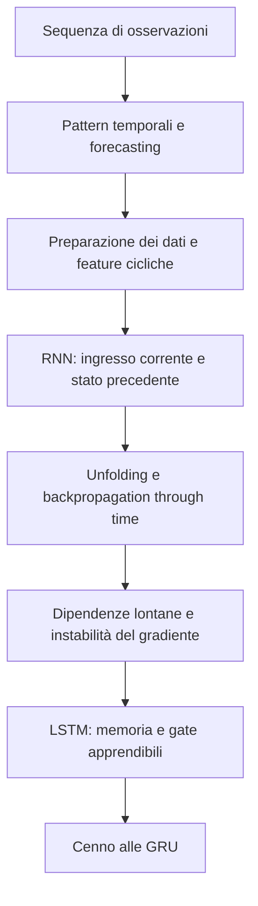
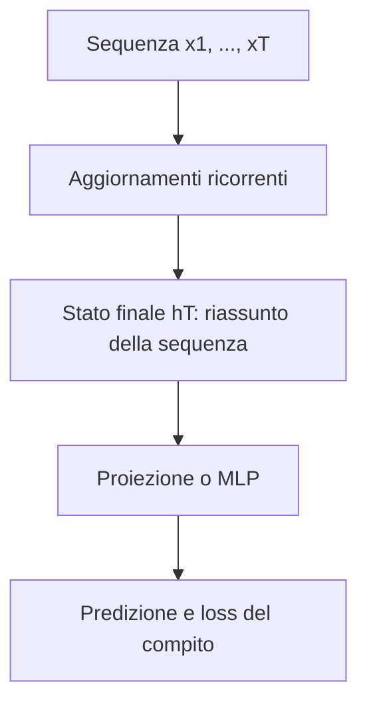
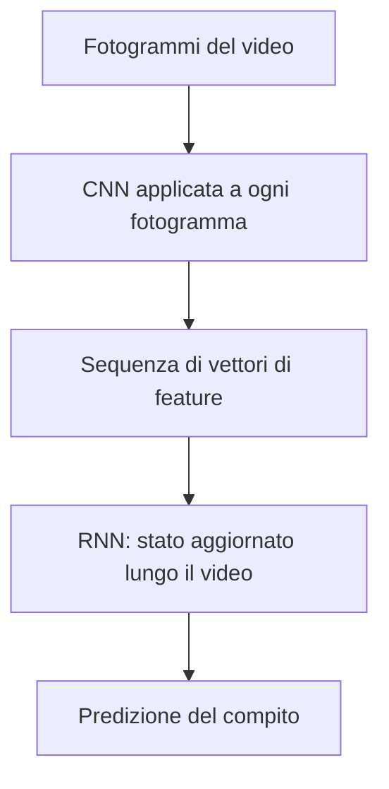
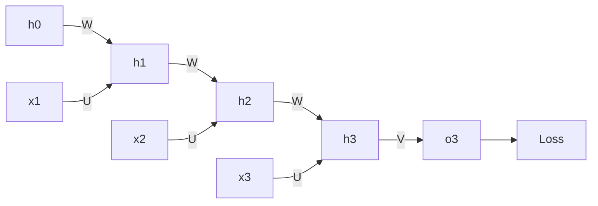
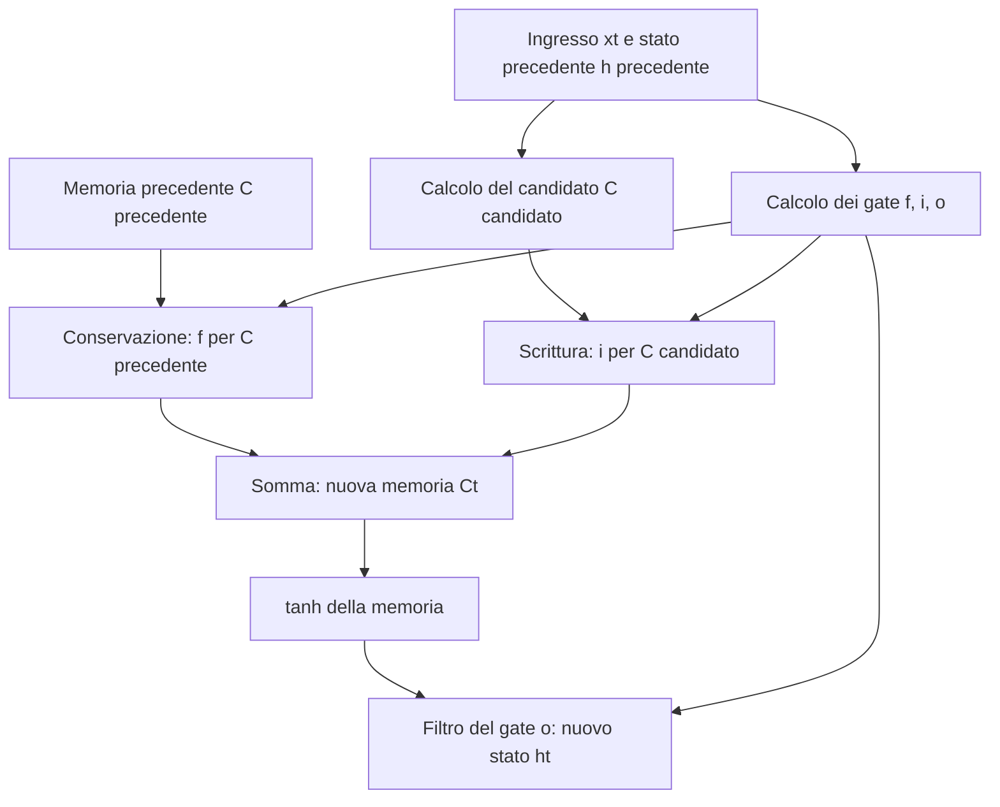

# Serie temporali e reti neurali ricorrenti

Le reti convoluzionali sfruttano la struttura spaziale delle immagini. Le **reti neurali ricorrenti**, o **RNN**, sfruttano invece l'ordine di una sequenza: a ogni passo combinano una nuova osservazione con una rappresentazione di quanto è stato elaborato prima. Il problema centrale è costruire e apprendere una memoria utile al compito, anche quando le sequenze hanno lunghezze diverse.

I riferimenti «slide N» indicano le pagine di `04_rnn.pdf`: in questo documento posizione nel PDF e numero stampato coincidono. La trattazione segue le slide fino alla 35; le slide 36–37 contengono bibliografia e ringraziamenti. Le parti presenti soltanto nelle slide e non sviluppate nella spiegazione sono segnalate con un callout informativo.

## 1. Serie temporali e sequenze di lunghezza variabile (slide 3–4)

Una **serie temporale** è una successione ordinata di osservazioni raccolte nel tempo. Esempi sono un segnale audio o una canzone, la temperatura misurata giorno per giorno, il prezzo di un titolo finanziario e le misure di un sensore. L'ordine è parte dell'informazione: scambiare due osservazioni può modificare il significato della sequenza.

Si distinguono un tempo continuo, in cui il segnale è definito su un intervallo temporale, e un tempo discreto, in cui si considerano istanti separati. Qui si lavora con sequenze discrete osservate per un numero finito di passi:

$$\boxed{X=(x_1,x_2,\ldots,x_T),\qquad x_t\in\mathbb R^d.}$$

$T$ è la **lunghezza della sequenza**; $d$ è il **numero di feature di ogni osservazione**. Con vettori colonna, ogni $x_t$ ha forma $d\times1$. Disporre una osservazione per riga produce una rappresentazione tabellare $X\in\mathbb R^{T\times d}$.

- Una serie **univariata** ha $d=1$: per esempio il solo numero di passeggeri.
- Una serie **multivariata** ha $d>1$: per esempio più misure meteorologiche per ciascun giorno. Aggiungere una codifica della data alle misure aumenta il numero di feature.

La differenza fra una e più componenti è analoga a quella fra un valore grayscale e i tre canali RGB di [[03_CNN]]; un'immagine RGB isolata, però, non è per questo una serie temporale. Una successione di immagini, come un video, possiede anche l'asse temporale. Analogamente, una nuvola di punti LiDAR isolata è un insieme spaziale, mentre misure LiDAR successive possono formare una sequenza.

Se il campionamento è regolare, gli istanti soddisfano

$$\boxed{t_k=t_0+k\Delta t,\qquad f_c=\frac1{\Delta t}.}$$

Il primo istante è $t_0$ e ogni passo aggiunge lo stesso intervallo $\Delta t$. In un secondo entrano $1/\Delta t$ intervalli, da cui la frequenza di campionamento $f_c$. Per esempio, una misura ogni $0.5$ secondi corrisponde a $f_c=2$ Hz. Per dati mensili il passo è invece un mese: si usa l'unità temporale appropriata.

> [!bug] Errata slide 4 — Discreto non significa finito
> Il tempo discreto è definito dall'insieme separato degli indici, non dalla finitezza della serie. Una serie discreta può continuare indefinitamente; è il campione osservato nel dataset a essere finito. Il campionamento regolare richiede inoltre un intervallo costante, non soltanto osservazioni discrete.

### 1.1 Sequenze di parole e limite dell'ingresso fisso (slide 4)

Una frase è una sequenza in cui l'indice $t$ indica la posizione, senza dover rappresentare un tempo fisico. Ogni elemento può essere un token, identificato da un indice in un vocabolario e fornito alla rete mediante una rappresentazione numerica. Due frasi possono contenere numeri diversi di token.

Per classificare il sentiment di una frase, un MLP applicato direttamente alla concatenazione degli ingressi richiede una dimensione iniziale fissata. Con $T$ osservazioni di $d$ feature, la concatenazione ha $Td$ componenti: se $T$ cambia, cambia anche il numero di ingressi richiesto al primo livello denso. È la stessa rigidità della testa densa discussa in [[03_CNN]].

Non significa che un MLP non possa mai essere usato con dati temporali: finestre e rappresentazioni di lunghezza fissata sono possibili. La RNN affronta direttamente il problema riutilizzando **lo stesso aggiornamento per ogni elemento**, per quante osservazioni siano presenti. Può variare $T$, mentre la dimensione $d$ dell'osservazione e quella dello stato rimangono fissate dal modello.

## 2. Pattern temporali: trend, stagionalità e residuo (slide 5–8)

Il grafico dei passeggeri aerei internazionali contiene misure mensili espresse in migliaia. Mostra contemporaneamente due regolarità: picchi che tendono a ripetersi e un livello complessivo che cresce. La prima suggerisce una componente stagionale; la seconda un trend crescente. Le annotazioni della slide evidenziano proprio la coesistenza delle due componenti.

| Componente | Significato | Lettura dell'esempio |
|---|---|---|
| **Trend** | Tendenza di fondo verso valori più alti o più bassi | Il numero di passeggeri cresce negli anni |
| **Stagionalità** | Fluttuazione che si ripete secondo un periodo di riferimento | Mesi corrispondenti tendono a mostrare comportamenti ricorrenti |
| **Ciclo** | Oscillazione attorno al trend | Una variazione ricorrente, non necessariamente legata a un calendario rigidamente fissato |
| **Outlier** | Osservazione insolita rispetto al comportamento atteso | Un valore eccezionalmente alto o basso, da interpretare nel suo contesto |
| **Residuo** | Parte non spiegata dalle componenti considerate | Rumore, irregolarità e pattern rimasti fuori dalla decomposizione |

Le misure possono contenere rumore di acquisizione; inoltre, l'evoluzione reale può dipendere da fattori non osservati. Nei dati finanziari, per esempio, molte cause influenzano il prezzo. Una componente stocastica non implica soltanto un sensore impreciso: può descrivere anche incertezza del processo o fattori non modellati.

Una scomposizione additiva permette di leggere il grafico come

$$\boxed{x_t=a_t+s_t+r_t,}$$

dove $a_t$ è il trend, $s_t$ la stagionalità e $r_t$ il residuo, tutti scalari con le stesse unità di $x_t$. Si ottiene il residuo sottraendo le parti spiegate:

$$
\begin{aligned}
x_t&=a_t+s_t+r_t &&\text{somma delle componenti},\\
x_t-a_t-s_t&=r_t &&\text{sottrazione di trend e stagionalità}.
\end{aligned}
$$

Se in un mese si osservano 135 migliaia di passeggeri, con trend stimato 120 e componente stagionale 10, il residuo è $135-120-10=5$. La ricostruzione trend più stagionalità vale 130; la differenza di 5 è ciò che quella ricostruzione non descrive. Non è automaticamente rumore bianco.

La **stazionarietà** descrive proprietà statistiche che non cambiano nel tempo. Una media che aumenta con il trend è già sufficiente a escludere la stazionarietà. Media e varianza costanti, da sole, non esauriscono tutte le condizioni: per la stazionarietà debole anche la covarianza deve dipendere dalla distanza temporale, non dall'istante assoluto. Qui il concetto serve a leggere i dati, senza introdurre test o procedure di stazionarizzazione.

> [!info] Slide 6–8 — Formalizzazione presente nelle slide, non approfondita
> Le slide nominano la decomposizione **STL**, basata su regressione LOESS per separare trend e stagionalità, e la definizione di stazionarietà. La lettura qualitativa dei pattern è centrale; l'algoritmo LOESS, i test statistici e i dettagli della procedura STL non sono sviluppati e non vengono aggiunti.

## 3. Forecasting: continuare una sequenza (slide 9–12)

Il **forecasting** consiste nel prevedere valori futuri usando osservazioni disponibili fino a un certo istante. Indichiamo con $T$ l'ultimo passo osservato e con $h>0$ l'**orizzonte di previsione**:

$$\boxed{\widehat x_{T+h}=F_\theta(x_1,\ldots,x_T;h).}$$

$F_\theta$ è il modello con parametri $\theta$; $\widehat x_{T+h}$ è la stima della futura osservazione. Nel caso multivariato appartiene a $\mathbb R^d$, come $x_t$. Per ottenere più passi si può considerare il vettore delle previsioni da $T+1$ a $T+H$.

La costruzione del problema avviene in tre passaggi: si sceglie dove terminano i dati osservati; si decide quanto avanti guardare; si confronta la previsione con il valore futuro effettivamente osservato. Per esempio, osservando i valori mensili $(100,110,120)$, una prosecuzione illustrativa della crescita di 10 al mese darebbe 130 a orizzonte 1 e 140 a orizzonte 2. È una possibile previsione, non una conseguenza certa dei tre numeri.

Tra le applicazioni ci sono la previsione della traiettoria di un veicolo, della domanda elettrica, della domanda di prodotti e dei valori finanziari. Prevedere la domanda permette di preparare l'offerta; prevedere una traiettoria aiuta ad anticipare dove si troverà un oggetto.

### 3.1 Previsione puntuale e incertezza (slide 10–11)

La linea tratteggiata nella figura rappresenta una possibile previsione puntuale. La fascia attorno alla linea esprime invece un intervallo di valori plausibili. Nell'esempio la fascia si allarga all'aumentare dell'orizzonte: più ci si allontana dalle osservazioni, maggiore è l'incertezza rappresentata.

Un intervallo dichiarato al 90% mira a contenere il valore futuro con quella copertura, sotto le ipotesi e la calibrazione del metodo. Per esempio, una previsione 130 accompagnata dall'intervallo $[120,140]$ comunica sia un valore centrale sia la sua incertezza. La sola presenza di una fascia nel disegno non dimostra la copertura del 90%, né impone una distribuzione gaussiana. La costruzione di tali intervalli non viene sviluppata qui.

> [!bug] Errata slide 10 — Conoscere il processo non elimina il caso
> Conoscere il processo generatore dei dati permette di descrivere correttamente la distribuzione futura; non garantisce di prevedere perfettamente ogni realizzazione se rimangono innovazioni casuali. Una previsione esatta a ogni orizzonte richiederebbe anche assenza di imprevedibilità residua e disponibilità delle informazioni necessarie.

### 3.2 Finestre di osservazione e componente casuale (slide 12)

Spesso la previsione usa una finestra limitata di osservazioni precedenti. Per prevedere il passo $t$ a partire da $q$ ritardi, l'ingresso è $(x_{t-1},\ldots,x_{t-q})$: sono $q$ osservazioni. La funzione appresa cerca di sfruttare le relazioni temporali contenute in quella finestra.

> [!info] Slide 12 — Schema statistico generale non sviluppato
> La slide scrive $x_t=f(x_{t-1},\ldots,x_{t-q};\phi)+g(\xi_{t-1},\ldots,\xi_{t-q};\theta)$, separando una funzione dei valori passati da una dei disturbi. $\phi,\theta$ sono parametri e $\xi$ indica disturbi casuali. È una rappresentazione introduttiva, non l'equazione della RNN né una definizione universale dei modelli di forecasting. Non si sviluppano qui stima dei disturbi o modelli combinati.

> [!bug] Errata slide 12 — Indici della finestra
> L'insieme $\{x_t,\ldots,x_{t-q}\}$ riportato nel testo contiene $q+1$ osservazioni e include il valore da prevedere nella formula sottostante. Per prevedere $x_t$ con $q$ soli valori passati si usa $\{x_{t-1},\ldots,x_{t-q}\}$. Inoltre lo schema dei disturbi non esplicita un'innovazione corrente $\xi_t$: non va letto come un modello stocastico completo senza ulteriori ipotesi.

## 4. Autoregressione e richiamo ai modelli statistici (slide 13–14)

Un modello è **autoregressivo** quando descrive un valore attraverso i valori precedenti della stessa sequenza. Nel modello lineare AR di ordine $p$:

$$\boxed{x_t=\sum_{i=1}^{p}\phi_i x_{t-i}+\xi_t.}$$

Qui $x_t,x_{t-i},\xi_t$ sono scalari; $\phi=(\phi_1,\ldots,\phi_p)\in\mathbb R^p$ contiene i coefficienti da stimare. Il termine $\xi_t$ rappresenta un'innovazione a media zero. Il rumore bianco ha assenza di correlazione fra istanti distinti; la gaussianità è una possibile ipotesi aggiuntiva, non la sua definizione.

L'equazione nasce scegliendo una combinazione lineare di $p$ ritardi e aggiungendo ciò che non è previsto da quella combinazione. Con $p=2$:

$$
\begin{aligned}
x_t&=\phi_1x_{t-1}+\phi_2x_{t-2}+\xi_t &&\text{sviluppo della somma},\\
\widehat x_t&=\phi_1x_{t-1}+\phi_2x_{t-2} &&\text{previsione con innovazione a media condizionale zero}.
\end{aligned}
$$

Con coefficienti $0.6$ e $0.2$ e osservazioni precedenti 120 e 100:

$$\widehat x_t=0.6\cdot120+0.2\cdot100=72+20=92.$$

Se l'innovazione realizzata è 3, il valore osservato è 95. La differenza rende concreta la distinzione fra previsione e osservazione. L'equazione mostrata omette l'intercetta; una trasformazione affine può includere anche un termine costante.

Il principio autoregressivo ricompare nella generazione di testo: il nuovo token è condizionato al contesto già disponibile, compresi i token generati prima. Questo non rende un generatore linguistico un modello AR lineare: il principio di condizionamento è condiviso, la funzione che lo realizza può essere non lineare.

> [!info] Slide 14 — Moving Average, presente nelle slide ma non sviluppato
> Il modello MA di ordine $q$ è riportato come $x_t=\mu+\xi_t+\sum_{i=1}^q\theta_i\xi_{t-i}$: combina innovazione corrente e innovazioni precedenti mediante coefficienti $\theta_i$. Qui $\mu$ è la media teorica del processo quando i disturbi hanno media zero; la media empirica può stimarla, ma non coincide per definizione con essa. Non è una media mobile dei valori osservati. Stima e applicazioni del modello MA non sono state sviluppate.

> [!bug] Errata slide 14 — Media del processo e media campionaria
> Identificare direttamente il parametro $\mu$ con la media empirica confonde una quantità del modello con un suo possibile stimatore. Sono concetti distinti anche se la seconda viene usata per stimare la prima.

## 5. Preparazione dei dati e codifica ciclica (slide 15–18)

Preparare una serie richiede di distinguere il **valore osservato** dall'**informazione temporale** associata. Una stringa come `1949-01` deve essere interpretata come una data, non come una generica etichetta: anno e mese possono essere estratti per organizzare e rappresentare le osservazioni. Le prime righe mostrate nelle slide associano, per esempio, gennaio 1949 a 112 migliaia di passeggeri e febbraio a 118.

Una seconda scelta riguarda la rappresentazione del segnale. Nel **dominio del tempo** si mantengono le osservazioni ordinate; nel **dominio delle frequenze** si descrivono componenti oscillatorie, per esempio mediante Fourier. Per vibrazioni di motori, le componenti in frequenza possono essere informative. Le reti ricorrenti qui descritte lavorano sugli ingressi nel dominio del tempo, senza richiedere una trasformata di Fourier preliminare.

> [!info] Slide 16 — Trasformate soltanto elencate
> La slide cita anche wavelet e Hilbert–Huang. Non ne vengono sviluppate definizioni, formule o algoritmi; rimangono indicazioni di possibili rappresentazioni alternative.

### 5.1 Perché i mesi non sono un semplice asse numerico (slide 18)

Numerare gennaio con 0, febbraio con 1, fino a dicembre con 11 mantiene una differenza di 1 fra molti mesi consecutivi, ma separa dicembre e gennaio di 11 unità. Nel calendario, invece, sono adiacenti.

Per una variabile con periodo $P$, una codifica su una circonferenza conserva questa vicinanza:

$$\boxed{\theta_k=\frac{2\pi k}{P},\qquad e(k)=\begin{bmatrix}\cos\theta_k\\\sin\theta_k\end{bmatrix}\in\mathbb R^2.}$$

Si divide un giro completo, $2\pi$ radianti, in $P$ intervalli; l'indice $k$ determina l'angolo. Coseno e seno forniscono le coordinate del punto sulla circonferenza unitaria. L'ordine delle due coordinate può essere invertito, purché si mantenga la convenzione.

Per le ore, $P=24$; per i mesi con indice $0,\ldots,11$, $P=12$. La periodicità deriva direttamente da seno e coseno:

$$
\begin{aligned}
\theta_{k+P}&=\frac{2\pi(k+P)}P=\theta_k+2\pi,\\
\cos(\theta_k+2\pi)&=\cos\theta_k,\\
\sin(\theta_k+2\pi)&=\sin\theta_k,\\
e(k+P)&=e(k).
\end{aligned}
$$

| Mese | $k$ | Angolo | $\cos\theta_k$ | $\sin\theta_k$ |
|---|---:|---|---:|---:|
| Gennaio | 0 | $0$ | 1 | 0 |
| Febbraio | 1 | $\pi/6$ | $\sqrt3/2\approx0.8660$ | $1/2$ |
| Dicembre | 11 | $11\pi/6$ | $\sqrt3/2\approx0.8660$ | $-1/2$ |

La distanza gennaio–dicembre è

$$
\begin{aligned}
\|e(0)-e(11)\|_2
&=\sqrt{(1-\sqrt3/2)^2+(0+1/2)^2} &&\text{distanza euclidea},\\
&=\sqrt{2-\sqrt3}\approx0.5176 &&\text{sviluppo dei quadrati}.
\end{aligned}
$$

È la stessa distanza di gennaio–febbraio. Usando mesi da 1 a 12 si può porre $k=m-1$; usare direttamente $m$ produce soltanto una rotazione comune della codifica.

Servono entrambe le coordinate per distinguere posizioni che una sola funzione confonderebbe: il seno, per esempio, vale zero sia a mezzanotte sia a mezzogiorno. Per l'ora 10, l'angolo è $5\pi/6$ e la coppia $(\cos,\sin)$ è $(-\sqrt3/2,1/2)$, coerente con il punto nel secondo quadrante della figura.

La codifica periodica è appropriata per grandezze **effettivamente cicliche**. L'anno assoluto non riparte automaticamente da zero: non gli si impone un ciclo senza una ragione legata al problema. Inoltre coordinate limitate fra $-1$ e 1 non garantiscono media empirica zero o una particolare varianza se i dati non coprono uniformemente il ciclo.

Il preprocessing costruisce le feature fornite al modello; non cambia la regola di ricorrenza. I richiami alla scala degli ingressi si collegano a [[mlp_appunti_completi]] e, per il diverso caso della normalizzazione delle attivazioni interne, a [[03_CNN]].

## 6. Reti ricorrenti e forme dei problemi sequenziali (slide 19–21)

In una rete feedforward il calcolo procede dall'ingresso attraverso livelli intermedi fino all'uscita. Una RNN introduce una connessione di ritorno: **lo stato calcolato a un passo viene utilizzato nel passo successivo**. Il feedback riguarda qui la rappresentazione nascosta, non necessariamente la predizione finale.

La sequenza può comparire all'ingresso, all'uscita o in entrambi. I termini «one» e «many» contano gli elementi della sequenza, non il numero di componenti del singolo vettore.

| Schema | Ingresso e uscita | Interpretazione |
|---|---|---|
| **One-to-one** | Un elemento → un risultato | Situazione ordinaria non sequenziale |
| **One-to-many** | Un elemento → una sequenza | Un ingresso avvia più passi di uscita |
| **Many-to-one** | Una sequenza → un risultato | Sentiment o categoria di una frase |
| **Many-to-many con uscita successiva** | Sequenza osservata → sequenza prodotta | Traduzione o prosecuzione futura di una serie |
| **Many-to-many allineato** | Una uscita associata a ogni ingresso | Ingressi e uscite sono indicizzati lungo la stessa sequenza |

Una frase può contenere molti token ma avere un solo target di classificazione; quel target può essere rappresentato da un vettore di score. Nel forecasting multipasso si osservano più valori e si prevedono più valori futuri. Nella traduzione, lunghezza dell'ingresso e lunghezza dell'uscita possono essere differenti. Anche domanda e risposta testuale illustrano il rapporto fra una sequenza in ingresso e una sequenza in uscita, senza che questo determini da solo l'architettura usata.

## 7. Vanilla RNN: equazioni, dimensioni e significato (slide 22)

La forma più semplice, detta **vanilla RNN**, aggiorna lo stato mediante due contributi: l'osservazione corrente e lo stato precedente. Adottiamo vettori colonna e la notazione della slide 22:

$$\boxed{\begin{aligned}
a_t&=Wh_{t-1}+Ux_t,\\
h_t&=\phi(a_t),\\
o_t&=Vh_t.
\end{aligned}}$$

| Simbolo       | Forma                               | Ruolo                                      |
| ------------- | ----------------------------------- | ------------------------------------------ |
| $x_t$         | $d\times1$                          | Osservazione al passo $t$                  |
| $h_{t-1},h_t$ | $m\times1$                          | Stato nascosto precedente e corrente       |
| $a_t$         | $m\times1$                          | Pre-attivazione, prima della non linearità |
| $U$           | $m\times d$                         | Proiezione ingresso → stato                |
| $W$           | $m\times m$                         | Trasformazione dello stato precedente      |
| $\phi$        | Applicata componente per componente | Attivazione, per esempio $\tanh$           |
| $V$           | $r\times m$                         | Proiezione stato → uscita                  |
| $o_t$         | $r\times1$                          | Uscita o score del passo corrente          |

La dimensione $m$ dello stato è una scelta architetturale, come la larghezza di un livello nascosto di un MLP. Anche una serie univariata può essere proiettata in uno stato di 256 componenti: $d=1$ non impone $m=1$.

### 7.1 Come si costruisce un aggiornamento (slide 22)

La formula si legge verificando prima le dimensioni:

$$
\begin{aligned}
u_t&=Ux_t\in\mathbb R^m &&(m\times d)(d\times1)=m\times1,\\
v_t&=Wh_{t-1}\in\mathbb R^m &&(m\times m)(m\times1)=m\times1,\\
a_t&=u_t+v_t\in\mathbb R^m &&\text{somma di vettori della stessa forma},\\
h_t&=\phi(a_t)\in\mathbb R^m &&\text{attivazione componente per componente},\\
o_t&=Vh_t\in\mathbb R^r &&(r\times m)(m\times1)=r\times1.
\end{aligned}
$$

Le trasformazioni portano ingresso e memoria nello stesso spazio; la somma li fonde; l'attivazione produce il nuovo stato. È lo schema del neurone di [[mlp_appunti_completi]], con un secondo ingresso che arriva dal passato.

Le slide omettono i bias per semplicità. Se presenti, si aggiungono un vettore $b_h\in\mathbb R^m$ prima di $\phi$ e un vettore $b_o\in\mathbb R^r$ nell'uscita. L'omissione non implica che un'implementazione debba esserne priva.

### 7.2 Esempio numerico di un passo (slide 22)

Consideriamo due feature di ingresso, due unità nascoste e una uscita: $d=m=2$, $r=1$. Siano

$$
x_t=\begin{bmatrix}1\\2\end{bmatrix},\quad
h_{t-1}=\begin{bmatrix}0.5\\-0.5\end{bmatrix},\quad
U=\begin{bmatrix}1&0\\0&0.5\end{bmatrix},\quad
W=\begin{bmatrix}0.2&0\\0&0.2\end{bmatrix},\quad
V=\begin{bmatrix}1&-1\end{bmatrix}.
$$

Applicando i passaggi precedenti:

$$
\begin{aligned}
Ux_t&=\begin{bmatrix}1\cdot1+0\cdot2\\0\cdot1+0.5\cdot2\end{bmatrix}
=\begin{bmatrix}1\\1\end{bmatrix},\\
Wh_{t-1}&=\begin{bmatrix}0.2\cdot0.5\\0.2\cdot(-0.5)\end{bmatrix}
=\begin{bmatrix}0.1\\-0.1\end{bmatrix},\\
a_t&=\begin{bmatrix}1.1\\0.9\end{bmatrix},\\
h_t&=\tanh(a_t)\approx\begin{bmatrix}0.800499\\0.716298\end{bmatrix},\\
o_t&=1\cdot0.800499-1\cdot0.716298\approx0.084201.
\end{aligned}
$$

L'uscita è qui uno scalare generico. In classificazione può essere uno score su cui costruire la loss appropriata; in regressione può rappresentare la quantità da stimare. Una trasformazione lineare $Vh_t$ non produce automaticamente probabilità.

### 7.3 Lunghezza variabile e pesi condivisi (slide 22)

Per una sequenza di tre elementi il modello calcola:

$$
\begin{aligned}
h_1&=\phi(Wh_0+Ux_1),\\
h_2&=\phi(Wh_1+Ux_2),\\
h_3&=\phi(Wh_2+Ux_3).
\end{aligned}
$$

Se arriva un quarto elemento si esegue un altro aggiornamento con **le stesse matrici**. Non si crea un nuovo insieme di pesi per ogni posizione. La ricorrenza cambia il numero delle iterazioni richieste, non la forma delle trasformazioni.

Senza bias e senza apprendere $h_0$, il conteggio deriva dal numero di elementi delle tre matrici:

$$
\begin{aligned}
P_U&=md,\qquad P_W=m^2,\qquad P_V=rm,\\
\boxed{P_{\mathrm{RNN}}}&=\boxed{md+m^2+rm.}
\end{aligned}
$$

Nell'esempio $d=m=2,r=1$ sono $4+4+2=10$ pesi, sia per una sequenza di 3 passi sia per una di 100. Due bias aggiungerebbero $m+r=3$ parametri; uno stato iniziale apprendibile aggiungerebbe altri $m=2$ valori. È il conteggio della parametrizzazione descritta, non una formula universale per qualsiasi implementazione multilivello.

La condivisione è temporale: nelle CNN lo stesso filtro viene riutilizzato in posizioni spaziali differenti; qui la stessa regola viene riutilizzata in istanti differenti. Più passi significano comunque più calcolo.

## 8. Hidden state: un riassunto utile, non il modello appreso (slide 23)

Lo stato $h_t$ può essere influenzato da tutti gli ingressi elaborati fino a $t$, perché $h_t$ dipende da $h_{t-1}$, che dipende da $h_{t-2}$, e così via. È un **riassunto della storia disponibile**, orientato al compito e generalmente con perdita di informazione. Una dimensione fissa $m$ non equivale a memorizzare esplicitamente una lista che cresce con la sequenza.

Per una classificazione many-to-one si può usare lo stato finale $h_T$ per ottenere la decisione. La RNN agisce da estrattore di feature temporali, come la parte convoluzionale estrae feature spaziali; sopra lo stato o la sua proiezione si può collegare un MLP.

Il riassunto non è necessariamente completo né sempre efficace: proprio l'apprendimento di informazioni lontane sarà il problema successivo. Il legame strutturale con il passato non garantisce che tutti gli elementi conservino la stessa influenza.

### 8.1 Che cosa rimane dopo il training? (slide 23)

Le matrici $U,W,V$ sono **parametri**, condivisi fra esempi. Lo stato $h_t$ è una **attivazione**, calcolata per una specifica sequenza. Il risultato dell'apprendimento sono le matrici e gli eventuali altri parametri, non l'ultimo stato prodotto dall'ultimo esempio di training.

Su una nuova sequenza si inizializza lo stato e si ripete il forward. $h_0$ può essere fissato, spesso a zero, oppure essere un parametro apprendibile. Per proseguire una stessa sequenza in inferenza è sufficiente mantenere lo stato corrente e aggiornarlo con la nuova osservazione; per esempi indipendenti non si trasferisce automaticamente la storia dell'esempio precedente.

In training, per calcolare i gradienti lungo la sequenza, servono invece gli intermedi del grafo o un modo di ricostruirli: dimensione fissa dello stato non significa memoria di addestramento indipendente da $T$.

### 8.2 Comporre CNN e RNN per un video (slide 23)

Un video è una sequenza di immagini. Una CNN può elaborare ciascun fotogramma e produrre un vettore di feature; la RNN può elaborare la successione di quei vettori. I due blocchi trattano rispettivamente struttura spaziale e ordine temporale.

È un esempio di composizione dei blocchi già studiati, senza introdurre una nuova regola di apprendimento.

## 9. Unfolding: esplicitare il calcolo nel tempo (slide 24–26)

Il disegno con un arco che torna sullo stato è una rappresentazione compatta. Lo **srotolamento**, o **unfolding/unrolling**, esplicita un nodo per ogni aggiornamento. Ogni copia usa gli stessi parametri: non rappresenta una cella con pesi nuovi.

Per tre osservazioni e una sola uscita finale:

Una volta fissata una sequenza finita, il grafo srotolato è un **DAG**, un grafo diretto senza cicli: $h_1$ dipende da $h_0$, $h_2$ da $h_1$, e nessun nodo torna indietro modificando il valore di un nodo precedente nello stesso forward. L'arco di ritorno del disegno compatto indica il riutilizzo al passo successivo.

Si può quindi applicare la backpropagation ordinaria. Poiché il backward attraversa i passi temporali in ordine inverso, si parla di **Backpropagation Through Time**, abbreviata **BPTT**. La regola della catena è quella di [[mlp_appunti_completi]]; qui le stesse matrici compaiono in più punti del grafo. Un sistema di differenziazione automatica può registrare questi passaggi e accumulare i gradienti corrispondenti.

## 10. BPTT: sommare i contributi ai parametri condivisi (slide 27)

Consideriamo il caso mostrato: $T=3$, un'uscita finale $o_3=Vh_3$ e una loss differenziabile $\mathcal L(y,o_3)$. Manteniamo vettori colonna, $h_0$ inizialmente indipendente da $U,W$ e bias omessi.

Definiamo:

$$
\boxed{g=\nabla_{o_3}\mathcal L\in\mathbb R^r,\qquad
D_t=\operatorname{diag}\bigl(\phi'(a_t)\bigr)\in\mathbb R^{m\times m}.}
$$

La matrice diagonale $D_t$ contiene una derivata di attivazione per ogni unità. Come già visto per l'MLP, la derivata della loss rispetto alla pre-attivazione combina il gradiente in arrivo con la derivata locale.

### 10.1 Gradiente della proiezione finale V (slide 27)

Per ogni componente:

$$
\begin{aligned}
o_{3,j}&=\sum_{i=1}^{m}V_{ji}h_{3,i},\\
\frac{\partial o_{3,j}}{\partial V_{ji}}&=h_{3,i}
&&\text{derivata locale della combinazione lineare},\\
\frac{\partial\mathcal L}{\partial V_{ji}}&=g_jh_{3,i}
&&\text{regola della catena},\\
\boxed{\nabla_V\mathcal L}&=\boxed{g h_3^T\in\mathbb R^{r\times m}.}
\end{aligned}
$$

È un **prodotto esterno**: un gradiente per ciascun peso. Nel grafo considerato $V$ compare soltanto nella proiezione finale, quindi c'è un solo contributo locale. Il suo valore dipende comunque da $h_3$, che riassume la sequenza: non significa che il passato sia irrilevante per $V$.

### 10.2 Gradiente attraverso gli stati (slide 27)

Poniamo $\delta_t=\nabla_{a_t}\mathcal L\in\mathbb R^m$. Dall'uscita finale si torna prima allo stato e poi alla pre-attivazione:

$$
\begin{aligned}
\nabla_{h_3}\mathcal L&=V^Tg
&&\text{backward della trasformazione lineare},\\
\delta_3&=D_3V^Tg
&&\text{backward dell'attivazione},\\
\nabla_{h_2}\mathcal L&=W^T\delta_3
&&\text{dipendenza di }a_3\text{ da }h_2,\\
\delta_2&=D_2W^T\delta_3
&&\text{backward dell'attivazione al passo 2},\\
\delta_1&=D_1W^T\delta_2
&&\text{stessa regola al passo 1}.
\end{aligned}
$$

In generale, quando la loss è soltanto sull'uscita finale:

$$\boxed{\delta_T=D_TV^Tg,\qquad\delta_t=D_tW^T\delta_{t+1}\quad(t<T).}$$

Tutti i prodotti restituiscono un vettore di $m$ componenti. Se ci sono loss anche su uscite intermedie si aggiungono i contributi locali di quelle uscite: il caso della slide rimane quello con una sola loss finale.

### 10.3 Perché compare una somma per W e U (slide 27)

La componente $i$ della pre-attivazione è

$$a_{t,i}=\sum_jW_{ij}h_{t-1,j}+\sum_\ell U_{i\ell}x_{t,\ell}.$$

Trattando gli ingressi al singolo nodo come fissati, le derivate **locali** sono:

$$
\begin{aligned}
\left.\frac{\partial a_{t,i}}{\partial W_{ij}}\right|_{\mathrm{locale}}
&=h_{t-1,j},\\
\left.\frac{\partial a_{t,i}}{\partial U_{i\ell}}\right|_{\mathrm{locale}}
&=x_{t,\ell}.
\end{aligned}
$$

Moltiplicando per $\delta_{t,i}$ si ottiene il contributo di quella specifica occorrenza del parametro. Poiché il parametro è lo stesso in ogni passo, si sommano tutte le occorrenze:

$$
\boxed{\begin{aligned}
\nabla_W\mathcal L&=\sum_{t=1}^{T}\delta_t h_{t-1}^T\in\mathbb R^{m\times m},\\
\nabla_U\mathcal L&=\sum_{t=1}^{T}\delta_t x_t^T\in\mathbb R^{m\times d}.
\end{aligned}}
$$

Per $T=3$, per esempio:

$$\nabla_W\mathcal L=\delta_1h_0^T+\delta_2h_1^T+\delta_3h_2^T.$$

La **sovrapposizione degli effetti** consiste nel tenere conto di tutti i modi in cui un parametro condiviso influenza l'uscita. I prodotti dentro $\delta_t$ trasportano l'effetto lungo un percorso; la somma combina le diverse occorrenze del peso. Somma fra contributi e prodotto lungo una catena hanno ruoli differenti.

> [!bug] Errata slide 27 — Derivate locali e stato iniziale
> Le somme con $\partial h^{(k)}/\partial W$ e $\partial h^{(k)}/\partial U$ richiedono di intendere queste derivate come contributi **locali** dell'occorrenza del parametro al passo $k$. Se fossero derivate totali, si conterebbero più volte percorsi già inclusi. Con aggiornamenti indicizzati da 1 a $T$ e $h_0$ indipendente dai pesi, le occorrenze sono $k=1,\ldots,T$; il termine $k=0$ della slide è nullo. Un $h_0$ appreso ha il proprio gradiente, non un'ulteriore occorrenza di $W$ o $U$.

Se $h_0$ è apprendibile, il suo gradiente in questo esempio è $W^T\delta_1$. Se c'è un bias nascosto condiviso, il contributo locale è $\delta_t$ e il gradiente del bias è la loro somma. Sono le stesse regole di accumulo.

### 10.4 Esempio numerico completo su tre passi (slide 26–27)

Per rendere trasparenti i conti, usiamo **solo in questo esempio** una ricorrenza scalare con attivazione identità: $h_t=Wh_{t-1}+Ux_t$. Non è il caso non lineare con $\tanh$ dell'esempio precedente; serve a isolare condivisione e regola della catena.

Siano $h_0=0$, $U=1$, $W=0.5$, $V=1$, ingressi $(x_1,x_2,x_3)=(1,2,0)$ e target $y=1$. La loss è $\mathcal L=\tfrac12(o_3-y)^2$, collegata alla MSE di [[mlp_appunti_completi]].

| Passo | Calcolo dello stato | Risultato |
|---|---|---:|
| 1 | $0.5\cdot0+1\cdot1$ | $h_1=1$ |
| 2 | $0.5\cdot1+1\cdot2$ | $h_2=2.5$ |
| 3 | $0.5\cdot2.5+1\cdot0$ | $h_3=1.25$ |

Seguono $o_3=1.25$ e $\mathcal L=\tfrac12(0.25)^2=0.03125$. La derivata della loss è $g=o_3-y=0.25$; con attivazione identità tutti i fattori $D_t$ valgono 1:

$$
\begin{aligned}
\delta_3&=1\cdot1\cdot0.25=0.25,\\
\delta_2&=1\cdot0.5\cdot0.25=0.125,\\
\delta_1&=1\cdot0.5\cdot0.125=0.0625.
\end{aligned}
$$

| Passo | Contributo a $\partial\mathcal L/\partial W$ | Contributo a $\partial\mathcal L/\partial U$ |
|---|---:|---:|
| 1 | $\delta_1h_0=0$ | $\delta_1x_1=0.0625$ |
| 2 | $\delta_2h_1=0.125$ | $\delta_2x_2=0.25$ |
| 3 | $\delta_3h_2=0.625$ | $\delta_3x_3=0$ |
| **Somma** | **0.75** | **0.3125** |

Per la proiezione finale, $\partial\mathcal L/\partial V=g h_3=0.25\cdot1.25=0.3125$. Si può verificare anche sviluppando la ricorrenza:

$$
\begin{aligned}
h_1&=Ux_1,\\
h_2&=WUx_1+Ux_2,\\
h_3&=W^2Ux_1+WUx_2+Ux_3,\\
\frac{\partial h_3}{\partial W}&=2WUx_1+Ux_2=1+2=3,\\
\frac{\partial\mathcal L}{\partial W}&=gV\frac{\partial h_3}{\partial W}=0.25\cdot1\cdot3=0.75.
\end{aligned}
$$

Il risultato coincide con la somma dei tre contributi. Il primo contributo locale a $W$ è nullo perché $h_0=0$, non perché il primo ingresso sia ignorato: $x_1$ influenza anche gli stati successivi e il gradiente di $U$.

Con un passo di gradient descent di ampiezza $\eta=0.1$, tutti i gradienti vengono prima calcolati con gli stessi valori correnti, poi i parametri diventano $W'=0.425$, $U'=0.96875$ e $V'=0.96875$. Non si modifica $W$ a metà del backward per usarlo nella derivazione degli altri contributi.

## 11. Dipendenze a lungo termine e instabilità del gradiente (slide 28–29)

Una dipendenza a lungo termine si presenta quando un'informazione ricevuta molto prima è utile alla predizione corrente. La RNN possiede un percorso che collega i due istanti, ma il gradiente deve attraversare tutti gli aggiornamenti intermedi per apprendere come conservare quell'informazione.

Definiamo la Jacobiana di una transizione:

$$\boxed{J_t=\frac{\partial h_t}{\partial h_{t-1}}=D_tW\in\mathbb R^{m\times m}.}$$

La formula si ricava da $h_t=\phi(a_t)$ e $a_t=Wh_{t-1}+Ux_t$: la derivata dell'attivazione è $D_t$; la derivata della pre-attivazione rispetto allo stato precedente è $W$. Per la regola della catena i due fattori si moltiplicano in quest'ordine.

### 11.1 Il prodotto lungo il tempo (slide 28)

Con tre passi:

$$
\begin{aligned}
\frac{\partial h_3}{\partial h_1}
&=\frac{\partial h_3}{\partial h_2}\frac{\partial h_2}{\partial h_1}
&&\text{regola della catena},\\
&=J_3J_2
&&\text{definizione delle Jacobiane},\\
&=D_3WD_2W
&&\text{sostituzione delle derivate locali}.
\end{aligned}
$$

In generale, per $t>k$:

$$\boxed{\frac{\partial h_t}{\partial h_k}=J_tJ_{t-1}\cdots J_{k+1}.}$$

Il gradiente rispetto allo stato iniziale del tratto si ottiene moltiplicando il gradiente in arrivo per la trasposta di questo prodotto. Nel caso scalare sono semplicemente prodotti di derivate.

Se ogni fattore scalare vale $0.5$, dieci transizioni danno $0.5^{10}=0.0009765625$; venti danno circa $9.54\cdot10^{-7}$. Un contributo partito con ampiezza 1 può quindi arrivare molto attenuato. Nell'esempio lineare della sezione precedente, $J_t=W=0.5$ e $\partial h_3/\partial h_1=0.25$.

Il **vanishing gradient** rende debole il segnale che dovrebbe insegnare alla rete a usare gli ingressi lontani. Non implica che ogni gradiente della rete sia nullo o che non rimanga alcuna informazione del passato: indica una difficoltà di apprendimento crescente lungo percorsi che contraggono ripetutamente il segnale.

### 11.2 Derivata dell'attivazione e matrice ricorrente (slide 28)

Per $\tanh$ e sigmoide, richiamando [[mlp_appunti_completi]]:

$$
\boxed{\tanh'(a)=1-\tanh^2(a)\leq1,\qquad
\sigma'(a)=\sigma(a)(1-\sigma(a))\leq\tfrac14.}
$$

Il limite della sigmoide si verifica completando il quadrato: posto $s=\sigma(a)\in(0,1)$,

$$
\begin{aligned}
s(1-s)&=s-s^2,\\
&=\frac14-\left(s-\frac12\right)^2,\\
&\leq\frac14.
\end{aligned}
$$

Per $\tanh$, il quadrato è non negativo, quindi $1-\tanh^2(a)\leq1$; in saturazione il quadrato è vicino a 1 e la derivata è piccola. Per esempio, $\tanh'(0)=1$; $\tanh'(2)\approx0.07065$. Per la sigmoide, $\sigma'(0)=0.25$.

Questi sono i limiti delle **derivate delle attivazioni**, non della transizione completa. Per la norma spettrale, la proprietà $\|AB\|_2\leq\|A\|_2\|B\|_2$ dà:

$$
\begin{aligned}
\|J_t\|_2&=\|D_tW\|_2\leq\|D_t\|_2\|W\|_2,\\
\left\|\frac{\partial h_t}{\partial h_k}\right\|_2
&\leq\prod_{j=k+1}^{t}\|J_j\|_2.
\end{aligned}
$$

Se ogni fattore è al più $c<1$, il prodotto è al più $c^{t-k}$, che diminuisce geometricamente. Con $c=0.5$ si ritrovano i numeri precedenti.

> [!bug] Errata slide 28 — Il limite non vale senza W
> I limiti 1 per $\tanh$ e $1/4$ per sigmoide riguardano $D_t$. La Jacobiana temporale è $J_t=D_tW$ e dipende anche dai pesi. Per esempio, nel caso scalare con $W=2$ e pre-attivazione zero, $\tanh'(0)=1$ ma $J_t=2$. Non si può dedurre dalla sola attivazione che ogni transizione abbia norma al più 1 o $1/4$.

### 11.3 Exploding gradient e mitigazioni (slide 29)

L'effetto opposto si verifica quando i prodotti amplificano il gradiente. Dieci fattori scalari uguali a 2 danno 1024; venti danno 1 048 576. Aggiornamenti molto grandi possono rendere instabile l'ottimizzazione e produrre problemi numerici. Si parla di **exploding gradient**.

Un limite superiore grande non dimostra che ogni direzione venga amplificata: nei vettori contano anche i pesi, le attivazioni e la direzione del gradiente. Gli esempi scalari isolano il meccanismo.

Inizializzazione e scelta delle attivazioni influenzano questi prodotti. Il **gradient clipping** limita gradienti eccessivamente grandi; per chiarirne il significato, un clipping sulla norma ha la forma:

$$\boxed{g_{\mathrm{clip}}=g\min\left(1,\frac{c}{\|g\|_2}\right),\qquad c>0,}$$

con $g_{\mathrm{clip}}=0$ se $g=0$. Se $\|g\|_2\leq c$, il minimo vale 1 e il gradiente non cambia. Se la norma supera $c$, lo si moltiplica per $c/\|g\|_2$, preservandone la direzione e portandone la norma a $c$. Per $g=(6,8)$ la norma è 10; con $c=5$ il risultato è $(3,4)$, la cui norma è 5.

> [!bug] Errata slide 29 — Il clipping non recupera gradienti svaniti
> Il clipping controlla soprattutto l'esplosione del gradiente. Non ricostruisce un contributo già diventato trascurabile. Inizializzazione, attivazioni e architettura intervengono sul flusso dei gradienti in modi differenti; non sono rimedi intercambiabili ai due problemi.

Una RNN srotolata su molti passi crea una grande profondità temporale anche se contiene un solo livello ricorrente. Problemi analoghi possono comparire nelle reti feedforward profonde, come già discusso in [[03_CNN]] per le connessioni residue.

La condivisione dei pesi è una proprietà dell'architettura; la BPTT ne calcola correttamente le conseguenze, non la introduce. La difficoltà deriva dai lunghi prodotti di Jacobiane, non dalla sola presenza di parametri condivisi. Non basta inserire un logaritmo nel backward: il gradiente deve rimanere la derivata della funzione effettivamente calcolata. Per cambiarne i percorsi si interviene su modello e calcolo, non sostituendo arbitrariamente la regola della catena.

## 12. Memoria selettiva e architetture con gate (slide 30)

La difficoltà delle dipendenze lontane motiva celle che possano imparare **quali informazioni conservare, quali aggiornare e quali esporre**. Le **Long Short-Term Memory**, o **LSTM**, introducono una memoria interna e gate apprendibili. Le **Gated Recurrent Unit**, o **GRU**, sono un'altra variante ricorrente, qui soltanto richiamata.

L'intuizione è accettare una memoria di dimensione fissata e imparare a gestirla. Non si può trattare lo stato come un archivio esplicito che contiene tutto il passato: conviene selezionare ciò che aiuta a ridurre la loss. Anche la vanilla RNN apprende una trasformazione selettiva degli ingressi; la differenza è che nella LSTM la selezione viene resa esplicita mediante gate e un percorso additivo della memoria.

Un **gate** si può immaginare come un interruttore graduabile. Un interruttore rigido lascia passare tutto o niente; un gate continuo può attenuare una componente in misura intermedia. I valori vicini a 1 lasciano passare quasi tutto, quelli vicini a 0 quasi nulla. Questa regolazione è appresa attraverso i pesi e la loss del compito, non impostata manualmente per ciascun ingresso.

Per le GRU basta qui ricordare il cenno conclusivo: impiegano **due gate**, comunemente detti aggiornamento e reset, e una struttura più compatta rispetto alla LSTM standard a parità di dimensioni. Non vengono sviluppate le equazioni GRU, né si deduce che due gate siano universalmente sufficienti per qualsiasi problema.

## 13. LSTM: stato interno e quadro delle equazioni (slide 31)

La LSTM mantiene due vettori di dimensione $m$:

- il **cell state** $C_t$, la memoria interna;
- lo **hidden state** $h_t$, la rappresentazione esposta dalla cella.

Entrambi vengono aggiornati lungo la sequenza. Il simbolo $o_t$ ora indica l'**output gate**: non è l'uscita $o_t=Vh_t$ usata per la vanilla RNN. Per evitare ambiguità, una eventuale proiezione finale della LSTM sarà chiamata $s_t$.

Le slide LSTM usano prodotti con vettori riga, mentre la slide 22 usava vettori colonna. Manteniamo qui la convenzione a colonne: la trasformazione $x_tU_i$ della slide diventa $U_ix_t$, con la matrice trasposta rispetto alla convenzione a righe. Non cambia l'operazione rappresentata.

Come nelle slide, i bias sono omessi. Il passo completo è:

$$
\boxed{\begin{aligned}
i_t&=\sigma(U_ix_t+W_ih_{t-1}),\\
f_t&=\sigma(U_fx_t+W_fh_{t-1}),\\
o_t&=\sigma(U_ox_t+W_oh_{t-1}),\\
\widetilde C_t&=\tanh(U_Cx_t+W_Ch_{t-1}),\\
C_t&=f_t\odot C_{t-1}+i_t\odot\widetilde C_t,\\
h_t&=o_t\odot\tanh(C_t).
\end{aligned}}
$$

| Quantità | Forma | Significato |
|---|---|---|
| $x_t$ | $d\times1$ | Osservazione corrente |
| $h_{t-1},h_t$ | $m\times1$ | Stato nascosto precedente e corrente |
| $C_{t-1},C_t$ | $m\times1$ | Memoria precedente e corrente |
| $i_t,f_t,o_t$ | $m\times1$ | Gate di ingresso, mantenimento e uscita |
| $\widetilde C_t$ | $m\times1$ | Contenuto candidato da scrivere |
| $U_i,U_f,U_o,U_C$ | $m\times d$ | Pesi che elaborano l'ingresso |
| $W_i,W_f,W_o,W_C$ | $m\times m$ | Pesi che elaborano lo stato precedente |
| $\odot$ | Operazione fra vettori della stessa forma | Prodotto elemento per elemento |

Le equazioni non sono un risultato da dedurre dalla vanilla RNN: **definiscono la nuova architettura**. Per comprenderle si segue il flusso del calcolo: si costruiscono i gate e il candidato da $x_t,h_{t-1}$; si aggiorna la memoria; si ricava lo stato nascosto. I passaggi seguenti esplicitano ogni operazione.

## 14. Gate: interruttori continui apprendibili (slide 32)

Tutti i gate ricevono ingresso corrente e stato nascosto precedente, ma hanno **matrici proprie**. Per un gate generico $g_t$:

$$
\begin{aligned}
z_{g,t}&=U_gx_t+W_gh_{t-1}\in\mathbb R^m
&&\text{combinazione delle due sorgenti},\\
g_{t,j}&=\sigma(z_{g,t,j})=\frac1{1+e^{-z_{g,t,j}}}\in(0,1)
&&\text{sigmoide per ciascuna componente}.
\end{aligned}
$$

La sigmoide dà una quantità interpretabile come frazione da lasciare passare. Per esempio:

| Pre-attivazione | Gate risultante | Interpretazione |
|---|---:|---|
| $0$ | $0.5$ | Passaggio a metà |
| $\ln3$ | $1/(1+1/3)=0.75$ | Passaggio al 75% |
| $-\ln3$ | $1/(1+3)=0.25$ | Passaggio al 25% |

Con pre-attivazioni finite, una sigmoide matematica è strettamente fra 0 e 1. I casi esatti 0 e 1 sono idealizzazioni utili per capire i meccanismi. La sigmoide è la scelta della cella descritta: il requisito concettuale è una selezione continua compatibile con l'apprendimento, non un teorema che impedisce ogni altro possibile gate.

### 14.1 Prodotto di Hadamard (slide 31–32)

Il simbolo $\odot$ è il **prodotto di Hadamard**:

$$\boxed{(a\odot b)_j=a_jb_j.}$$

Due vettori di $m$ componenti producono un vettore di $m$ componenti. Ogni posizione viene moltiplicata soltanto per la posizione corrispondente, senza sommare fra coordinate.

L'esempio dell'interruttore selettivo è:

$$\begin{bmatrix}1\\2\\3\end{bmatrix}\odot\begin{bmatrix}0\\1\\0\end{bmatrix}
=\begin{bmatrix}1\cdot0\\2\cdot1\\3\cdot0\end{bmatrix}
=\begin{bmatrix}0\\2\\0\end{bmatrix}.$$

Un gate può quindi conservare una componente e sopprimerne altre. È diverso sia da un prodotto scalare, che restituirebbe un solo numero, sia dalla trasformazione tramite una matrice che mescola componenti.

### 14.2 I tre ruoli distinti (slide 32)

| Gate | Dove interviene | Cosa controlla |
|---|---|---|
| **Forget** $f_t$ | $f_t\odot C_{t-1}$ | Quanto della memoria precedente conservare |
| **Input** $i_t$ | $i_t\odot\widetilde C_t$ | Quanto del candidato scrivere nella memoria |
| **Output** $o_t$ | $o_t\odot\tanh(C_t)$ | Quanto dello stato trasformato esporre come $h_t$ |

Il nome *forget gate* può trarre in inganno: un valore grande **conserva** il contenuto precedente; un valore piccolo lo attenua. La quantità scartata, lungo quel percorso, cresce quando $f_t$ diminuisce. Il gate di ingresso filtra il candidato, che dipende anche da $h_{t-1}$, non semplicemente i valori grezzi di $x_t$.

> [!bug] Errata slide 32 — Interpretazione del forget gate
> La descrizione in termini di memoria da «sovrascrivere» va letta attraverso l'equazione: il valore del forget gate è la frazione di memoria **conservata** sul percorso diretto. Un valore vicino a 1 non significa dimenticare tutto.

I gate non sono tre RNN indipendenti con tre memorie nascoste separate: sono tre trasformazioni apprendibili che leggono lo stesso $x_t$ e lo stesso $h_{t-1}$ e operano in punti diversi della cella.

## 15. Stato candidato: proporre un nuovo contenuto (slide 33)

Il candidato usa una combinazione di ingresso e stato precedente simile alla vanilla RNN:

$$\boxed{\widetilde C_t=\tanh(U_Cx_t+W_Ch_{t-1})\in\mathbb R^m.}$$

Prima si proiettano le due sorgenti nello stesso spazio, poi si sommano e si applica $\tanh$. Le matrici sono proprie del candidato, distinte da quelle dei gate. Ogni componente del candidato è compresa fra $-1$ e 1: può proporre un contributo positivo o negativo.

Per esempio, se una componente della pre-attivazione vale $\ln3$, allora

$$
\begin{aligned}
\widetilde C_{t,j}
&=\tanh(\ln3)
=\frac{e^{\ln3}-e^{-\ln3}}{e^{\ln3}+e^{-\ln3}}\\
&=\frac{3-1/3}{3+1/3}=\frac{8/3}{10/3}=0.8.
\end{aligned}
$$

È un contenuto **candidato**, non ancora la nuova memoria. Se il gate di ingresso corrispondente vale $0.5$, la componente effettivamente scritta è $0.5\cdot0.8=0.4$. Il modello separa così la proposta del contenuto dalla decisione su quanto scriverne.

## 16. Aggiornare la memoria ed esporre lo stato (slide 34)

La memoria nuova combina due percorsi:

$$\boxed{C_t=f_t\odot C_{t-1}+i_t\odot\widetilde C_t.}$$

Per ciascuna componente:

$$
\begin{aligned}
p_{t,j}&=f_{t,j}C_{t-1,j} &&\text{parte conservata del passato},\\
n_{t,j}&=i_{t,j}\widetilde C_{t,j} &&\text{parte accettata del candidato},\\
C_{t,j}&=p_{t,j}+n_{t,j} &&\text{somma dei contributi}.
\end{aligned}
$$

Non è obbligatoriamente una media pesata: $f_{t,j}+i_{t,j}$ non deve essere 1. Le due selezioni sono apprese separatamente. Lo stato $C_t$ non è perciò vincolato all'intervallo $[-1,1]$ del candidato.

Il secondo passaggio costruisce lo stato nascosto:

$$\boxed{h_t=o_t\odot\tanh(C_t).}$$

Prima si trasforma ogni componente della memoria con $\tanh$, poi si applica il gate di uscita. La cella può conservare un contenuto in $C_t$ e decidere di non esporlo pienamente in $h_t$. Il risultato rimane un vettore di $m$ componenti.

### 16.1 Che cosa accade quando un gate si chiude? (slide 34)

I casi limite rendono esplicito il significato delle formule:

| Caso ideale, componente per componente | Nuova memoria | Significato |
|---|---|---|
| $f_t=1$, $i_t=0$ | $C_t=C_{t-1}$ | Conservare il passato senza nuova scrittura |
| $f_t=0$, $i_t=1$ | $C_t=\widetilde C_t$ | Sostituire la memoria con il candidato |
| $f_t=0$, $i_t=0$ | $C_t=0$ | Eliminare entrambi i contributi |
| $i_t=0$, $f_t=0.5$ | $C_t=0.5C_{t-1}$ | Nessuna nuova scrittura, ma attenuazione del passato |

Chiudere soltanto l'input gate non garantisce di conservare lo stato identico: rimane il fattore $f_t$. Anche l'espressione «ignorare l'ingresso corrente» va intesa sul percorso di scrittura, perché $x_t$ può continuare a influenzare gli altri gate.

Se l'output gate vale zero, $h_t=0$ su quella componente, ma $C_t$ può rimanere diverso da zero. Chiudere l'esposizione non equivale a cancellare la memoria.

> [!bug] Errata slide 34 — Indice della memoria precedente
> Il testo descrittivo indica la memoria del passo precedente come $C^{(t)}$: il simbolo corretto è $C^{(t-1)}$. L'equazione dell'aggiornamento nella slide usa già l'indice corretto. Il forget gate pesa il contenuto precedente prima della somma con il candidato.

### 16.2 Esempio scalare completo della cella (slide 31–34)

Prendiamo $d=m=1$, $x_t=1$, $h_{t-1}=0$ e $C_{t-1}=2$. Poniamo tutti i pesi ricorrenti $W_i,W_f,W_o,W_C$ a zero e scegliamo $U_i=U_o=0$, $U_f=U_C=\ln3$. I bias rimangono omessi.

| Quantità | Calcolo | Valore |
|---|---|---:|
| Input gate | $i_t=\sigma(0\cdot1+0\cdot0)$ | 0.5 |
| Forget gate | $f_t=\sigma((\ln3)\cdot1+0\cdot0)$ | 0.75 |
| Output gate | $o_t=\sigma(0\cdot1+0\cdot0)$ | 0.5 |
| Candidato | $\widetilde C_t=\tanh((\ln3)\cdot1+0\cdot0)$ | 0.8 |
| Memoria conservata | $f_tC_{t-1}=0.75\cdot2$ | 1.5 |
| Nuova scrittura | $i_t\widetilde C_t=0.5\cdot0.8$ | 0.4 |
| Nuova memoria | $C_t=1.5+0.4$ | 1.9 |
| Stato nascosto | $h_t=0.5\tanh(1.9)$ | $\approx0.478119$ |

L'esempio verifica due punti: la memoria può superare 1 e la sua esposizione può essere attenuata dal gate di uscita. Il valore iniziale $C_{t-1}=2$ è ammesso; con output gate precedente nullo si può anche avere $h_{t-1}=0$ pur conservando memoria non nulla.

Con un'eventuale proiezione scalare $s_t=2h_t$ si avrebbe $s_t\approx0.956237$. Questa proiezione è esterna al meccanismo dei gate: il gate $o_t=0.5$ non è la predizione finale.

## 17. Perché separare cell state e hidden state (slide 35)

Il **cell state** offre un percorso di conservazione e aggiornamento additivo della memoria. Lo **hidden state** espone una versione trasformata e filtrata di tale memoria al resto della rete e al calcolo dei passi successivi.

L'interpretazione «memoria a lungo termine» per $C_t$ e «a breve termine» per $h_t$ descrive i loro ruoli, non due durate fissate. Non c'è un numero prestabilito di passi oltre il quale un contenuto debba scomparire: la conservazione dipende dai gate e dall'apprendimento.

### 17.1 Percorso diretto della memoria e gradiente (slide 30–35)

Per chiarire il vantaggio rispetto alla vanilla RNN, consideriamo il percorso diretto da $C_{t-1}$ a $C_t$, mantenendo fissi gate e candidato. Per la componente $j$:

$$
\begin{aligned}
C_{t,j}&=f_{t,j}C_{t-1,j}+i_{t,j}\widetilde C_{t,j},\\
\left.\frac{\partial C_{t,j}}{\partial C_{t-1,j}}\right|_{\mathrm{diretto}}
&=f_{t,j}
&&\text{derivata del termine lineare nella memoria},\\
\left.\frac{\partial C_t}{\partial C_{t-1}}\right|_{\mathrm{diretto}}
&=\operatorname{diag}(f_t)
&&\text{aggiornamento separato per componente}.
\end{aligned}
$$

Se un gate di mantenimento è vicino a 1 per più passi, questo percorso può trasportare la memoria e il relativo gradiente senza imporre ogni volta una nuova moltiplicazione per $W$ e una nuova derivata di $\tanh$ come nella catena della vanilla RNN. Per esempio, dieci fattori $0.99$ danno $0.99^{10}\approx0.9044$, contro $0.5^{10}\approx0.0009766$.

Si tratta del **contributo diretto**, non della derivata totale della cella: gate e candidato dipendono anche da $h_{t-1}$ e quindi introducono altri percorsi. Le LSTM mitigano la difficoltà delle dipendenze lontane; non garantiscono memoria infinita né assenza di vanishing o exploding gradient in ogni condizione.

La conservazione rimane orientata alla loss: i gate non hanno un criterio esterno che stabilisca cosa sia interessante. La BPTT aggiorna le loro matrici affinché la selezione aiuti la predizione del target. L'intuizione di un interruttore è utile, ma la selezione è continua e differenziabile, non una decisione simbolica separata.

### 17.2 Confine della trattazione e collegamenti (slide 35; riferimenti 36–37)

La trattazione delle slide termina con i due stati della LSTM. Il cenno alle GRU resta limitato alla variante con due gate e alla maggiore compattezza; non sono state sviluppate le relative equazioni. La bibliografia della slide 36 richiama i lavori su LSTM, GRU e difficoltà dell'addestramento ricorrente; la slide 37 contiene ringraziamenti.

I Transformer sono soltanto anticipati come successivo argomento: possono evitare la specifica catena di transizioni ricorrenti lungo il tempo, ma non è corretto trasformare questo richiamo nella garanzia che eliminino ogni difficoltà dei gradienti. La loro architettura non viene aggiunta a questa nota. Il laboratorio RNN è annunciato, senza sviluppare qui codice PyTorch non presente nelle fonti della lezione.

I collegamenti utili per il ripasso sono [[mlp_appunti_completi]] per neurone, attivazioni, loss e regola della catena; [[03_CNN]] per condivisione dei pesi, composizione dei blocchi e connessioni residue; [[Manuale_Studio_Machine_Learning_to_Deep_Learning]] per regressione e ottimizzazione.

## 18. Riepilogo operativo (slide 4–35)

| Concetto | Formula o forma | Interpretazione e condizioni |
|---|---|---|
| Sequenza | $X\in\mathbb R^{T\times d}$ | $T$ passi, $d$ feature per passo; $T$ può variare |
| Codifica periodica | $(\cos(2\pi k/P),\sin(2\pi k/P))$ | Preserva la vicinanza a cavallo del ciclo |
| AR($p$) | $x_t=\sum_{i=1}^p\phi_ix_{t-i}+\xi_t$ | Dipendenza lineare dai ritardi più innovazione |
| Stato RNN | $h_t=\phi(Wh_{t-1}+Ux_t)$ | Ingresso corrente e storia compressa |
| Uscita RNN | $o_t=Vh_t$ | Score o quantità di uscita, non automaticamente probabilità |
| Dimensioni dei pesi | $U:m\times d$, $W:m\times m$, $V:r\times m$ | Convenzione a vettori colonna |
| Pesi RNN | $md+m^2+rm$ | Senza bias o stato iniziale appreso; indipendenti da $T$ |
| Jacobiana temporale | $J_t=D_tW$ | Include derivata dell'attivazione e pesi ricorrenti |
| Dipendenza lontana | $\partial h_t/\partial h_k=J_t\cdots J_{k+1}$ | Prodotto delle transizioni intermedie |
| BPTT finale | $\delta_T=D_TV^Tg$, $\delta_t=D_tW^T\delta_{t+1}$ | Una sola loss finale; $g=\nabla_{o_T}\mathcal L$ |
| Gradiente di $V$ | $g h_T^T$ | Prodotto esterno alla proiezione finale |
| Gradienti condivisi | $\nabla_W\mathcal L=\sum_t\delta_th_{t-1}^T$, $\nabla_U\mathcal L=\sum_t\delta_tx_t^T$ | Si sommano le occorrenze dello stesso parametro |
| Gate LSTM | $g_t=\sigma(U_gx_t+W_gh_{t-1})$ | Un valore fra 0 e 1 per componente; $g=i,f,o$ |
| Candidato LSTM | $\widetilde C_t=\tanh(U_Cx_t+W_Ch_{t-1})$ | Proposta di contenuto da filtrare con $i_t$ |
| Memoria LSTM | $C_t=f_t\odot C_{t-1}+i_t\odot\widetilde C_t$ | Conservazione più scrittura; non necessariamente media |
| Hidden state LSTM | $h_t=o_t\odot\tanh(C_t)$ | Esposizione filtrata della memoria |

> [!summary] Da saper spiegare
> Una RNN riusa le stesse matrici per aggiornare uno stato di dimensione fissata, quindi può elaborare sequenze di lunghezza variabile. La BPTT applica la regola della catena al grafo srotolato e somma i contributi ai pesi condivisi. I lunghi prodotti di Jacobiane possono attenuare o amplificare il gradiente. La LSTM introduce una memoria con aggiornamento additivo e tre gate apprendibili: conservare il passato, scrivere il candidato ed esporre lo stato sono operazioni distinte.

## 19. Errata e precisazioni da conservare nel ripasso (slide 4–35)

| Riferimento | Correzione o precisazione |
|---|---|
| Slide 4 | Discreto non significa finito; il campione osservato è finito, il processo può proseguire. |
| Slide 6–8 | Stagionalità e ciclo non richiedono la stessa periodicità rigida; residuo non equivale automaticamente a rumore bianco. Media e varianza non esauriscono la stazionarietà. |
| Slide 10 | Un processo stocastico noto può mantenere innovazioni imprevedibili: conoscere il DGP non dà sempre il valore futuro esatto. |
| Slide 11 | Una fascia nel grafico non prova copertura al 90% o gaussianità; l'incertezza è rappresentata, non derivata qui. |
| Slide 12 | Per prevedere $x_t$ con $q$ ritardi usare $x_{t-1},\ldots,x_{t-q}$; lo schema dei disturbi non esplicita l'innovazione corrente. |
| Slide 13–14 | Rumore bianco non implica gaussianità; nel MA $\mu$ è la media del processo, stimabile mediante la media empirica. |
| Slide 18 | Usare codifiche cicliche per periodi effettivi; l'anno assoluto non è automaticamente ciclico. Media empirica zero non è garantita dalla sola coppia seno-coseno. |
| Slide 22–23 | $U,W,V$ sono parametri; $h_t$ è un'attivazione della sequenza. Lunghezza variabile non significa numero di feature variabile. |
| Slide 24–27 | Lo srotolamento riusa i pesi; la BPTT non crea la condivisione. La profondità temporale cresce con i passi. |
| Slide 27 | Le derivate nella somma devono essere locali; per $h_0$ indipendente dai pesi il termine $k=0$ è nullo. Il gradiente di $V$ usa lo stato finale, che dipende dalla storia. |
| Slide 28 | La Jacobiana della transizione è $D_tW$, non la sola derivata dell'attivazione. |
| Slide 29 | Il clipping limita gradienti grandi, senza ricostruire contributi già svaniti. |
| Slide 30–32 | I gate sono continui, non bit rigidi; il forget gate alto conserva, basso attenua. La LSTM non è l'unico modello con memoria di dimensione fissata. |
| Slide 31 | Notazione LSTM a righe convertita coerentemente a colonne; l'output gate $o_t$ è distinto dallo score della RNN. |
| Slide 34 | La memoria precedente è $C_{t-1}$. Con $i_t=0$ rimane $f_t\odot C_{t-1}$: identità solo se anche $f_t=1$ nelle componenti considerate. |
| Slide 35 | LSTM e GRU mitigano il problema delle dipendenze lontane; non garantiscono conservazione illimitata o stabilità assoluta. |

Le forme trascritte come «Adamart/Adamard», «EFO» e «bad propagation» sono ricondotte rispettivamente a **Hadamard**, ai gate **$i,f,o$** e alla **backpropagation**, coerentemente con formule e contesto. I frammenti non intelligibili della domanda sul confronto con altri regressori non consentono di ricostruire un metodo preciso e non sono trasformati in contenuti aggiuntivi.
