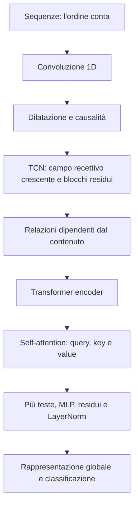
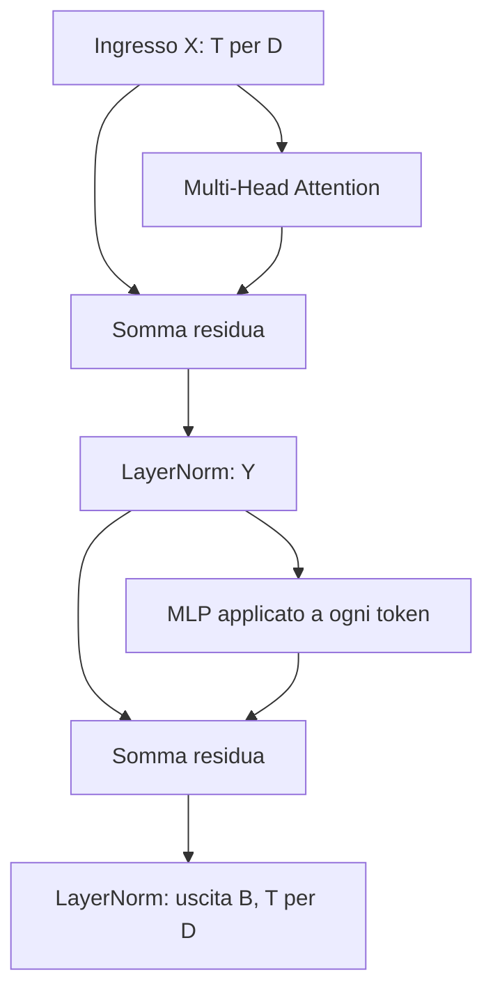
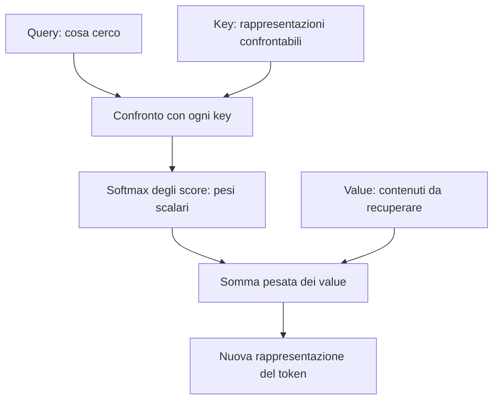
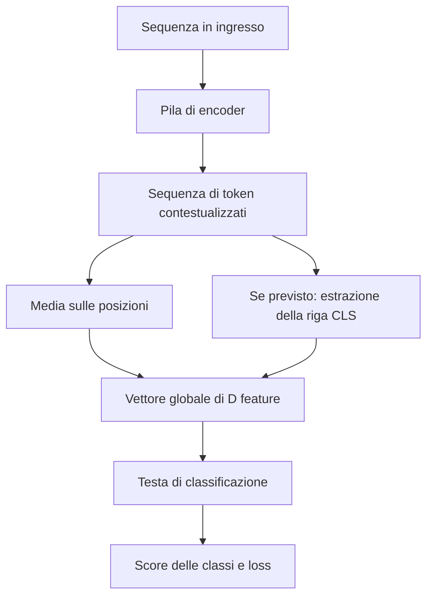

# Temporal Convolutional Networks e Transformer

Le sequenze possono essere elaborate senza una ricorrenza sullo stato nascosto. Una prima possibilità consiste nello spostare un filtro convoluzionale lungo il tempo; una seconda nel costruire relazioni fra elementi mediante **attention**, con coefficienti che dipendono dall'ingresso corrente. Le **Temporal Convolutional Networks** (TCN) e i **Transformer** realizzano queste due idee.

**Convenzione dei riferimenti:** «slide N» indica la **pagina fisica** di `Transformer.pdf` e il suffisso dell'immagine. Il PDF contiene 63 pagine ma il contatore stampato arriva a 44: diverse pagine sono animazioni della stessa slide. La parte spiegata termina con il confronto TCN–Transformer, alle pagine PDF 39–41, tutte numerate 32/44, e con un cenno orale alla cache di chiavi e valori. Le loss di regressione delle pagine successive sono rinviate e non vengono sviluppate qui.

## 1. Modelli per sequenze: l'ordine è informazione (slide 3–4)

Un modello sequenziale riceve una successione di elementi e produce un risultato oppure un'altra successione. Gli elementi possono essere misure numeriche, parole, lettere, segnali audio o rappresentazioni di immagini. Una traduzione può trasformare «Je suis étudiant» in «I am a student»: il numero di elementi in ingresso e in uscita può essere diverso.

L'ordine modifica il significato. Nel testo, cambiare la posizione di soggetto e oggetto può cambiare chi compie un'azione; nelle serie temporali, scambiare due misure cambia l'evoluzione osservata. Traduzione, forecasting, descrizione di video, generazione audio e riassunto di testi sono esempi di compiti sequenziali.

Una sequenza di $T$ osservazioni con $C$ feature per osservazione si può disporre in una matrice $X\in\mathbb R^{T\times C}$, con un'osservazione per riga. Qui l'indice temporale può anche indicare semplicemente una posizione nel testo. La distinzione fra lunghezza e numero di feature è quella introdotta in [[04_RNN]].

Una RNN elabora gli ingressi successivamente e li riassume nello stato. Le alternative qui considerate mantengono invece una sequenza di rappresentazioni intermedie: le convoluzioni la trasformano con finestre locali; l'attention mette in relazione elementi in base al loro contenuto.

## 2. Dalla convoluzione 2D alla convoluzione 1D (slide 5–8)

Una convoluzione sulle immagini sposta il kernel lungo altezza e larghezza. Per una sequenza basta un solo asse di scorrimento: il tempo o la posizione. Le feature di ogni osservazione svolgono il ruolo dei canali dell'immagine.

**Una convoluzione 1D ha un solo asse di scorrimento, non necessariamente un solo peso per posizione.** Un filtro su una finestra di $k$ elementi, ciascuno con $C_{\mathrm{in}}$ feature, contiene $kC_{\mathrm{in}}$ pesi, più un eventuale bias. Il kernel copre tutti i canali e scorre lungo la sequenza, come descritto per i canali in [[03_CNN]].

### 2.1 Operazione scalare e multicanale (slide 7)

La convoluzione discreta scalare riportata nelle slide è

$$\boxed{y_t=(x*\omega)(t)=\sum_{i=0}^{k-1}x*(t-i)\omega_i.}$$

$x_t,y_t,\omega_i$ sono scalari; $k$ è il numero di coefficienti del filtro. Si prende una finestra di valori, si moltiplica ogni valore per il peso associato e si sommano i risultati. Per $k=3$:

$$
\begin{aligned}
y_t&=x_t\omega_0+x_{t-1}\omega_1+x_{t-2}\omega_2
&&\text{sviluppo della sommatoria}.
\end{aligned}
$$

Con valori correnti e passati $(3,2,1)$ e pesi $(1,0,-1)$ si ottiene $3\cdot1+2\cdot0+1\cdot(-1)=2$. La formula usa pesi ordinati per ritardo; all'inizio della serie occorre precisare come trattare gli indici mancanti, per esempio mediante padding.

Per l'esempio a finestre delle slide è più comoda la notazione di **correlazione incrociata** senza ribaltamento del kernel, come già chiarito in [[03_CNN]]. Per una finestra che parte in $t$, con stride 1:

$$\boxed{Y_{t,o}=b_o+\sum_{i=0}^{k-1}\sum_{c=1}^{C_{\mathrm{in}}}X_{t+i,c}K_{i,c,o}.}$$

$X$ è la sequenza di feature; $K_{i,c,o}$ è il peso all'offset temporale $i$, canale di ingresso $c$, filtro di uscita $o$; $b_o$ è il bias di quel filtro. Si somma prima sui canali e poi sulle posizioni della finestra. Ogni filtro produce una feature per posizione, quindi $C_{\mathrm{out}}$ filtri producono $C_{\mathrm{out}}$ canali di uscita.

Non cambia il principio di apprendimento: la differenza fra le due convenzioni riguarda orientamento dei pesi e indici, non l'idea di applicare un prodotto scalare locale condiviso. La finestra $t,t+1,t+2$ descrive qui l'inizio della patch; non va confusa con un'uscita causalmente allineata al suo primo istante.

### 2.2 Esempio completo: «Asimov scrisse molti racconti sui robot positronici» (slide 8)

Ogni parola è rappresentata da quattro feature:

| Parola | Feature 1 | Feature 2 | Feature 3 | Feature 4 |
|---|---:|---:|---:|---:|
| Asimov | 0.2 | 0.1 | −0.3 | 0.4 |
| scrisse | 0.5 | 0.2 | −0.3 | −0.1 |
| molti | −0.1 | −0.3 | −0.2 | 0.4 |
| racconti | 0.3 | −0.3 | 0.1 | 0.1 |
| sui | 0.2 | −0.3 | 0.4 | 0.2 |
| robot | 0.1 | 0.2 | −0.1 | −0.1 |
| positronici | −0.4 | −0.4 | 0.2 | 0.3 |

La finestra temporale è lunga 3, perciò un filtro ha forma $3\times4$:

$$K=\begin{bmatrix}3&1&2&-3\\-1&2&1&-3\\1&1&-1&1\end{bmatrix}.$$

Le tre righe corrispondono alle tre posizioni della finestra; le quattro colonne alle feature. Non è una convoluzione che scorre anche sull'asse delle feature: quell'asse è coperto interamente, mentre lo scorrimento avviene lungo le parole.

Sulla prima finestra, con bias omesso, i tre prodotti scalari sono:

$$
\begin{aligned}
u_1&=0.2\cdot3+0.1\cdot1+(-0.3)\cdot2+0.4\cdot(-3)\\
&=0.6+0.1-0.6-1.2=-1.1,\\
u_2&=0.5\cdot(-1)+0.2\cdot2+(-0.3)\cdot1+(-0.1)\cdot(-3)\\
&=-0.5+0.4-0.3+0.3=-0.1,\\
u_3&=(-0.1)\cdot1+(-0.3)\cdot1+(-0.2)\cdot(-1)+0.4\cdot1\\
&=-0.1-0.3+0.2+0.4=0.2,\\
y_1&=u_1+u_2+u_3=-1.1-0.1+0.2=\boxed{-1}.
\end{aligned}
$$

Spostando la finestra di una parola alla volta:

| Finestra | Risultato verificato |
|---|---:|
| Asimov – scrisse – molti | −1.0 |
| scrisse – molti – racconti | −0.5 |
| molti – racconti – sui | −3.6 |
| racconti – sui – robot | −0.2 |
| sui – robot – positronici | 0.3 |

Da 7 posizioni si ottengono $7-3+1=5$ uscite con stride 1 e senza padding. Un filtro produce un canale; per generare più feature si usano più filtri distinti.

Il conteggio per uno strato standard, con bias, è

$$\boxed{P_{\mathrm{Conv1D}}=C_{\mathrm{out}}(kC_{\mathrm{in}}+1).}$$

Si contano $kC_{\mathrm{in}}$ pesi e un bias per filtro, poi si moltiplica per il numero di filtri. Con $k=3$, $C_{\mathrm{in}}=4$ e 8 filtri sono $8(12+1)=104$ parametri; nell'esempio con un solo filtro senza bias sono 12 pesi. La lunghezza della sequenza non compare nel conteggio.

> [!bug] Precisazione slide 5–6 — Richiamo storico e significato di 1D
> LeNet-5 è un riferimento storico importante, ma non segna la prima comparsa in assoluto delle idee convoluzionali. La distinzione 1D/2D riguarda il numero di assi lungo cui scorre il filtro; con più canali, un filtro 1D non è semplicemente un vettore di soli $k$ scalari.

## 3. Dilatazione: ampliare la regione osservata senza nuovi pesi (slide 9)

Una finestra piccola coglie relazioni locali. Per osservare elementi più lontani si può introdurre una **dilatazione**: i pesi vengono applicati a posizioni distanziate, lasciando intervalli fra un campione e il successivo.

$$\boxed{y_t=\sum_{i=0}^{k-1}x_{t-di}\omega_i,\qquad d\geq1.}$$

$d$ è il fattore di dilatazione, intero positivo. Nell'indice del campione si sostituisce il ritardo $i$ con $di$. Per $k=3$:

$$y_t=x_t\omega_0+x_{t-d}\omega_1+x_{t-2d}\omega_2.$$

La distanza fra primo e ultimo campione è $(k-1)d$; contando entrambi gli estremi, l'ampiezza temporale coperta è

$$\boxed{k_{\mathrm{eff}}=1+(k-1)d.}$$

Con $k=3,d=2$ si usano gli offset $0,2,4$, quindi si copre un intervallo di 5 posizioni con **tre** pesi per canale. Con $d=4$, gli offset sono $0,4,8$ e l'intervallo è lungo 9. La dilatazione non trasforma il kernel in un filtro denso di 5 o 9 pesi.

La differenza dallo **stride** è essenziale:

- la dilatazione modifica la distanza fra i punti letti all'interno della finestra;
- lo stride modifica la distanza fra le posizioni di uscita a cui si applica la finestra.

Si può usare $d>1$ mantenendo stride 1, senza sottocampionare la griglia delle uscite. È utile quando un evento molto breve, quasi impulsivo, non deve scomparire fra due posizioni campionate. Anche nelle immagini un sottocampionamento può perdere dettagli: la differenza è una scelta legata al compito, non una garanzia assoluta dei dati visivi.

Un livello dilatato legge solo alcuni punti della sua griglia di ingresso; se i livelli precedenti hanno già combinato osservazioni locali, quei punti rappresentano però regioni più estese. Saltare una posizione intermedia a un livello profondo non equivale necessariamente a scartare il corrispondente dato grezzo dall'intera rete.

> [!bug] Precisazione slide 9–11 — Indici, stride e crescita del campo recettivo
> Con kernel di tre elementi e dilatazione 2 si leggono, in avanti, le posizioni 1, 3 e 5, non 1, 3 e 6. La dilatazione non richiede stride 2. Inoltre anche convoluzioni non dilatate a stride 1 fanno crescere il campo recettivo quando si impilano livelli: la dilatazione ne accelera la crescita.

## 4. Causalità: non leggere un futuro indisponibile (slide 10)

Per produrre un risultato al tempo $t$ usando soltanto ciò che è già disponibile, una convoluzione deve dipendere da ingressi con indice **minore o uguale a $t$**. Questo è il vincolo di **causalità temporale**. Una finestra centrata su $t$ che leggesse anche $t+1$ o $t+2$ violerebbe il vincolo.

La formula dilatata precedente è già scritta in forma causale, perché usa $t,t-d,\ldots,t-(k-1)d$. All'inizio mancano alcuni valori passati: un padding soltanto a sinistra permette di trattarli senza leggere valori futuri. Per stride 1 e uscita lunga quanto l'ingresso:

$$\boxed{P_{\mathrm{sinistra}}=(k-1)d,\qquad P_{\mathrm{destra}}=0.}$$

Infatti il kernel effettivo è lungo $k_{\mathrm{eff}}=1+(k-1)d$. Partendo da una sequenza di lunghezza $T$:

$$
\begin{aligned}
T_{\mathrm{out}}&=T+P_{\mathrm{sinistra}}-k_{\mathrm{eff}}+1
&&\text{conteggio delle finestre a stride 1},\\
&=T+(k-1)d-[1+(k-1)d]+1=T
&&\text{sostituzione e semplificazione}.
\end{aligned}
$$

Con $k=3,d=2$ servono quattro valori di padding a sinistra. Se i pesi sono tutti 1 e i primi dati sono $(1,2,3,4,5)$, l'uscita al terzo istante usa $x_3+x_1+x_{-1}=3+1+0=4$; al quinto usa $x_5+x_3+x_1=5+3+1=9$. Nessuno dei due risultati richiede valori futuri.

La causalità indica un vincolo di disponibilità dell'informazione, non una prova che un ingresso causi fisicamente un evento. Inoltre $y_t$ può dipendere da $x_t$: se il compito consiste nel prevedere il valore ancora sconosciuto $x_t$, occorre allineare i target rispetto agli ingressi, per esempio prevedendo $x_{t+1}$ dai dati fino a $t$. Causalità del filtro e definizione della previsione devono essere coerenti.

## 5. Temporal Convolutional Network: gerarchia e blocchi residui (slide 11)

Una **TCN** combina convoluzioni causali e dilatate in una gerarchia. La figura mostra kernel di ampiezza 3 e dilatazioni $1,2,4$: salendo di livello, ogni elemento riassume una porzione più lunga della sequenza originale.

### 5.1 Campo recettivo lungo la sequenza (slide 11)

Riprendiamo da [[03_CNN]] il campo recettivo $r_\ell$ e la distanza $j_\ell$ fra centri di uscite adiacenti, misurati sull'ingresso originale. Con kernel $k_\ell$, dilatazione $d_\ell$ e stride $s_\ell$:

$$\boxed{\begin{aligned}
r_\ell&=r_{\ell-1}+(k_\ell-1)d_\ell j_{\ell-1},\\
j_\ell&=s_\ell j_{\ell-1},\qquad r_0=j_0=1.
\end{aligned}}$$

Fra primo e ultimo punto della finestra ci sono $k_\ell-1$ intervalli; ognuno vale $d_\ell$ posizioni della griglia precedente, distanziate di $j_{\ell-1}$ sull'ingresso. Da qui il termine aggiunto. Lo stride determina invece la nuova distanza fra uscite.

Con stride sempre 1 si mantiene $j_\ell=1$. Per i tre livelli della figura:

| Livello | $k$ | $d$ | Calcolo | Campo recettivo |
|---|---:|---:|---|---:|
| Ingresso | — | — | Valore iniziale | 1 |
| 1 | 3 | 1 | $1+2\cdot1$ | 3 |
| 2 | 3 | 2 | $3+2\cdot2$ | 7 |
| 3 | 3 | 4 | $7+2\cdot4$ | 15 |

Un'uscita finale può quindi dipendere da 15 istanti, pur usando kernel di soli tre campioni. I salti di un livello si combinano con le regioni già elaborate dal precedente.

### 5.2 Che cosa contiene il blocco reale (slide 11)

Il blocco a destra della figura comprende due sequenze convoluzione causale dilatata → normalizzazione dei pesi → ReLU → dropout, oltre a una connessione residua. La **WeightNorm** riguarda i pesi: non è la BatchNorm sulle attivazioni di [[03_CNN]] e non viene qui sviluppata matematicamente.

La shortcut somma ingresso e ramo trasformato. Se i canali non coincidono, una convoluzione $1\times1$ può adattarli. È la stessa condizione di compatibilità delle forme già incontrata con ResNet: i due rami vengono calcolati e sommati, senza scegliere quale eseguire.

Il disegno a sinistra conta **una convoluzione per livello**. Se invece si impilano tre blocchi con due convoluzioni ciascuno alle dilatazioni $1,2,4$, il campo recettivo massimo del ramo profondo diventa $1+2\cdot2(1+2+4)=29$. Il conteggio va fatto sulle operazioni effettive, non confondendo un blocco con una singola convoluzione.

Le convoluzioni possono elaborare sequenze di lunghezza diversa mantenendo gli stessi pesi. Una eventuale testa densa su una concatenazione completa può tuttavia reintrodurre il vincolo di lunghezza fissa; la flessibilità dell'estrattore non rende automaticamente flessibile qualsiasi classificatore finale.

## 6. Caso di studio finanziario: dati, baseline e risultati (slide 12–13)

Il caso illustrato combina tre fonti: valori giornalieri dell'indice DJIA, titoli di notizie e conoscenza strutturata da grafi. Il compito è classificare il movimento successivo come rialzo o ribasso. Le feature provenienti da più fonti possono essere allineate e affiancate lungo l'asse dei canali, mantenendo la struttura temporale.

Aggiungere canali non cambia il principio convoluzionale, ma **aumenta i pesi del filtro**, perché ciascun filtro deve coprire anche le nuove feature. Non significa inserire dati eterogenei senza prima renderli rappresentabili e temporalmente coerenti. La costruzione dei grafi e degli embedding del caso di studio non è sviluppata.

| Modello, confronto iniziale | Accuracy media | F1 |
|---|---:|---:|
| ARIMA | $52.40\%\pm0.25\%$ | $0.3844\pm0.0052$ |
| LSTM | $56.17\%\pm0.26\%$ | $0.5348\pm0.0039$ |
| CNN | $55.41\%\pm0.25\%$ | $0.5280\pm0.0021$ |
| TCN | $60.96\%\pm0.26\%$ | $0.5317\pm0.0036$ |

La TCN migliora l'accuracy della LSTM di $60.96-56.17=4.79$ **punti percentuali**. La F1 è però leggermente più bassa: $0.5317<0.5348$. Dire che un modello è migliore richiede quindi di specificare la metrica, oltre al dataset e al protocollo.

Nella tabella con diverse covariate, il modello KDTCN che combina prezzi, notizie e conoscenza strutturata raggiunge $69.77\%\pm0.25\%$ di accuracy e $0.7073\pm0.0030$ di F1. La tabella sui cambiamenti bruschi riporta lo stesso valore centrale di accuracy, con dispersione $0.24\%$: le due tabelle non vanno fuse attribuendo loro un'identica condizione sperimentale.

Un'accuracy attorno al 60% è un risultato del caso studiato, non una garanzia di previsione finanziaria o redditività. Una baseline casuale al 50% di accuracy presuppone una scelta binaria equiprobabile; per le metriche e il dataset reale servono confronti appropriati. In particolare una F1 pari a 0.5 non è una baseline universale: dipende da prevalenza della classe positiva e regola di predizione. Il significato delle metriche si collega a [[Manuale_Studio_Machine_Learning_to_Deep_Learning]].

## 7. TCN e RNN: memoria, parallelismo e spiegazioni (slide 14)

Una RNN conserva uno stato di dimensione fissata. Riassumere 20 osservazioni o 4000 osservazioni in 128 numeri pone un diverso carico alla stessa rappresentazione: è l'idea del **riassunto con perdita** discussa in [[04_RNN]]. Una TCN conserva invece mappe di feature indicizzate lungo la sequenza, fino a un'eventuale aggregazione finale.

La maggiore lunghezza delle mappe ha un costo di memoria. A parità di canali, raddoppiare la lunghezza raddoppia le attivazioni di un livello che la conserva. Inoltre una TCN di profondità fissata vede un campo recettivo finito: accettare ingressi più lunghi non amplia automaticamente la storia osservabile da ogni uscita.

Il vantaggio computazionale è l'assenza di una ricorrenza che imponga di completare $h_t$ prima di calcolare $h_{t+1}$. Le posizioni di una convoluzione nello stesso livello possono essere calcolate in parallelo, oltre ai filtri; rimane la dipendenza fra livelli successivi.

Per l'apprendimento si applica la backpropagation al grafo convoluzionale, senza srotolare una cella ricorrente per ogni istante. **La backpropagation non scompare.** Le connessioni residue e la struttura della rete possono facilitarla; non eliminano ogni possibile instabilità.

> [!bug] Errata slide 14 — Nessuna garanzia assoluta sui gradienti
> L'affermazione «no vanishing/exploding gradients» è troppo forte. La TCN evita la specifica catena ricorrente attraverso tutti gli istanti, ma una rete convoluzionale profonda può comunque avere gradienti che svaniscono o esplodono. I risultati favorevoli rispetto a LSTM e GRU descrivono confronti sperimentali, non una superiorità universale.

La struttura convoluzionale consente anche di adattare strumenti di localizzazione come Grad-CAM per evidenziare porzioni della sequenza associate a una decisione. Non segue che le RNN siano impossibili da analizzare: anche un grafo ricorrente srotolato può essere studiato con metodi di attribuzione. Il richiamo alla spiegabilità indica una possibilità pratica delle TCN, senza sviluppare qui l'algoritmo Grad-CAM né trasformare una mappa di attribuzione in una prova causale.

## 8. Dai collegamenti regolari alle relazioni dipendenti dal contenuto (slide 15–18)

Le convoluzioni impongono un'organizzazione regolare dei collegamenti. La dilatazione può ampliare la distanza fra campioni, ma la regola dei salti è fissata dall'architettura: una volta scelti kernel e dilatazioni, le posizioni potenzialmente collegate sono determinate.

Molte dipendenze non seguono una distanza costante. In una frase, un nome può essere collegato al suo articolo e poi richiamato molto più avanti; fra i due possono comparire quantità diverse di parole. Nel codice, la chiusura di un ciclo `for` è collegata alla sua apertura, ma la distanza cambia con la lunghezza del blocco. Non basta quindi scegliere un unico salto periodico adatto a tutti gli esempi.

La domanda è: **si possono calcolare, per ogni ingresso, coefficienti che descrivano quali elementi mettere in relazione?** L'attention costruisce proprio questi coefficienti. Non cambia i parametri del modello durante il forward: usa parametri già appresi per produrre relazioni che dipendono dai dati correnti.

Il Transformer presentato in *Attention Is All You Need* del 2017 combina meccanismi di attention con trasformazioni lineari, MLP, connessioni residue e normalizzazione. Non è una rete priva di struttura o di bias induttivi: cambia il modo di far interagire le posizioni, rendendolo dipendente dal contenuto.

## 9. Encoder e decoder: ruoli e perimetro (slide 19–20)

L'architettura illustrata ha due rami:

- l'**encoder** trasforma una sequenza in una sequenza di rappresentazioni;
- il **decoder** costruisce una sequenza di uscita, eventualmente condizionandosi anche alle rappresentazioni dell'encoder.

Nella traduzione, l'encoder rappresenta la frase nella lingua di partenza e il decoder produce quella nella lingua di arrivo. Per classificare una frase come positiva o negativa può bastare un encoder con una testa di classificazione. Una rete di generazione può invece essere basata sul solo decoder, producendo progressivamente nuovi elementi condizionati al contesto.

La coppia encoder–decoder non serve soltanto a cambiare modalità: una traduzione fra lingue rimane interamente testuale. Analogamente, usare token di modalità differenti richiede rappresentazioni e addestramento coerenti, non necessariamente proprio lo schema completo della figura.

Il prompt «Elon Musk che mangia un Kinder Bueno» illustra il principio di **condizionare** una generazione di immagini con una descrizione testuale: il testo deve influire sul contenuto prodotto. L'esempio non identifica l'architettura esatta di ogni sistema di generazione d'immagini, né implica che tutti seguano il decoder testuale disegnato nella figura.

Il valore $N=6$ riportato nelle slide è il numero di livelli della configurazione di riferimento, non una costante obbligatoria per ogni Transformer.

> [!info] Slide 20 — Componenti non sviluppate in dettaglio
> La trattazione si concentra sull'encoder. Del positional encoding viene data l'intuizione qualitativa; non vengono sviluppate le sue formule sinusoidali. Decoder, masking e cross-attention restano richiami di contesto: non si aggiungono le equazioni o la descrizione completa di questi moduli.

## 10. Dall'ingresso ai token e alla posizione (slide 21)

Per entrare nel Transformer, ogni elemento deve essere rappresentato mediante un vettore di dimensione fissata $D=d_{\mathrm{model}}$. Con una riga per token:

$$\boxed{X\in\mathbb R^{T\times D}.}$$

$T$ è il numero di token; $D$ è il numero di feature di ogni token. Per esempio, 100 token con 10 feature danno una matrice $100\times10$. Il blocco encoder descritto mantiene questa forma: non esegue pooling temporale fra un livello e il successivo.

### 10.1 Tokenizzazione ed embedding sono passaggi distinti (slide 21)

Nel caso testuale, la **tokenizzazione** suddivide il testo in unità e le associa a identificativi; l'**embedding** associa agli identificativi dei vettori numerici. Nel linguaggio del calcolo, «token» può indicare anche il vettore che rappresenta quell'unità, ma è utile distinguere i due passaggi.

Una parola non corrisponde necessariamente a un solo token: un tokenizer può produrre sottoparole o altre unità. La corrispondenza «un ingresso, un vettore» descrive la sequenza dopo che quelle unità sono state definite. Il numero di feature per vettore rimane fissato, mentre il numero di vettori può variare.

Word2Vec è un esempio richiamato per l'idea di rappresentare parole con vettori. Non occorre che i vettori siano progettati manualmente; possono essere appresi e possono provenire da un modello già disponibile. Il modulo di embedding di un Transformer può anche essere addestrato insieme al resto della rete. Non si deve estendere al suo embedding l'idea che il tokenizer discreto venga normalmente scelto prima del training del modello.

> [!bug] Precisazione slide 21 — Token, parola e rappresentazione appresa
> «Un token per parola» è una semplificazione dell'esempio, non una proprietà generale. Tokenizzazione ed embedding non sono la stessa operazione: la prima definisce le unità e gli identificativi, il secondo costruisce i vettori e può ricevere gradienti durante l'addestramento end-to-end.

### 10.2 Perché aggiungere la posizione (slide 21)

Confrontare il contenuto dei token, da solo, non assegna un significato alla loro posizione nella frase. Per rendere accessibile l'ordine si introduce una rappresentazione della posizione, qui descritta come un vettore aggiunto alle feature:

$$\boxed{x_t=e_t+p_t,\qquad e_t,p_t,x_t\in\mathbb R^D.}$$

$e_t$ è l'embedding del contenuto e $p_t$ codifica la posizione. La somma è possibile perché le forme coincidono. Per esempio, nell'illustrazione più semplice si potrebbe aggiungere l'indice a ogni feature: con $e_1=(0.2,0.4)$ e $p_1=(1,1)$ si ottiene $x_1=(1.2,1.4)$; alla seconda posizione si potrebbe usare $p_2=(2,2)$. È un esempio intuitivo, non la codifica sinusoidale dell'architettura di riferimento né una raccomandazione progettuale.

Nel caso descritto, le funzioni di posizione sono fissate; altri dettagli di progettazione non sono necessari per seguire il blocco encoder. Il collegamento con le feature cicliche di [[04_RNN]] è l'uso di funzioni numeriche per rappresentare una struttura dell'indice, senza identificare i due meccanismi.

## 11. Blocco encoder: attention, MLP, residui e normalizzazione (slide 22–25)

Il blocco contiene due trasformazioni principali: **Multi-Head Attention** e **Feed-Forward Network**. Dopo ciascuna si somma l'ingresso del sottoblocco e si applica LayerNorm. L'ordine mostrato è quindi quello con normalizzazione successiva alla somma.

Scrivendo $\operatorname{MHA}$ per la multi-head attention e $\operatorname{FFN}$ per il piccolo MLP:

$$\boxed{\begin{aligned}
Y&=\operatorname{LN}_1\bigl(X+\operatorname{MHA}(X)\bigr),\\
B&=\operatorname{LN}_2\bigl(Y+\operatorname{FFN}(Y)\bigr).
\end{aligned}}$$

$X,Y,B$ hanno forma $T\times D$. Perché le somme siano definite, anche MHA e FFN devono restituire $T\times D$. Le due LayerNorm hanno propri parametri. La forma resta uguale, ma il contenuto dei vettori cambia: ogni livello può affinare le rappresentazioni.

### 11.1 MLP per token e condivisione dei pesi (slide 23–25)

Il feed-forward comprende due trasformazioni lineari con ReLU in mezzo. Per un token riga $y_t\in\mathbb R^{1\times D}$:

$$\boxed{\operatorname{FFN}(y_t)=\operatorname{ReLU}(y_tW_1+b_1)W_2+b_2.}$$

La dimensione interna $F$ può essere diversa da $D$:

| Quantità | Forma |
|---|---|
| $W_1$ | $D\times F$ |
| $b_1$ | $1\times F$ |
| $y_tW_1+b_1$ | $1\times F$ |
| $W_2$ | $F\times D$ |
| $b_2$ | $1\times D$ |
| $\operatorname{FFN}(y_t)$ | $1\times D$ |

Il calcolo prima proietta da $D$ a $F$, applica la non linearità e poi torna da $F$ a $D$. **Lo stesso MLP, con gli stessi pesi, viene applicato a ogni posizione.** «Indipendentemente» significa che questa operazione non mescola token differenti, non che ogni token abbia un MLP distinto. Le posizioni possono essere elaborate in parallelo.

Per $D=2,F=3$, con bias nulli:

$$y_t=\begin{bmatrix}1&-1\end{bmatrix},\quad
W_1=\begin{bmatrix}1&0&-1\\0&1&1\end{bmatrix},\quad
W_2=\begin{bmatrix}2&0\\0&1\\1&1\end{bmatrix}.$$

Si ottiene:

$$
\begin{aligned}
y_tW_1&=\begin{bmatrix}1&-1&-2\end{bmatrix}
&&\text{primo prodotto riga per matrice},\\
\operatorname{ReLU}(y_tW_1)&=\begin{bmatrix}1&0&0\end{bmatrix}
&&\text{soglia a zero},\\
\operatorname{FFN}(y_t)&=\begin{bmatrix}2&0\end{bmatrix}
&&\text{seconda proiezione},\\
y_t+\operatorname{FFN}(y_t)&=\begin{bmatrix}3&-1\end{bmatrix}
&&\text{somma residua prima della normalizzazione}.
\end{aligned}
$$

Il MLP ha dimensione finale uguale all'ingresso pur cambiando la dimensione interna. La connessione residua aggiunge il contributo diretto, come in [[03_CNN]]; non sostituisce la trasformazione né ne evita il calcolo. Il ruolo dell'attention sarà invece quello di mescolare informazioni fra token.

## 12. Layer Normalization: normalizzare le feature del singolo token (slide 26–28)

La **Layer Normalization**, o **LayerNorm**, controlla centro e scala delle attivazioni **all'interno di ogni token**. Su un tensore di forma $N\times T\times D$, qui si aggrega l'ultimo asse $D$: ogni coppia campione–posizione ha le proprie statistiche.

Per un token $x\in\mathbb R^D$, con vettori scritti qui per componenti:

$$\boxed{\begin{aligned}
\mu&=\frac1D\sum_{j=1}^{D}x_j,\\
v&=\frac1D\sum_{j=1}^{D}(x_j-\mu)^2,\\
\widehat x_j&=\frac{x_j-\mu}{\sqrt{v+\epsilon}},\\
y_j&=\gamma_j\widehat x_j+\beta_j.
\end{aligned}}$$

$\mu,v$ sono scalari calcolati dal token corrente; $\epsilon>0$ è una costante di stabilità. I vettori $\gamma,\beta\in\mathbb R^D$ sono apprendibili e condivisi fra le posizioni per lo stesso modulo. In uscita rimangono $D$ componenti.

### 12.1 Da dove vengono i passaggi (slide 26–27)

La sottrazione della media centra gli scarti:

$$
\begin{aligned}
\frac1D\sum_j(x_j-\mu)
&=\frac1D\sum_jx_j-\frac1D\sum_j\mu
&&\text{linearità della somma},\\
&=\mu-\mu=0
&&\text{definizione della media}.
\end{aligned}
$$

La divisione per la deviazione standard stabilizzata controlla la scala. Poiché $\widehat x$ ha media zero:

$$
\begin{aligned}
\operatorname{var}(\widehat x)
&=\frac1D\sum_j\frac{(x_j-\mu)^2}{v+\epsilon},\\
&=\frac{v}{v+\epsilon}.
\end{aligned}
$$

Questa varianza è vicina a 1 quando $v$ è grande rispetto a $\epsilon$, non identicamente 1. Se tutte le componenti coincidono, $v=0$ e gli scarti normalizzati sono zero; $\epsilon$ evita la divisione per zero. Un esempio con componenti tutte uguali a 5 produce quindi $\widehat x=0$ e $y=\beta$.

> [!bug] Precisazione slide 26–27 — Deviazione standard e stabilizzatore
> Il denominatore della slide è $\sigma+\epsilon$: $\sigma$ va letto come **deviazione standard**, non varianza né covarianza. Qui si esplicita la convenzione comune $\sqrt{v+\epsilon}$. Le due collocazioni di $\epsilon$ sono varianti numeriche diverse: non si sostituisce l'una all'altra come identità algebrica. Dividere direttamente per $v$ non realizza la standardizzazione descritta.

### 12.2 Gamma e beta: scala e traslazione apprendibili (slide 26–27)

La normalizzazione è seguita da una trasformazione affine per feature. $\gamma_j$ scala la componente $j$; $\beta_j$ la trasla. Una scala zero può annullare il contributo di una feature normalizzata, ma **$\gamma$ non è un gate sigmoidale**: non è vincolato fra 0 e 1, può amplificare o cambiare segno. Non è una maschera nuova scelta separatamente per ciascun token.

I parametri apprendibili sono $D$ scale e $D$ traslazioni:

$$\boxed{P_{\mathrm{LN}}=2D.}$$

Per $D=4$ sono 8 scalari. Media e varianza del token non sono parametri ottimizzati. Con valori generali di $\gamma,\beta$, l'uscita finale non deve mantenere media zero o varianza unitaria.

### 12.3 Esempio numerico completo (slide 26–27)

Per un token $x=(1,3,5,7)$:

$$
\begin{aligned}
\mu&=(1+3+5+7)/4=4,\\
v&=[(-3)^2+(-1)^2+1^2+3^2]/4=20/4=5,\\
\sqrt{v+\epsilon}&=\sqrt{5.00001}\approx2.23607
\qquad(\epsilon=10^{-5}),\\
\widehat x&\approx(-1.34164,-0.44721,0.44721,1.34164).
\end{aligned}
$$

Con $\gamma=(2,2,2,2)$ e $\beta=(1,1,1,1)$ si ottiene

$$\boxed{y\approx(-1.68328,0.10557,1.89443,3.68328).}$$

Qui la media finale è 1 e la varianza circa 4. Il modulo non impone una scala rigida finale: fornisce una base normalizzata e lascia apprendere la trasformazione successiva.

Se una feature è molto grande rispetto alle altre, per esempio $x=(1000,0,0,0)$, con $\epsilon$ trascurabile si hanno $\mu=250$, $v=187500$ e

$$\widehat x=(\sqrt3,-1/\sqrt3,-1/\sqrt3,-1/\sqrt3).$$

L'esempio chiarisce perché la normalizzazione ridimensiona il valore estremo rispetto alla scala del token; l'eventuale $\gamma$ permette poi una scala diversa per ciascuna coordinata. Non è necessario supporre che il grande valore rimanga invariato dopo aver diviso per la deviazione standard.

### 12.4 LayerNorm e BatchNorm a confronto (slide 27)

| Aspetto | LayerNorm del Transformer | BatchNorm convoluzionale di [[03_CNN]] |
|---|---|---|
| Statistiche | Fra le feature dello stesso token | Per canale, aggregando batch e posizioni spaziali |
| Dipendenza dagli altri esempi | Non serve il resto del batch | Presente durante il training |
| Inferenza | Ricalcola le statistiche del token | Nella configurazione standard usa statistiche mobili memorizzate |
| Parametri affini | Una scala e un bias per feature | Una scala e un bias per canale |

La LayerNorm del caso descritto non richiede di passare a statistiche mobili per l'inferenza. Questo non rende identico in train ed eval l'intero Transformer, che può includere altri moduli con comportamenti differenti.

Controllare la scala non significa assegnare a tutti i token uguale importanza semantica, uguali gradienti o una probabilità identica di riceverli. Queste dipendenze sono determinate dal grafo, dalla loss e dai parametri; non sono una conseguenza garantita della normalizzazione. La LayerNorm non rende inoltre gaussiane le feature e non ne annulla automaticamente le correlazioni.

## 13. Attention: ricostruire ogni token dal contesto (slide 29–32)

Il meccanismo di attention costruisce una nuova rappresentazione per ogni posizione combinando informazioni dalla sequenza. I coefficienti non sono uguali per tutte le posizioni: la prima può attribuire molto peso a certi elementi, la seconda ad altri. La scelta dipende dal contenuto dell'ingresso corrente.

Nella forma introduttiva della slide 30:

$$\boxed{z_t=\sum_{i=1}^{T}\alpha_{t,i}x_i.}$$

$x_i\in\mathbb R^D$ è un vettore della sequenza; $z_t\in\mathbb R^D$ è il nuovo vettore alla posizione $t$; **$\alpha_{t,i}$ è uno scalare** che pesa l'intero vettore $x_i$. Non è una seconda rappresentazione multidimensionale. La somma di vettori pesati conserva la loro dimensione.

Se $x_1=(2,0)$ e $x_2=(0,4)$ e per una posizione si assegnano pesi $0.75$ e $0.25$, allora

$$z_t=0.75(2,0)+0.25(0,4)=(1.5,1).$$

Con pesi $0.25$ e $0.75$, un'altra posizione produce $(0.5,3)$. Cambiano i coefficienti e quindi la combinazione. L'attention concreta delle slide successive applicherà questi pesi ai **value proiettati**, non necessariamente agli embedding grezzi $x_i$.

### 13.1 Dalle similarità ai coefficienti (slide 30)

Per ogni posizione $t$ si calcola un insieme di score $s_{t,1},\ldots,s_{t,T}$ e si applica la softmax lungo l'indice $i$:

$$\boxed{\alpha_{t,i}=\frac{e^{s_{t,i}}}{\sum_{j=1}^{T}e^{s_{t,j}}},\qquad\sum_{i=1}^{T}\alpha_{t,i}=1.}$$

La normalizzazione deriva dividendo ogni esponenziale per la somma degli esponenziali della **stessa riga**. La somma dei coefficienti è 1 perché numeratore sommato e denominatore coincidono. Con score $(\ln3,0)$, gli esponenziali sono $(3,1)$ e i pesi diventano $(3/4,1/4)$, come nell'esempio precedente.

Ogni riga può essere letta come una distribuzione sui token a cui si attinge. Non è una probabilità che una parola sia corretta, né una probabilità sulle classi del compito. Con score finiti e senza mascheramento i pesi sono positivi: «non selezionare» un elemento significa spesso attribuirgli peso molto piccolo, non necessariamente zero esatto.

I coefficienti sono calcolati durante il forward mediante funzioni parametriche apprese. Non sono un insieme di parametri statici $\alpha_{t,i}$ memorizzati una volta per tutte per ciascuna posizione. A parità di modello, cambiando la frase possono cambiare le relazioni.

Anche CNN e RNN producono risposte dipendenti dall'ingresso; non trattano ogni contenuto come semanticamente uguale. La novità specifica dell'attention descritta è calcolare esplicitamente **coefficienti di interazione fra coppie di posizioni**.

### 13.2 Analogia con una memoria interrogabile (slide 31–32)

L'attention si può leggere come un accesso a memoria guidato dal contenuto:

1. La **query** descrive ciò che si cerca per costruire una certa uscita.
2. Le **key** rappresentano il contenuto in una forma confrontabile con la query.
3. Il confronto produce score e coefficienti normalizzati.
4. I **value** contengono le informazioni da combinare con quei coefficienti.

La query interroga la stessa collezione di coppie key–value per ogni posizione. Il richiamo a tag e indici delle cache dei calcolatori aiuta a separare **ciò che consente il confronto** da **ciò che viene recuperato**. Le key sono però vettori appresi, non indirizzi interi né necessariamente identificativi univoci.

L'analogia riguarda la selezione e la combinazione di contenuti, non dimostra una capacità generale di ragionamento. L'apprendimento sceglie come rappresentare query, key e value affinché l'uscita serva al compito.

## 14. Query, key e value: tre proiezioni dello stesso ingresso (slide 33)

Le tre rappresentazioni si ottengono mediante trasformazioni lineari. Con una riga per token:

$$\boxed{Q=XW^Q,\qquad K=XW^K,\qquad V=XW^V.}$$

| Quantità | Forma | Significato |
|---|---|---|
| $X$ | $T\times D$ | Sequenza di ingresso, con $D=d_{\mathrm{model}}$ |
| $W^Q$ | $D\times d_k$ | Proiezione verso le query |
| $W^K$ | $D\times d_k$ | Proiezione verso le key |
| $W^V$ | $D\times d_v$ | Proiezione verso i value |
| $Q,K$ | $T\times d_k$ | Una query e una key per token |
| $V$ | $T\times d_v$ | Un value per token |

Le slide usano $d_v=d_k$; la condizione essenziale per il prodotto scalare è che **query e key abbiano la stessa dimensione**. La dimensione dei value può, in generale, essere distinta. Nell'esempio successivo manteniamo la scelta della slide: $D=4$ e $d_k=d_v=3$.

Il prodotto $XW^Q$ applica la stessa trasformazione a ogni riga:

$$
\begin{aligned}
q_{t,j}&=\sum_{a=1}^{D}X_{t,a}W^Q_{a,j},\\
q_t&=x_tW^Q\in\mathbb R^{1\times d_k}.
\end{aligned}
$$

Si ripete il procedimento con matrici distinte per $K$ e $V$. Proiettare permette di apprendere spazi adatti al confronto e al contenuto da recuperare: l'embedding iniziale non deve già essere la rappresentazione migliore per tutti e tre i ruoli.

Poiché query, key e value derivano dalla **stessa sequenza**, si parla di **self-attention**. Nel richiamo alla cross-attention la query può provenire da una sequenza e key–value da un'altra; non viene sviluppato qui il relativo modulo.

### 14.1 Esempio delle tre proiezioni, con dimensioni esplicite (slide 33)

Consideriamo due token di quattro feature:

$$X=\begin{bmatrix}1&0&1&0\\0&1&0&1\end{bmatrix}.$$

Le seguenti matrici $4\times3$ sono un piccolo esempio numerico costruito per esplicitare i prodotti, non valori leggibili nel disegno della slide:

$$
W^Q=\begin{bmatrix}1&0&0\\0&1&0\\0&0&0\\0&0&0\end{bmatrix},\quad
W^K=\begin{bmatrix}1&0&1\\2&2&0\\0&0&0\\0&0&0\end{bmatrix},\quad
W^V=\begin{bmatrix}1&2&0\\3&0&1\\0&0&0\\0&0&0\end{bmatrix}.
$$

La prima riga di $X$, $(1,0,1,0)$, combina prima e terza riga di ciascuna matrice di proiezione; la seconda combina seconda e quarta. Poiché terza e quarta sono qui nulle:

$$
\boxed{Q=\begin{bmatrix}1&0&0\\0&1&0\end{bmatrix},\quad
K=\begin{bmatrix}1&0&1\\2&2&0\end{bmatrix},\quad
V=\begin{bmatrix}1&2&0\\3&0&1\end{bmatrix}.}
$$

Ogni risultato ha ancora **due righe**, una per token; la dimensione delle feature è passata da 4 a 3. Il valore $d_k$ conta le componenti di query e key, non il numero dei token.

## 15. Single-head attention: dal confronto alla somma pesata (slide 34)

La **scaled dot-product attention** esegue in forma matriciale tutti i confronti e tutte le combinazioni:

$$\boxed{Z=\operatorname{Attention}(Q,K,V)=\operatorname{softmax}_{\mathrm{righe}}\!\left(\frac{QK^T}{\sqrt{d_k}}\right)V.}$$

La lettura va fatta da dentro verso fuori: prodotti scalari query–key, riscalamento, softmax per riga e prodotto finale con i value.

### 15.1 Perché K viene trasposta e quali righe si confrontano (slide 33–34)

$Q$ e $K$ hanno forma $T\times d_k$. Per confrontare ogni riga di $Q$ con ogni riga di $K$ occorre il prodotto

$$\boxed{S_0=QK^T\in\mathbb R^{T\times T},\qquad (S_0)_{t,i}=\sum_{a=1}^{d_k}Q_{t,a}K_{i,a}=q_t\cdot k_i.}$$

La trasposizione porta le righe delle key sulle colonne della matrice moltiplicata. Per due token si ottiene:

$$QK^T=\begin{bmatrix}
q_1\cdot k_1&q_1\cdot k_2\\
q_2\cdot k_1&q_2\cdot k_2
\end{bmatrix}.$$

Questa è la risposta al dubbio annotato nella slide 33: **non si moltiplicano soltanto la prima riga di $Q$ con la seconda di $K$ e la seconda di $Q$ con la prima di $K$**. Quelli sono due confronti incrociati; si calcolano anche i confronti sulla diagonale. Per ogni query si considerano tutte le key ammesse.

Nel nostro esempio:

$$
\begin{aligned}
q_1\cdot k_1&=1\cdot1+0\cdot0+0\cdot1=1,\\
q_1\cdot k_2&=1\cdot2+0\cdot2+0\cdot0=2,\\
q_2\cdot k_1&=0\cdot1+1\cdot0+0\cdot1=0,\\
q_2\cdot k_2&=0\cdot2+1\cdot2+0\cdot0=2,\\
QK^T&=\begin{bmatrix}1&2\\0&2\end{bmatrix}.
\end{aligned}
$$

Il prodotto è una misura di compatibilità appresa, non necessariamente una correlazione statistica normalizzata. Poiché $W^Q$ e $W^K$ sono diversi, $q_t$ e $k_t$ non sono in generale lo stesso vettore. Perciò la matrice non deve essere simmetrica e la diagonale **non deve essere la massima**. Nell'esempio la prima query ha score 2 con la seconda key, maggiore del proprio score diagonale 1. La conservazione dell'ingresso è favorita anche dalla connessione residua esterna, non garantita da una diagonale dominante.

### 15.2 Perché dividere per la radice della dimensione (slide 34)

Il prodotto scalare somma $d_k$ contributi. All'aumentare della dimensione, la sua scala può crescere e produrre score molto separati; la softmax può allora diventare estremamente concentrata, con gradienti piccoli.

Per chiarire il riscalamento, sotto l'ipotesi illustrativa di componenti indipendenti, a media zero e varianza unitaria, e query e key indipendenti:

$$
\begin{aligned}
s&=\sum_{a=1}^{d_k}q_ak_a,\\
\mathbb E[q_ak_a]&=\mathbb E[q_a]\mathbb E[k_a]=0
&&\text{indipendenza e medie nulle},\\
\operatorname{var}(q_ak_a)&=\mathbb E[q_a^2]\mathbb E[k_a^2]=1
&&\text{indipendenza e secondi momenti unitari},\\
\operatorname{var}(s)&=\sum_a1=d_k
&&\text{somma di contributi indipendenti},\\
\operatorname{var}\!\left(\frac{s}{\sqrt{d_k}}\right)&=\frac{d_k}{d_k}=1
&&\text{varianza di una quantità riscalata}.
\end{aligned}
$$

Non è una garanzia che query e key apprese soddisfino queste ipotesi; è la motivazione di scala. Per $d_k=64$, il denominatore è **8**, non 64. La normalizzazione degli score e la LayerNorm hanno posizioni e scopi collegati alla stabilità, ma sono operazioni diverse.

> [!bug] Precisazione slide 34 — Matrici e fattore di scala
> Nella formula, $Q,K,V$ sono matrici che raccolgono vettori per token, non tre singoli vettori di lunghezza 64. $d_k=64$ è un esempio di dimensione delle query e delle key; il fattore di scala è $1/\sqrt{d_k}$. Il numero di righe resta il numero di token e non viene sostituito da $d_k$.

### 15.3 Softmax per riga: esempio completo (slide 34)

Con $d_k=3$, si riscalano gli score:

$$S=\frac1{\sqrt3}\begin{bmatrix}1&2\\0&2\end{bmatrix}
\approx\begin{bmatrix}0.577350&1.154701\\0&1.154701\end{bmatrix}.$$

Per la prima riga:

$$
\begin{aligned}
\alpha_{1,1}
&=\frac{e^{1/\sqrt3}}{e^{1/\sqrt3}+e^{2/\sqrt3}}
=\frac1{1+e^{1/\sqrt3}}\approx0.359543,\\
\alpha_{1,2}&=1-\alpha_{1,1}\approx0.640457.
\end{aligned}
$$

Si ripete sulla seconda riga, separatamente:

$$
\begin{aligned}
\alpha_{2,1}&=\frac1{1+e^{2/\sqrt3}}\approx0.239632,\\
\alpha_{2,2}&=1-\alpha_{2,1}\approx0.760368.
\end{aligned}
$$

La matrice dei coefficienti è quindi

$$\boxed{A\approx\begin{bmatrix}0.359543&0.640457\\0.239632&0.760368\end{bmatrix}.}$$

Ogni riga somma a 1; le colonne non devono farlo. La prima riga risponde alla domanda «quanto pesa ciascun value per costruire l'uscita della prima query?». La seconda risponde alla stessa domanda per la seconda query. Applicare la softmax per colonne normalizzerebbe una domanda diversa e non realizzerebbe la formula descritta.

### 15.4 Il prodotto finale con V ricostruisce i token (slide 34)

Il prodotto

$$\boxed{Z=AV\in\mathbb R^{T\times d_v},\qquad z_t=\sum_{i=1}^{T}A_{t,i}v_i}$$

usa i pesi per combinare i value. Con $V=\begin{bmatrix}1&2&0\\3&0&1\end{bmatrix}$:

$$
\begin{aligned}
z_1&\approx0.359543(1,2,0)+0.640457(3,0,1)\\
&\approx(0.359543+1.921372,\;0.719085,\;0.640457)\\
&\approx(2.280915,0.719085,0.640457),\\
z_2&\approx0.239632(1,2,0)+0.760368(3,0,1)\\
&\approx(0.239632+2.281105,\;0.479263,\;0.760368)\\
&\approx(2.520737,0.479263,0.760368).
\end{aligned}
$$

I conti usano i coefficienti non arrotondati fino al risultato finale. Si ottiene ancora una sequenza di due elementi, ora con tre feature ciascuno. Ogni uscita combina entrambe le righe di $V$, con pesi diversi.

Il passaggio $AV$ è lineare rispetto a $V$ **a coefficienti fissati**. L'intero meccanismo è però non lineare rispetto all'ingresso, perché anche $A$ dipende da $X$ attraverso proiezioni, prodotti e softmax. Non è quindi uno strato lineare con una matrice di pesi costante per tutte le sequenze.

## 16. Multi-Head Attention: più confronti in parallelo (slide 35–36)

Una sola testa costruisce un insieme di relazioni mediante le sue proiezioni. La **Multi-Head Attention**, o **MHA**, ripete il procedimento con proiezioni distinte, così che rappresentazioni differenti possano concorrere alla stessa uscita.

Per $H$ teste:

$$\boxed{\begin{aligned}
Z_h&=\operatorname{Attention}(XW_h^Q,XW_h^K,XW_h^V),\qquad h=1,\ldots,H,\\
\operatorname{MHA}(X)&=\operatorname{Concat}_{\mathrm{feature}}(Z_1,\ldots,Z_H)W^O.
\end{aligned}}$$

La concatenazione avviene sulle **feature dello stesso token**, non sull'asse della sequenza. Se ogni $Z_h$ ha forma $T\times d_v$, la concatenazione ha forma $T\times Hd_v$ e

$$\boxed{W^O\in\mathbb R^{Hd_v\times D},\qquad\operatorname{MHA}(X)\in\mathbb R^{T\times D}.}$$

Prima si tengono le uscite delle teste affiancate, poi si apprende come combinarle con la proiezione $W^O$. Si torna così alla dimensione richiesta dalla somma residua.

### 16.1 Esempio di concatenazione e proiezione (slide 35–36)

Con $T=2$, $H=2$ e $d_v=1$, supponiamo che due teste abbiano prodotto:

$$Z_1=\begin{bmatrix}1\\2\end{bmatrix},\qquad
Z_2=\begin{bmatrix}3\\4\end{bmatrix}.$$

La concatenazione per feature è

$$C=\begin{bmatrix}1&3\\2&4\end{bmatrix},$$

non una sequenza di quattro righe. Se $D=2$ e

$$W^O=\begin{bmatrix}1&1\\1&-1\end{bmatrix},$$

allora

$$CW^O=\begin{bmatrix}1+3&1-3\\2+4&2-4\end{bmatrix}
=\boxed{\begin{bmatrix}4&-2\\6&-2\end{bmatrix}}.$$

Rimangono due token e la proiezione combina le due informazioni di testa per ciascuno. È l'analogia con più filtri convoluzionali: si apprendono più trasformazioni parallele, senza assegnare manualmente a ogni testa un significato prestabilito.

Somma o media delle teste sarebbero altre regole di aggregazione, ma la formula della MHA qui studiata usa **concatenazione seguita da proiezione**. Nella configurazione frequente $D=Hd_k$ e $d_v=d_k$, il totale delle feature concatenate è già $D$, ma $W^O$ rimane una trasformazione apprendibile.

> [!bug] Precisazione slide 35–36 — Le teste non moltiplicano la lunghezza
> Ogni testa produce $T$ righe; le $H$ sequenze sono risultati intermedi paralleli. La concatenazione finale della MHA unisce le feature allineate alla stessa posizione, dando $T\times Hd_v$, non $HT$ token successivamente compressi lungo il tempo. Una proiezione lineare applicata per token cambia le feature, non il numero dei token.

All'interno dell'attention le teste possono cambiare dimensione delle feature; il modulo completo deve restituire $D$ per la somma residua. Quando si dice che il blocco conserva la forma, si parla della sua interfaccia, non dell'assenza di proiezioni interne.

## 17. Dalla sequenza di rappresentazioni alla classificazione (slide 37–38)

Dopo una pila di encoder rimane una matrice $Z\in\mathbb R^{T\times D}$, non un unico vettore globale. Ogni riga è una rappresentazione **contestualizzata** della posizione: può aver ricevuto informazioni dagli altri token, ma rimane una riga della sequenza.

Per classificare l'intera frase o serie si può costruire un vettore globale mediante **average pooling** oppure tramite un **token di classificazione**. È l'interfaccia fra estrattore e classificatore, analoga a quella discussa per le CNN in [[03_CNN]].

### 17.1 Average pooling sui token (slide 37)

La media viene calcolata lungo l'asse della sequenza, separatamente per ogni feature:

$$\boxed{g=\frac1T\sum_{t=1}^{T}z_t\in\mathbb R^{1\times D},\qquad
g_j=\frac1T\sum_{t=1}^{T}Z_{t,j}.}$$

Si sommano le righe e si divide per il loro numero. Non si fa la media di tutte le feature in un singolo scalare. Per esempio:

$$Z=\begin{bmatrix}1&3\\3&1\end{bmatrix}
\quad\Longrightarrow\quad
g=\left(\frac{1+3}2,\frac{3+1}2\right)=(2,2).$$

Una testa lineare per $C$ classi produce

$$\boxed{s=gW_c+b_c\in\mathbb R^{1\times C},\qquad W_c\in\mathbb R^{D\times C},\quad b_c\in\mathbb R^{1\times C}.}$$

Con $C=3$, $W_c=\begin{bmatrix}1&0&-1\\0&0.5&1\end{bmatrix}$ e bias nullo:

$$s=(2,2)W_c=(2,1,0).$$

Sono tre score di classe. La softmax darebbe circa $(0.66524,0.24473,0.09003)$, mentre una loss di classificazione può lavorare direttamente sugli score secondo la propria definizione, come spiegato in [[mlp_appunti_completi]]. I parametri della testa sono $DC+C=C(D+1)$: qui $3(2+1)=9$ con bias incluso, indipendentemente da $T$.

Il pooling finale riduce la sequenza; non contraddice il fatto che i singoli blocchi encoder conservino la lunghezza. Somma e media sono operazioni distinte: la media richiede il divisore $T$, importante quando si confrontano lunghezze diverse.

### 17.2 Token [CLS]: una posizione dedicata al riassunto (slide 38)

In alternativa si antepone un token speciale all'ingresso. Se gli elementi originari sono $T$, la sequenza elaborata ha forma $(T+1)\times D$. Il token partecipa all'attention; alla fine si preleva la sua rappresentazione:

$$\boxed{g=z_{\mathrm{[CLS]}}\in\mathbb R^{1\times D}.}$$

Per esempio, tre token ordinari più [CLS] danno quattro righe; dopo i blocchi rimangono quattro righe e soltanto quella corrispondente a [CLS] viene data alla testa di classificazione. Il token speciale non è di per sé l'etichetta della classe: è una posizione a cui il modello può imparare a trasferire informazioni utili.

La selezione finale della riga non è una somma manuale: il riassunto è stato costruito dalle interazioni nei blocchi. Il modello deve essere addestrato o adattato a utilizzare quella posizione; inserire un token arbitrario in una rete preaddestrata non garantisce che il relativo vettore sia già un buon riassunto.

Il pooling medio può essere calcolato su rappresentazioni già disponibili, ma la sua efficacia va valutata rispetto al compito e all'addestramento del modello. Non è intercambiabile per definizione con una rappresentazione [CLS] appresa.

## 18. TCN e Transformer: confronto, modalità e costi (slide 39–41)

Le due famiglie organizzano in modo diverso il contesto disponibile:

| Aspetto | TCN descritta | Transformer encoder descritto |
|---|---|---|
| Interazioni | Filtri causali locali con dilatazioni fissate | Coefficienti query–key calcolati dal contenuto |
| Contesto di un'uscita | Campo recettivo determinato da kernel, dilatazioni e profondità | Tutti i token ammessi dall'attention |
| Asse temporale | Mappe indicizzate per posizione | Token indicizzati per posizione |
| Parallelismo | Posizioni e filtri nello stesso livello | Proiezioni, teste, confronti e MLP per token |
| Trasformazioni | Convoluzioni e blocchi residui | MHA, MLP, residui e LayerNorm |
| Memoria | Attivazioni delle mappe convoluzionali | Attivazioni dei token e, nell'implementazione diretta, matrici di attention |

«Campo recettivo non fisso» nei Transformer indica che cambiano **le rilevanze attribuite alle posizioni**. Nell'encoder con attention piena le posizioni potenzialmente accessibili sono già tutte quelle del contesto fornito. Non vengono creati accessi a una sequenza infinita o a informazioni non presenti nell'ingresso.

Il vincolo causale non nasce dal semplice uso della parola Transformer: l'encoder qui studiato può usare entrambi i lati della sequenza. Se il compito richiede predizioni online, bisogna impedire l'accesso al futuro mediante una configurazione appropriata. I dettagli del masking restano fuori dal perimetro sviluppato.

### 18.1 Stesso meccanismo, ingressi di modalità diverse (slide 39–41)

L'attention opera su vettori. Se testo, musica, misure numeriche o porzioni di immagini vengono rappresentati in uno spazio di feature compatibile, lo stesso tipo di blocco può elaborarli.

Per un'immagine, l'intuizione è dividerla in piccoli quadrati, rappresentare ciascuna **patch** con un vettore e organizzare i vettori in una sequenza. L'attention può allora collegare parti diverse dell'immagine. È il richiamo ai Vision Transformer, senza sviluppare un'architettura visiva completa.

L'analogia delle patch come «parole visive» riguarda il formato a token. Non significa che un tokenizer testuale possa elaborare direttamente pixel grezzi o che basti rendere uguali le dimensioni per ottenere comprensione fra modalità. Servono proiezioni compatibili e un addestramento che dia significato alle relazioni. L'architettura comune rende possibile la fusione, non la realizza automaticamente.

### 18.2 Dove sono i parametri: proiezioni e MLP (slide 39–41)

MHA richiede proiezioni per query, key e value di ogni testa, oltre alla proiezione di uscita. L'MLP aggiunge due matrici, e ogni blocco della pila ha i propri pesi. La condivisione del MLP fra posizioni non implica condivisione fra tutti i blocchi.

Con $H$ teste, dimensioni $d_k=d_v$ e bias omessi:

$$
\begin{aligned}
P_Q+P_K+P_V&=3HDd_k &&\text{tre proiezioni per testa},\\
P_O&=Hd_kD &&\text{ricombinazione delle feature},\\
\boxed{P_{\mathrm{MHA}}}&=\boxed{4HDd_k.}
\end{aligned}
$$

Se si mantiene $D=Hd_k$, il conteggio diventa $4D^2$. A $D$ fisso, aumentare $H$ riducendo $d_k$ proporzionalmente non moltiplica automaticamente i pesi della MHA. Se invece si mantiene $d_k$ fisso e si aumentano le teste, il conteggio cresce con $H$. Occorre sempre dichiarare quale dimensione è mantenuta costante.

Per il feed-forward con dimensione interna $F$:

$$
\begin{aligned}
P_{W_1}&=DF,\qquad P_{W_2}=FD,\\
\boxed{P_{\mathrm{FFN}}}&=\boxed{2DF}\quad\text{senza bias},\\
P_{\mathrm{FFN,con\ bias}}&=2DF+F+D.
\end{aligned}
$$

Con $D=4,H=2,d_k=2,F=8$, la MHA ha $4\cdot2\cdot4\cdot2=64$ pesi e il feed-forward $2\cdot4\cdot8=64$ pesi; includendo i bias del solo FFN, quest'ultimo arriva a 76. Sono conteggi delle trasformazioni, non di tutto il modello con embedding e testa finale.

Per una configurazione illustrativa più grande, $D=512$ e $F=4D=2048$, si hanno $1\,048\,576$ pesi di MHA e $2\,097\,152$ pesi di FFN. Fra queste due componenti il FFN pesa $2/3$, circa il 66.7%. Può essere la parte predominante, ma una quota dell'80% non è una proprietà universale: dipende dalle dimensioni interne e da quali componenti si includono nel totale. La stessa cautela nel distinguere estrattore e parte densa era necessaria per VGG in [[03_CNN]].

Il numero dei parametri dei blocchi descritti non cresce direttamente con $T$: le proiezioni e il MLP vengono riutilizzati sulle posizioni. Ciò che cresce con $T$ è il **calcolo e la memoria delle attivazioni**.

### 18.3 Lunghezza del contesto e matrici di attention (slide 39–41)

Una sequenza più lunga richiede più righe di rappresentazioni in ogni blocco. Per una testa con attention piena, inoltre, $QK^T$ ha $T^2$ coefficienti:

$$\boxed{QK^T\in\mathbb R^{T\times T}\quad\Longrightarrow\quad T^2\text{ score per testa}.}$$

Con 100 token sono 10 000 score; con 200 token sono 40 000. Raddoppiare la lunghezza quadruplica i confronti della matrice piena. Con otto teste, nell'implementazione diretta si avrebbero rispettivamente 80 000 e 320 000 score, prima di considerare batch e numero di blocchi.

Questa crescita si aggiunge ai vettori di feature, alle attivazioni dei MLP e allo stato necessario al training. Non significa che ogni implementazione debba materializzare sempre tutte le matrici allo stesso modo; chiarisce il costo della formula diretta studiata.

L'esempio di un libro molto lungo rende intuitiva la differenza rispetto a comprimere tutto in un singolo stato ricorrente: preservare una rappresentazione per ogni elemento è costoso. Parole e token non coincidono necessariamente, e ogni modello concreto ha limiti di contesto e memoria: non si assume che una sequenza arbitrariamente lunga entri interamente nel modello.

### 18.4 Cenno conclusivo: cache di key e value nella generazione (slide 39–41, estensione orale)

Nella generazione progressiva, una procedura ingenua potrebbe ricalcolare a ogni nuovo token tutte le rappresentazioni del prefisso precedente. Questo ripeterebbe molto lavoro. La **KV cache** conserva le key e i value già calcolati, per riutilizzarli quando arriva il nuovo elemento.

Per il singolo livello e la singola testa, se il prefisso contiene $T$ elementi, la cache contiene $T$ righe di key e $T$ righe di value. Dopo un nuovo elemento le righe diventano $T+1$: si aggiungono le sue rappresentazioni e la nuova query può confrontarsi con le key conservate. Il nuovo token deve comunque interagire con il contesto: la cache riduce ricalcoli, non rende nullo il costo dell'attention e occupa memoria crescente.

Il riuso così descritto riguarda una generazione **causale**: aggiungere un token futuro non deve cambiare le rappresentazioni già calcolate del passato. Non si trasferisce automaticamente all'encoder bidirezionale pieno qui studiato, dove un token precedente potrebbe cambiare rappresentazione vedendo il nuovo elemento. La cache viene mantenuta nei livelli e nelle teste interessate, non è soltanto una lista di token grezzi. I dettagli implementativi non sono sviluppati.

## 19. Confine della spiegazione e materiale rinviato (slide 42–60)

La spiegazione si conclude dopo il confronto delle architetture e il cenno alla KV cache. L'ultima slide di contenuto corrispondente è il riepilogo stampato **32/44**, completato alla **pagina PDF 41**. La pagina PDF 42 apre invece «Loss Function for Regression», numerata 33/44.

> [!info] Slide 42–60 — Materiale nel PDF non ancora spiegato
> La parte successiva contiene loss di regressione, MSE e MAE, discretizzazione del target in intervalli, limiti delle penalizzazioni simmetriche, quantili e quantile loss. La trascrizione rinvia esplicitamente questi argomenti alla spiegazione successiva. Non vengono integrati come contenuti già trattati, né si aggiungono qui derivazioni o esempi di queste loss. Le pagine 61–63 contengono riferimenti e ringraziamenti.

La causalità delle TCN, il riassunto delle RNN e la differenza fra parametri e attivazioni si collegano a [[04_RNN]]; filtri, canali, campo recettivo, pooling, residui e BatchNorm a [[03_CNN]]; MLP, ReLU, softmax e loss di classificazione a [[mlp_appunti_completi]].

## 20. Riepilogo delle forme e delle formule (slide 5–41)

| Operazione | Formula o forma | Da ricordare |
|---|---|---|
| Conv1D multicanale | $Y_{t,o}=b_o+\sum_{i,c}X_{t+i,c}K_{i,c,o}$ | Filtro condiviso lungo un solo asse |
| Parametri Conv1D | $C_{\mathrm{out}}(kC_{\mathrm{in}}+1)$ | Con bias; non dipendono da $T$ |
| Dilatazione causale | $y_t=\sum_{i=0}^{k-1}x_{t-di}\omega_i$ | Punti distanziati di $d$ |
| Ampiezza del kernel dilatato | $1+(k-1)d$ | Ampiezza coperta, non numero di pesi |
| Padding causale | $P_{\mathrm{sinistra}}=(k-1)d$ | Stride 1, stessa lunghezza in uscita |
| Campo recettivo | $r_\ell=r_{\ell-1}+(k_\ell-1)d_\ell j_{\ell-1}$ | $j_\ell=s_\ell j_{\ell-1}$ |
| Sequenza Transformer | $X:T\times D$ | Una riga per token |
| Feed-forward | $\operatorname{ReLU}(y_tW_1+b_1)W_2+b_2$ | Stessi pesi sulle posizioni; $D\to F\to D$ |
| LayerNorm | $y_j=\gamma_j(x_j-\mu)/\sqrt{v+\epsilon}+\beta_j$ | Statistiche sulle feature del singolo token |
| Proiezioni | $Q=XW^Q$, $K=XW^K$, $V=XW^V$ | Q e K: $T\times d_k$; V: $T\times d_v$ |
| Score | $QK^T:T\times T$ | Riga = query; colonna = key |
| Scala | $S=QK^T/\sqrt{d_k}$ | Con $d_k=64$ si divide per 8 |
| Pesi | $A=\operatorname{softmax}_{\mathrm{righe}}(S)$ | Ogni riga somma a 1 |
| Attention | $Z=AV:T\times d_v$ | Somma pesata dei value per query |
| Multi-head | $\operatorname{Concat}(Z_1,\ldots,Z_H)W^O$ | Concatenazione sulle feature, uscita $T\times D$ |
| Residui e norm | $Y=\operatorname{LN}_1(X+\operatorname{MHA}(X))$; $B=\operatorname{LN}_2(Y+\operatorname{FFN}(Y))$ | Forma del blocco conservata |
| Average pooling | $g=T^{-1}\sum_tz_t$ | Da $T\times D$ a un vettore di $D$ feature |
| Token [CLS] | Ingresso $(T+1)\times D$, poi estrazione di una riga | Il riassunto va appreso dal modello |

> [!summary] Percorso essenziale da saper ricostruire
> Le TCN combinano localmente una sequenza usando filtri condivisi, dilatati e causali. Il Transformer rende invece dinamici i coefficienti delle interazioni: proietta i token in query, key e value; confronta ogni query con le key; normalizza gli score per riga; combina i value. Più teste offrono proiezioni diverse, poi ricombinate sulle feature. Residui, LayerNorm e MLP completano il blocco, mantenendone la forma. Per classificare l'intera sequenza occorre infine un riassunto, per esempio media dei token o rappresentazione [CLS].

## 21. Errata e precisazioni principali (slide 5–41)

| Riferimento | Precisazione |
|---|---|
| Slide 5–6 | LeNet-5 non è la prima comparsa assoluta delle idee convoluzionali. 1D descrive l'asse di scorrimento, non l'assenza di canali. |
| Slide 7–8 | La formula a ritardi e l'esempio a finestre usano convenzioni di orientamento diverse; esplicitare indici e ribaltamento del kernel. I cinque risultati numerici della slide 8 sono verificati. |
| Slide 9–11 | Dilatazione 2 su tre punti dà offset 0, 2, 4. La dilatazione è distinta dallo stride; il campo recettivo cresce anche a stride 1. |
| Slide 10 | Causalità significa non accedere a ingressi futuri; non dimostra causalità fisica e non sostituisce l'allineamento corretto dei target. |
| Slide 11 | Tre convoluzioni con dilatazioni 1, 2, 4 danno campo recettivo 15; tre blocchi con due convoluzioni ciascuno danno 29 alle stesse dilatazioni. |
| Slide 12–13 | Aggiungere feature aumenta i canali e i pesi; accuracy e F1 possono ordinare diversamente i modelli. F1 casuale 0.5 non è una baseline universale. |
| Slide 14 | TCN non garantisce assenza di vanishing/exploding gradient; usa la backpropagation. Anche RNN può essere studiata con metodi di attribuzione. |
| Slide 19–20 | Encoder–decoder non serve soltanto a cambiare modalità. Sei livelli sono una configurazione di riferimento, non una regola generale. |
| Slide 21 | Tokenizzazione ed embedding sono distinti; non c'è sempre un token per parola e l'embedding può essere addestrato end-to-end. |
| Slide 22–25 | Il MLP è applicato separatamente alle posizioni ma con pesi condivisi; la forma finale uguale non esclude dimensioni interne diverse. |
| Slide 26–27 | Si divide per una deviazione standard stabilizzata, non per la varianza. $\gamma$ è una scala apprendibile non vincolata, non un gate sigmoidale. |
| Slide 26–27 | LayerNorm non rende tutti i token ugualmente rilevanti e non garantisce identici gradienti; le statistiche sono per token, non fra tutti i token della sequenza. |
| Slide 30 | Ogni $\alpha_{t,i}$ è uno scalare; la softmax normalizza l'intero insieme degli score della riga. Nell'attenzione concreta si combinano i value proiettati. |
| Slide 33 | Si confrontano tutte le coppie query–key, comprese quelle sulla diagonale. Q e K devono avere la stessa dimensione; V può in generale averne una diversa. |
| Slide 34 | $Q,K,V$ raccolgono vettori in matrici. Il fattore di scala usa $\sqrt{d_k}$, non $d_k$. La matrice degli score non è necessariamente simmetrica e la diagonale non deve dominare. |
| Slide 35–36 | Si concatenano le feature delle teste allineate per posizione, non le lunghezze delle sequenze. |
| Slide 37–38 | Il pooling finale riduce la sequenza; i blocchi interni la conservano. Un token [CLS] arbitrario non è automaticamente un riassunto utile. |
| Slide 39–41 | L'80% di parametri nel MLP non è una quota universale; contano le dimensioni. Più token aumentano attivazioni e calcolo, non direttamente i pesi condivisi. |
| Slide 39–41 | La cache KV descritta richiede la stabilità delle rappresentazioni passate nella generazione causale; non si trasferisce invariata all'encoder bidirezionale. |

Le forme trascritte come «deletion», «casual», «GCN/DCN/TCM», «MootGate/MootHead attention», «Venus/batteries» e «graph count» sono ricondotte, dove il contesto lo rende univoco, a **dilation**, **causal**, **TCN**, **Multi-Head Attention**, **values** e **Grad-CAM**. Il passaggio dai termini corrotti alle nozioni corrette segue formule e figure, senza introdurre nuovi moduli.
