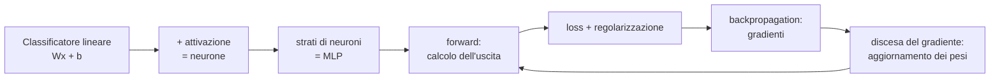
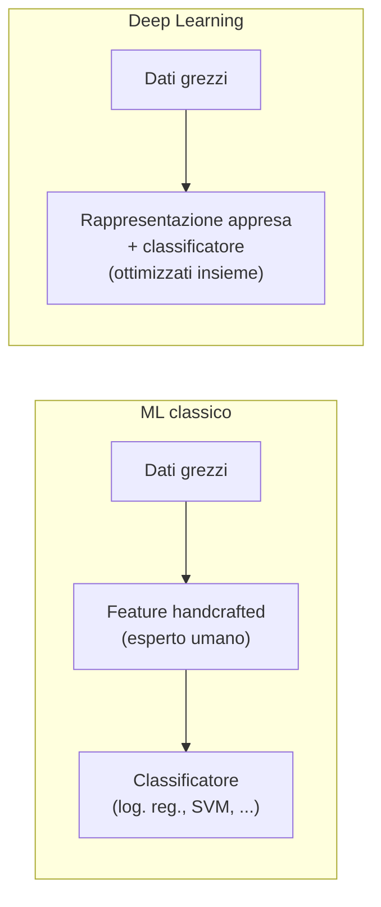
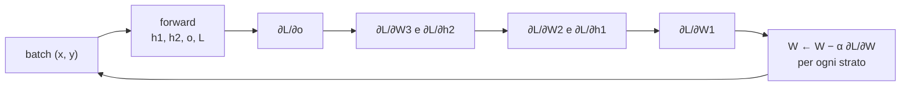

# Multilayer Perceptron (MLP)

**Agenda (slide 2):** Introduzione → Classificatori lineari → Modellare un neurone → Reti neurali → Addestrare una DNN → Regolarizzazione.

---

## 1. Introduzione

### 1.1 Perché studiare il Deep Learning (slide 4)

Gran parte dei risultati dell'IA moderna si fonda su sistemi di deep learning:

- IA generativa e *large language models*;
- IA per la chimica (progettazione di proteine e farmaci);
- la parte di **percezione** della guida autonoma;
- in robotica, i modelli **Vision-Language-Action (VLA)**, che uniscono interpretazione del linguaggio, percezione e decisione per muovere il robot.

Questi sistemi sono in larga parte **indipendenti dall'applicazione**. Come in tutto il machine learning, una volta che si sa come sono fatti i modelli, come combinarli e come addestrarli, l'applicazione diventa secondaria: si prendono i dati del dominio e, se il modello è ben progettato, funziona.

Molte "novità" sono in realtà un **rebranding** di tecniche di 10–15 anni fa: i *world models* sono in sostanza autoencoder (li vedremo nel corso) e gli LLM come GPT sono il *decoder* del Transformer. Quello che va padroneggiato è il machine learning che sta sotto, non l'etichetta applicativa.

### 1.2 Le reti neurali non sono nuove: tre ondate (slide 5)

| Periodo | Cosa succede |
|---|---|
| **1940–1960** | Teorie di apprendimento ispirate alla biologia; primi modelli pionieristici come il **perceptron**. Per la prima volta si addestra un singolo neurone. |
| **1980–1990** | Reti con un paio di strati nascosti addestrate con **backpropagation** (1986). |
| **2006–oggi** | Ondata attuale di ricerca. |

Negli anni '80 le reti si scontrarono con due limiti: **mancava la potenza di calcolo** e **mancavano i dati**, e le reti neurali sono modelli molto *data hungry*.

### 1.3 Perché proprio ora? (slide 6–9)

Le idee di base esistevano da tempo, ma le prestazioni sono esplose solo di recente grazie a fattori complementari:

- grandi dataset etichettati;
- potenza di calcolo;
- addestramento su **GPU** (eventualmente distribuito).

La crescita della scala dei dati è stata più che lineare, quasi esponenziale:

- **2003** (Fergus, Perona, Zisserman): un dataset "grande" contava **fino a 400 immagini** (slide 7);
- **2017** (YouTube-BoundingBoxes, Real et al.): **240.000 video**, 5,6 milioni di bounding box e 10,5 milioni di annotazioni umane (slide 8).

Il grafico di Andrew Ng (slide 9) riassume il punto:

- con pochi dati, gli algoritmi classici e il deep learning si equivalgono;
- aumentando i dati, gli algoritmi classici raggiungono un **plateau**, mentre il deep learning **continua a migliorare**.

Per questo la "magia" di sistemi come GPT non è stata tecnica: si è presa un'architettura già esistente (il Transformer, 2017) e la si è riempita con un'enorme quantità di dati.

### 1.4 Il problema della rappresentazione dei dati (slide 10)

Le prestazioni di un algoritmo di ML dipendono fortemente da **come rappresentiamo i dati**. Le **feature** sono i pezzi discreti d'informazione che usiamo come *proxy* per modellare la complessità del mondo. Per molto tempo sono state **progettate a mano** (*handcrafted*), in modo diverso per ogni compito. Il deep learning invece **impara la rappresentazione direttamente dai dati**.

**Perché le feature fissate impongono un tetto.** Supponiamo di classificare immagini usando come unica feature il **colore medio**. Non si raggiungerà mai il 100% di accuratezza, qualunque classificatore e qualunque quantità di dati si usi: la feature è troppo povera. Fissare le feature significa fissare implicitamente anche un **tetto alle prestazioni** (*performance cap*): le feature sono il "carburante" del sistema di ML.

**Cosa cambia con il deep learning.** Una rete neurale risolve **contemporaneamente due problemi**:

1. partendo dal dato il più grezzo possibile, **estrae una rappresentazione** adatta al problema;
2. su questa rappresentazione, **costruisce il classificatore**.

I due problemi sono accoppiati: la rappresentazione appresa è quella più utile per minimizzare la loss. Se le feature possono cambiare, all'aumentare dei dati la rete impara feature sempre più espressive e può migliorare le prestazioni, senza garantirne la convergenza al 100%. È questa la spiegazione della curva blu della slide 9.

> [!warning] Il prezzo da pagare: la perdita di controllo
> La rete rappresenta il mondo con feature scelte **per risolvere la loss**, non secondo le nostre categorie. Per queste feature **non abbiamo un nome**, e ciò che non si può nominare non si può davvero capire. Si possono estrarre dal modello spiegazioni o regole, ma il "carburante" resta privo di significato per un essere umano. L'idea che si possano comprendere fino in fondo le rappresentazioni interne di un modello profondo è quindi falsa. (Annotazione slide 9: *"il prezzo da pagare è la mancanza di feature [interpretabili], quindi il controllo"*.)

---

## 2. Un passo indietro: i classificatori lineari

Un **classificatore lineare** è un classificatore in cui la mappa è affine nell’input a parametri fissati e affine nei parametri a input fissato, ma non congiuntamente lineare nelle due variabili: calcola una **somma pesata** degli input. In 2D separa gli oggetti con una retta; in più dimensioni con un piano o un iperpiano. Conviene ripartire da qui perché **una rete neurale è una collezione di classificatori lineari**, ed è sorprendente che basti combinarli per ottenere modelli così potenti.

### 2.1 Formalizzazione (slide 12–14)

Ci concentriamo sulla **classificazione di immagini**. Il training set contiene $N$ immagini:

$$
x_i \in \mathbb{R}^D,\quad i = 1,\dots,N, \qquad (x_i, y_i),\; y_i \in \{1,\dots,K\}
$$

L'obiettivo è una funzione $f:\mathbb{R}^D \to \mathbb{R}^K$ che associa a ogni immagine **un punteggio (score) per ciascuna classe**; la classe predetta è quella con lo score più alto. La mappa lineare è:

$$
\boxed{f(x_i, W, b) = W x_i + b}
$$

**Esempio CIFAR-10 (slide 13–14).** Il dataset contiene $N = 60\,000$ immagini RGB $32\times32$ divise in $K = 10$ classi.

Ogni immagine ha 3 canali (R, G, B) e va "srotolata" in un vettore colonna:

$$
D = 32 \times 32 \times 3 = 3072 \;\Rightarrow\; x_i \in \mathbb{R}^{3072}
$$

- $W \in \mathbb{R}^{10\times3072}$ è la **matrice dei pesi**: una riga per classe, cioè 10 righe da 3072 coefficienti. Ogni riga contiene i parametri che producono lo score di una classe.
- $b \in \mathbb{R}^{10}$ è il **vettore dei bias**.
- $Wx_i + b \in \mathbb{R}^{10}$ contiene i 10 score.

Si vuole imparare $W, b$ dal training set in modo che, per una nuova immagine $x^{test}$, **lo score della classe corretta sia più alto degli score delle altre classi**.

**Il bias.** Se i dati non sono centrati nell'origine, il bias permette di **traslare** l'iperpiano di separazione. È importante, ma non cambia la sostanza matematica: si può sempre **assorbire nei dati**. Basta aggiungere a $x$ una componente costante pari a 1 e a $W$ una colonna con i bias:

$$
Wx + b = \begin{bmatrix} W & b \end{bmatrix}\begin{bmatrix} x \\ 1 \end{bmatrix} = W'x'
$$

### 2.2 Esempio numerico (slide 15)

È la stessa formula $f(x) = Wx + b$ del caso CIFAR-10, ma in miniatura, così i conti si fanno a mano: un'immagine di **4 pixel in scala di grigi** ($D = 4$) e **3 classi**, gatto, cane e nave ($K = 3$).

**Passo 1: l'immagine diventa un vettore.** L'immagine è $2\times2$ e ogni pixel è un'intensità di grigio tra 0 (nero) e 255 (bianco). La si "stira" in una colonna (*stretch pixels into single column*):

$$
\begin{bmatrix}56 & 231\\ 24 & 2\end{bmatrix} \;\longrightarrow\; x = \begin{bmatrix}56\\231\\24\\2\end{bmatrix} \in \mathbb{R}^4
$$

**Passo 2: i parametri.** $W$ ha **una riga per classe** e **una colonna per pixel**, quindi è $3\times4$. La riga $k$ dice quanto conta ciascun pixel per la classe $k$:

- un peso positivo significa "se questo pixel è chiaro, lo score della classe sale";
- un peso negativo significa il contrario.

Il bias $b$ aggiunge un valore fisso per ogni classe.

$$
W = \begin{bmatrix} 0.2 & -0.5 & 0.1 & 2.0 \\ 1.5 & 1.3 & 2.1 & 0.0 \\ 0 & 0.25 & 0.2 & -0.3 \end{bmatrix}\begin{matrix}\leftarrow \text{gatto}\\ \leftarrow \text{cane}\\ \leftarrow \text{nave}\end{matrix}
\qquad
b = \begin{bmatrix}1.1\\3.2\\-1.2\end{bmatrix}
$$

**Passo 3: uno score per classe.** Ogni score è il **prodotto scalare** tra la riga della classe e $x$ (pixel per peso, poi somma), più il bias della classe:

$$
s_k = \sum_{j=1}^{4} W_{kj}\,x_j + b_k
$$

| Classe | pixel 1 (56) | pixel 2 (231) | pixel 3 (24) | pixel 4 (2) | somma | + bias | **score** |
|---|---|---|---|---|---|---|---|
| gatto | $0.2\cdot56 = 11.2$ | $-0.5\cdot231 = -115.5$ | $0.1\cdot24 = 2.4$ | $2.0\cdot2 = 4.0$ | $-97.9$ | $+1.1$ | **−96.8** |
| cane | $1.5\cdot56 = 84.0$ | $1.3\cdot231 = 300.3$ | $2.1\cdot24 = 50.4$ | $0.0\cdot2 = 0$ | $434.7$ | $+3.2$ | **437.9** |
| nave | $0\cdot56 = 0$ | $0.25\cdot231 = 57.75$ | $0.2\cdot24 = 4.8$ | $-0.3\cdot2 = -0.6$ | $61.95$ | $-1.2$ | **60.75** |

In forma matriciale sono le tre righe dello stesso prodotto: $Wx + b = [-96.8,\ 437.9,\ 60.75]^T$.

**Passo 4: la predizione.** Vince la classe con lo score più alto, cioè **cane**. L'immagine però è un gatto: la predizione è **sbagliata**, perché i pesi sono arbitrari e non addestrati. Addestrare il classificatore significa proprio **modificare $W$ e $b$** finché, per le immagini di gatto, è la riga "gatto" a dare lo score più alto.

Il pixel 2 (231) è molto chiaro: la riga "cane" gli assegna un peso positivo alto (1.3), la riga "gatto" un peso negativo (−0.5). Da solo, questo pixel sposta gli score di centinaia di punti.

> [!bug] Errata slide 15
> La slide riporta $s_{ship} = 61.95$, che è il valore di $w_3^T x$ **senza** il bias $-1.2$. Il valore corretto è **60.75**. Gli altri due score sono corretti.

**Cosa c'è di sbagliato in questi score?** **Non sono normalizzati.** $437.9$ è un valore alto o basso? Non si può dire: gli score vivono in $(-\infty, +\infty)$, non sommano a 1 e non hanno una scala di riferimento. Serve una funzione che li trasformi in quantità confrontabili, come nella regressione logistica.

### 2.3 Regressione logistica e binary cross-entropy (slide 16–17)

Aggiungendo una non linearità sigmoide alla mappa lineare si ottiene la **regressione logistica**:

$$
f(x_i, W, b) = \sigma(Wx_i + b), \qquad \sigma(x) = \frac{1}{1+e^{-x}}
$$

La si addestra minimizzando la **binary cross-entropy** su $m$ esempi, dove $f_{x_i}$ indica $f(x_i,W,b)$:

$$
\boxed{\mathcal{L}(W,b) = -\frac{1}{m}\sum_{i=1}^{m}\Big( y_i \log f_{x_i} + (1-y_i)\log(1-f_{x_i}) \Big), \qquad y_i\in\{0,1\}}
$$

L'etichetta $y_i$ fa da **selettore**:

- se $y_i = 1$, il secondo termine si annulla ($1-y_i = 0$) e resta $-\log f_{x_i}$. Vale 0 se $f_{x_i} = 1$ e tende a $+\infty$ se $f_{x_i}\to 0$: **penalizza le predizioni vicine a 0**;
- se $y_i = 0$, il primo termine si annulla e resta $-\log(1-f_{x_i})$, che **penalizza le predizioni vicine a 1**.

In pratica si prende lo score che il modello assegna alla classe giusta e lo si vuole **alzare**, cioè si vuole abbassare il suo $-\log$.

### 2.4 Classificatore Softmax (slide 18–19)

Il **classificatore Softmax** generalizza la regressione logistica al caso multiclasse. La funzione softmax prende un vettore $z$ di score reali arbitrari e lo "schiaccia" in valori tra 0 e 1 che sommano a 1:

$$
\boxed{\text{softmax}_j(z) = \frac{e^{z_j}}{\sum_{k=1}^{K} e^{z_k}}}
$$

**Calcolo passo passo dell'esempio della slide 18**, con $z = [1.2,\ 5.1,\ 2.7]$:

| | $z_j$ | $e^{z_j}$ | $e^{z_j} / \sum_k e^{z_k}$ |
|---|---|---|---|
| classe 1 | 1.2 | 3.32 | **0.018** |
| classe 2 | 5.1 | 164.02 | **0.900** |
| classe 3 | 2.7 | 14.88 | **0.082** |
| somma | | 182.22 | 1 |

Rispetto alla regressione logistica multiclasse vista nel corso precedente, che modellava $K-1$ classi e ricavava la $K$-esima per complemento, qui si tratta **allo stesso modo tutte le $K$ classi**: esponenziale di ogni score, diviso la somma di tutti gli esponenziali. Si usa un insieme di parametri in più, ma la formulazione è più semplice.

**La softmax produce una distribuzione di probabilità del modello:** ogni componente è positiva e la somma è 1. Questo non garantisce che i valori coincidano con le frequenze reali delle classi. Non è una soglia rigida e non spinge necessariamente il massimo vicino a 1: score tutti uguali producono $1/K$ per classe. Le differenze fra score, non i loro rapporti, determinano i rapporti tra probabilità.

Il motivo sta nell'esponenziale: il rapporto tra due uscite dipende dalla **differenza** degli score, non dal loro rapporto:

$$
\frac{\text{softmax}_2}{\text{softmax}_3} = \frac{e^{5.1}}{e^{2.7}} = e^{5.1-2.7} = e^{2.4} \approx 11
$$

L'annotazione «stiamo semplicemente applicando una soglia» va intesa come analogia con una decisione morbida. La decisione discreta avviene dopo, scegliendo $\arg\max_j p_j$ (oppure confrontando una probabilità binaria con una soglia). La calibrazione riguarda l'attendibilità delle probabilità, non la loro validità matematica.

Nel classificatore softmax gli score $f(x_i,W) = Wx_i$ sono interpretati come **log-probabilità non normalizzate**, e lo si addestra con la **cross-entropy**:

$$
\mathcal{L} = -\sum_{k} y^{true}_{k}\,\log\big(y^{pred}_{k}\big)
$$

dove $y^{true}$ è la distribuzione vera (un vettore **one-hot** che seleziona la classe corretta) e $y^{pred} = \text{softmax}(f)$. La forma esplicita per il singolo esempio è derivata in §7.2.

> [!bug] Errata slide 18–19
> Nella slide 18 il denominatore è scritto $\sum_k e^{z_j}$: l'indice corretto è $\sum_k e^{z_k}$. Nella slide 19 manca il segno **meno** davanti alla cross-entropy.

**Riepilogo:**

$$
\underbrace{Wx+b}_{\text{classificatore lineare}} \;+\; \text{softmax} \;+\; \text{cross-entropy} \;+\; \text{discesa del gradiente} \;=\; \textbf{regressione logistica}
$$

---

## 3. Modellare un neurone

### 3.1 Il neurone biologico (slide 21)

Le reti neurali sono un modello matematico **ispirato in modo grossolano** (*coarsely*) al funzionamento del cervello. Il neurone ne è l'unità computazionale di base: ne abbiamo circa **86 miliardi**, collegati da circa $10^{14}$–$10^{15}$ **sinapsi**. Ogni neurone riceve segnali dai **dendriti** e produce l'uscita lungo il suo (unico) **assone**, che si ramifica e si collega tramite sinapsi ai dendriti di altri neuroni.

L'analogia utile associa la forza delle connessioni ai pesi, la combinazione dei segnali alla somma pesata e la risposta del neurone all'attivazione. Non è una descrizione fisiologica letterale: in particolare l'immagine di una sinapsi «dura o morbida» è soltanto una metafora della modulazione del segnale. Il neurone biologico ha una dinamica temporale che questa mappa statica non rappresenta.

### 3.2 Il neurone artificiale (slide 22–23)

La traduzione in matematica è uno a uno:

| Biologia | Matematica |
|---|---|
| Dendriti (ingressi) | input $x_i$ |
| Sinapsi (amplifica/attenua) | moltiplicazione per un peso $w_i$ (grande o piccolo) |
| Cellula (mette insieme i segnali) | **somma**: $\sum_i w_i x_i + b$ |
| Soglia di accensione | **funzione di attivazione** $f(\cdot)$ |
| Assone (uscita) | $y = f\big(\sum_i w_i x_i + b\big)$ |

Un neurone può avere più ingressi. La sua uscita è il **prodotto scalare tra ingressi e pesi, più il bias, a cui si applica una non linearità**:

$$
\boxed{y = f\!\left(w^T x + b\right)}
$$

È il **perceptron** di McCulloch e Pitts (anni '40).

> [!important] Neurone = regressione logistica (slide 23)
> Una combinazione affine seguita dalla **sigmoide** definisce il modello di regressione logistica binaria. Se il neurone usa la sigmoide ed è addestrato con la binary cross-entropy tramite discesa del gradiente, gli ingredienti sono gli stessi, al 100%: stesse equazioni, quindi stesso modello.
>
> **Il grado di libertà in più:** nulla impone che la funzione di sogliatura sia la sigmoide o la softmax, se ne può usare qualunque. Prende il nome di **funzione di attivazione** perché stabilisce se il neurone è attivo (acceso) oppure no.

### 3.3 Funzioni di attivazione (slide 24–26)

Le funzioni di attivazione sono **funzioni non lineari** calcolate sull'uscita di ogni neurone. Le più usate storicamente sono **sigmoide, tanh e ReLU**; ne esistono anche di più complesse.

Nel deep learning il successo dipende dai **dettagli**. Progettare una rete si fa in un pomeriggio, farla addestrare è un'altra storia. Molto spesso il problema non è di progetto ma **tecnico**:

- la saturazione del gradiente;
- **neuroni che non si attivano mai**;
- il **gradiente che svanisce** perché la rete è troppo profonda.

Le attivazioni sono il primo di questi dettagli.

#### Sigmoide

$$
\boxed{\sigma(x) = \frac{1}{1+e^{-x}} = \frac{e^{x}}{1+e^{x}} \in (0,1)}
$$

La seconda forma si ottiene moltiplicando numeratore e denominatore per $e^x$ ed è quella della regressione logistica. La curva ha la forma a "S" di una soglia morbida: sopra la soglia spinge verso 1, sotto verso 0.

**La derivata, passo passo.** Serve per capire il secondo difetto della sigmoide.

1. Si riscrive $\sigma(x) = (1+e^{-x})^{-1}$.
2. Si deriva con la regola della catena, dove la funzione esterna è $u^{-1}$ e quella interna è $u = 1+e^{-x}$:
$$\sigma'(x) = -(1+e^{-x})^{-2}\cdot\frac{d}{dx}(1+e^{-x}) = -(1+e^{-x})^{-2}\cdot(-e^{-x}) = \frac{e^{-x}}{(1+e^{-x})^2}$$
3. Si spezza la frazione in due fattori:
$$\sigma'(x) = \frac{1}{1+e^{-x}}\cdot\frac{e^{-x}}{1+e^{-x}}$$
4. Si riconosce che il secondo fattore è $1-\sigma(x)$:
$$\frac{e^{-x}}{1+e^{-x}} = \frac{(1+e^{-x})-1}{1+e^{-x}} = 1-\frac{1}{1+e^{-x}} = 1-\sigma(x)$$
5. Quindi:
$$\boxed{\sigma'(x) = \sigma(x)\big(1-\sigma(x)\big)}$$

| $x$ | 0 | 2 | 4 | 5 | 10 | 100 |
|---|---|---|---|---|---|---|
| $\sigma(x)$ | 0.5 | 0.881 | 0.982 | 0.993 | 0.99995 | ≈ 1 |
| $\sigma'(x)$ | **0.25** | 0.105 | 0.018 | 0.0066 | 0.00005 | ≈ 0 |

Il massimo della derivata è $0.25$, in $x = 0$. Già per $|x| \gtrsim 4$ la derivata è praticamente nulla: sono le zone esterne alle due linee verticali disegnate sulla slide 24.

La sigmoide è meno usata negli strati nascosti profondi, per **due difetti** (slide 24).

**1. Non è centrata sullo zero.** Le uscite della sigmoide sono positive e valgono 0.5 quando la preattivazione è zero. Questa asimmetria può influenzare la dinamica dell’ottimizzazione; non è una contraddizione biologica del modello matematico.

**2. Saturazione.** Negli strati nascosti una derivata piccola può attenuare il segnale di apprendimento.

Con la BCE e $p=\sigma(z)$, la regola della catena dà
$$
\begin{aligned}
\frac{\partial L}{\partial z}
&=\left(-\frac{y}{p}+\frac{1-y}{1-p}\right)p(1-p)\\
&=-y(1-p)+(1-y)p=p-y.
\end{aligned}
$$
Per $z=5$ e $y=1$ vale circa $-0.0067$; per $z=100$ è estremamente vicino a zero perché la predizione è corretta e molto sicura. Con lo stesso $z$ ma $y=0$ il gradiente è invece vicino a 1. Non esiste una soglia finita oltre la quale il gradiente della BCE sia sempre nullo: l'arrotondamento numerico va distinto dal limite matematico.

Negli strati nascosti ogni sigmoide introduce il fattore $\sigma'(z)\leq1/4$, ma compaiono anche le matrici dei pesi. Il contributo delle sole attivazioni lungo dieci strati è al più $4^{-10}\approx9.54\cdot10^{-7}$; non è un limite sull'intero gradiente senza ulteriori ipotesi sui pesi.

La saturazione rende difficile trasmettere gradienti attraverso molte attivazioni sigmoidi. È una difficoltà di ottimizzazione e va distinta dall’errore piccolo di una predizione già corretta.

#### Tangente iperbolica (tanh)

Per risolvere la mancata centratura si riscalano l’argomento e l’uscita della sigmoide e si sottrae 1, così che in 0 valga 0:

$$
\boxed{\tanh(x) = \frac{e^{x}-e^{-x}}{e^{x}+e^{-x}} = 2\sigma(2x) - 1 \in (-1, 1)}, \qquad \tanh(0) = 0
$$

**Verifica dell'identità, passo passo:**

$$
2\sigma(2x)-1 = \frac{2}{1+e^{-2x}} - 1 = \frac{2-(1+e^{-2x})}{1+e^{-2x}} = \frac{1-e^{-2x}}{1+e^{-2x}} \overset{\cdot\, e^{x}/e^{x}}{=} \frac{e^{x}-e^{-x}}{e^{x}+e^{-x}} = \tanh(x)
$$

L'uscita è **centrata sullo zero**, ma la funzione **satura ancora**: la sua derivata $1-\tanh^2(x)$ vale al massimo 1 in $x=0$ e tende a 0 per $|x|$ grande. La tanh risolve il primo difetto della sigmoide, non il secondo.

> [!bug] Errata slide 25
> La slide scrive $\tanh(x) = 2\sigma(x) - 1$. L'identità esatta è $\tanh(x) = 2\sigma(2x) - 1$ (con $2\sigma(x)-1$ si ottiene $\tanh(x/2)$; per $x = 0.7$: $\tanh(0.7) = 0.604$, mentre $2\sigma(0.7)-1 = 0.336$). Il concetto non cambia: è una sigmoide riscalata e centrata.

#### ReLU (Rectified Linear Unit)

$$
\boxed{\text{ReLU}(x) = \max(0, x)}, \qquad \frac{d}{dx}\text{ReLU}(x) = \begin{cases}1 & x>0\\ 0 & x<0\end{cases}
$$

La ReLU evita la saturazione sul semiasse positivo:

- nel **semipiano sinistro** il neurone è **spento** (uscita 0);
- nel **semipiano destro** il neurone **copia** l'ingresso.

Proprietà principali:

- **Non satura verso l'alto.** Per $x>0$ la derivata è 1: questo fattore non attenua il gradiente. I pesi degli altri strati possono comunque amplificarlo o ridurlo, quindi non è una garanzia contro ogni problema di gradiente.

> [!note] Precisazione
> La ReLU è **continua** in 0 ma **non derivabile** in 0 (spigolo). La non linearità deriva dallo spigolo, non da una discontinuità. In pratica in $x = 0$ si usa per convenzione derivata 0.

### 3.4 Perché servono le non linearità (slide 27)

Viene spontaneo chiedersi perché non togliere l'attivazione e usare solo $Wx$: non satura ed è centrata sullo zero. Il problema è che **la composizione di funzioni lineari è lineare**.

1. Con due strati e attivazioni la rete è $f(x) = \phi\big(W_2\,\phi(W_1 x)\big)$.
2. Si tolgono le attivazioni: $f(x) = W_2 (W_1 x)$.
3. Per l'associatività del prodotto matriciale, $W_2 (W_1 x) = (W_2 W_1)x$.
4. $W_2 W_1$ è **un'unica matrice**: con $W_1\in\mathbb{R}^{H\times D}$ e $W_2\in\mathbb{R}^{K\times H}$, si ha $W = W_2W_1 \in \mathbb{R}^{K\times D}$. Quindi $f(x) = Wx$.

Qualunque sia il numero di strati, senza attivazioni tutta la rete **collassa in un singolo strato lineare**, cioè in una mappa affine se sono presenti bias. Si ottiene regressione logistica solo conservando una sigmoide o softmax finale. Le attivazioni, essendo non lineari (ReLU compresa), **impediscono questa fattorizzazione**: sono loro a dare senso alla profondità.

---

## 4. Reti neurali: il Multilayer Perceptron

### 4.1 Struttura a strati (slide 29)

Connettendo un insieme di neuroni in un grafo si ottiene un **Multilayer Perceptron (MLP)**. I neuroni sono organizzati in **strati** (*layer*):

- **input layer**: un cerchio per ogni feature d'ingresso. Sono **cerchi fittizi**: nessun peso, nessuna attivazione, **nessun parametro**;
- **N hidden layer** nel mezzo;
- **output layer**: **un cerchio per ogni classe**, ciascuno dà lo score della sua classe.

Le connessioni sono **fully connected**:

- **nessuna connessione tra neuroni dello stesso strato**;
- ogni neurone di uno strato è connesso a **tutti** i neuroni dello strato successivo;
- ogni connessione è una **sinapsi**, cioè un peso $w$.

**L'equazione di un layer è esattamente il classificatore lineare di §2**, seguito dall'attivazione. La matrice $W$ ha:

- **numero di colonne = numero di feature in ingresso** (*inbound*);
- **numero di righe = numero di feature in uscita** (*outbound*, cioè i neuroni dello strato).

Ogni neurone ha la sua funzione di attivazione. Nella figura ogni neurone del primo hidden layer riceve 6 pesi e produce un valore, quindi $W_1$ ha 6 colonne e 4 righe.

### 4.2 Esercizio: da dove vengono i 47 parametri?

Ogni cerchio rappresenta una combinazione affine $w^Tx+b$ seguita da un’attivazione: ogni neurone non di input ha **un peso per ogni ingresso più un bias**. Il conteggio $6\cdot4 + 4\cdot3 + 3\cdot1 = 39$ dimentica proprio i bias.

| Strato | Pesi | Bias | Totale |
|---|---|---|---|
| Input (6) | – | – | 0 |
| Hidden 1 (4) | $4\times6 = 24$ | 4 | 28 |
| Hidden 2 (3) | $3\times4 = 12$ | 3 | 15 |
| Output (1) | $1\times3 = 3$ | 1 | 4 |
| **Totale** | **39** | **8** | **47** |

In generale, uno strato con $d$ ingressi e $k$ neuroni ha $k\cdot d + k = k(d+1)$ parametri. Questi conteggi vanno avuti perfettamente chiari, perché le architetture cresceranno molto rapidamente.

### 4.3 Forward propagation (slide 30–31)

La rete a 4 strati della figura si scrive così, con i bias incorporati nelle matrici $W$ per alleggerire la notazione:

$$
\boxed{\text{out} = \phi\Big(W_3\,\phi\big(W_2\,\phi(W_1 x)\big)\Big)}
$$

con $x \in \mathbb{R}^6$, $W_1 \in \mathbb{R}^{4\times6}$, $W_2 \in \mathbb{R}^{3\times4}$, $W_3 \in \mathbb{R}^{1\times3}$. Esplicitando i bias, strato per strato:

| Passo | Calcolo | Forma |
|---|---|---|
| 1 | $h_1 = \phi(W_1x + b_1)$ | $(4\times6)(6) + (4) \to 4$ |
| 2 | $h_2 = \phi(W_2h_1 + b_2)$ | $(3\times4)(4) + (3) \to 3$ |
| 3 | $\text{out} = \phi(W_3h_2 + b_3)$ | $(1\times3)(3) + (1) \to 1$ |

> [!bug] Errata slide 30
> La slide chiama tutte le matrici $W_1$ e indica $W_2\in\mathbb{R}^{4\times3}$. Seguendo la regola "righe = outbound, colonne = inbound", le dimensioni corrette sono **$W_2 \in \mathbb{R}^{3\times4}$** e **$W_3 \in \mathbb{R}^{1\times3}$**.

La **forward propagation** è il calcolo dell'uscita della rete dato l'ingresso. Si chiama *forward* perché segue il flusso dell'informazione **dall'input verso la risposta**, ad esempio dall'immagine alla sua classe.

Una rete neurale è quindi una **composizione non lineare di tante unità lineari**, cioè una grande composizione di funzioni.

Le equazioni rendono esplicito il calcolo della rete. Questo non rende automaticamente interpretabili le rappresentazioni apprese: conoscere le operazioni e attribuire un significato semantico a ogni feature sono problemi distinti.

---

## 5. Potere rappresentazionale

Nella formula compatta senza bias questi sono **omessi**, non incorporati nelle matrici delle dimensioni riportate. Per incorporarli bisogna aumentare l'ingresso di una componente costante e aggiungere una colonna a ogni matrice: $[W\ b][h^T\ 1]^T=Wh+b$.

### 5.1 Il teorema di approssimazione universale (slide 32)

Una rete è fatta solo di prodotti scalari, somme e soglie. Che percentuale di "tutte le funzioni del mondo", anche quelle non ancora scoperte, può rappresentare?

> [!abstract] Teorema di approssimazione universale (slide 32)
> Siano $K\subset\mathbb{R}^d$ compatto e $f:K\to\mathbb{R}$ continua. Con un'attivazione adatta, per esempio sigmoide, per ogni $\epsilon>0$ esiste una rete con uno strato nascosto sufficientemente ampio tale che
> $$\boxed{\sup_{x\in K}|f(x)-g(x)|<\epsilon.}$$
> Una forma della rete è $g(x)=\sum_{j=1}^{m}a_j\sigma(w_j^Tx+b_j)+c$, con $w_j\in\mathbb{R}^d$ e gli altri coefficienti scalari.

La precisione è uniforme su $K$: vale per ogni suo punto, non soltanto in media sui campioni. Il numero $m$ può dipendere dalla funzione e dalla precisione richiesta. L'enunciato non promette un'approssimazione uniforme sull'intero spazio non limitato, né dice che qualunque attivazione o qualunque rete piccola siano sufficienti. Non permette di dedurre la prevedibilità di fenomeni casuali o l'esistenza di informazioni assenti dall'input.

Per esempio, approssimare una funzione su $[0,1]$ con errore inferiore a $0.01$ significa mantenere tutta la curva della rete nella fascia verticale $f(x)\pm0.01$. È una proprietà di rappresentazione, non un algoritmo per trovare i pesi.

**Rappresentare non significa imparare bene.** Il teorema dice che lo strumento *può* rappresentare la funzione, non che la imparerà. È come chiedersi "sei fisicamente in grado di giocare a calcio?": sì. "Sei un buon giocatore?": dipende dall'allenamento. Il teorema riguarda la **rappresentazione**, non la **performance**.

### 5.2 Dalla teoria alla pratica

Passando dalla matematica al computer si introducono approssimazioni:

1. nel computer funzioni e numeri **non sono continui ma discreti** (precisione finita);
2. anche le **misure** degli strumenti sono discrete (risoluzione finita).

Una capacità sufficiente permette di rappresentare relazioni complesse; più profondità può rappresentarle in modo più efficiente. Aumentare la dimensione, però, non garantisce prestazioni migliori: contano dati, ottimizzazione e regolarizzazione. La precisione finita non dimostra che una rete più grande sia sempre preferibile.

---

## 6. Iperparametri e overfitting

### 6.1 Iperparametri dell'architettura (slide 33)

Numero di layer e numero di neuroni per layer sono **iperparametri** dell'architettura:

- aumentarli fa **crescere la capacità** della rete, cioè lo spazio delle funzioni rappresentabili (**bene**);
- reti più grandi **senza regolarizzazione** sono molto più inclini all'**overfitting** (**male**).

### 6.2 Perché le reti tendono a fare overfitting

Durante l'addestramento si dà alla rete solo una **loss** da ottimizzare sul training set, chiedendole di risolverla al meglio. Con molti parametri la rete ha **molti "posti" in cui memorizzare il training set**: questo è l'overfitting.

La sovraparametrizzazione rende possibile memorizzare il training set, ma non implica necessariamente overfitting. Il problema è una discrepanza tra buone prestazioni di training e prestazioni peggiori su dati nuovi: si valuta con un insieme di validazione indipendente.

L’overfitting è una causa di scarsa generalizzazione anche quando il training è ben ottimizzato e va tenuto sempre presente.

**Riga superiore (slide 34).** Rete a 3 layer che separa punti rossi e verdi, al variare del numero di neuroni nascosti:

- **3 neuroni**: superficie non lineare ma regolare;
- **6 neuroni**: compaiono forme irregolari;
- **20 neuroni**: superficie molto irregolare, con zone rosse attorno a singoli punti che probabilmente sarebbero verdi. Aumentando ancora, la rete finirebbe per **disegnare un cerchio attorno a ogni punto**.

Una frontiera molto irregolare può suggerire overfitting, che va verificato su dati indipendenti. E 20 neuroni sono pochissimi.

**Regola pratica (slide 34).** Le reti si fanno **grandi quanto consente il budget computazionale**, e poi si previene l'overfitting con opportune **tecniche di regolarizzazione** (dropout, weight decay, input noise…), viste in §7.4 e §10.

---

## 7. Addestrare una rete: funzione obiettivo e loss

### 7.1 La funzione obiettivo (slide 36)

Con l'architettura si è definita una **funzione parametrica**, la forward propagation. Ora serve una procedura per **imparare i parametri**, esattamente come per qualunque modello parametrico di ML: si definisce una loss e la si minimizza.

La loss deve essere un **surrogato continuo** del problema da risolvere: cross-entropy per la classificazione, MSE per la regressione, ecc. Valgono tutte le considerazioni di ML già viste: **l'ipotesi i.i.d.**, il modo di campionare i dati, la **partizione training/test**, la variabilità del training set.

La funzione obiettivo misura la **qualità della mappatura** input → output e ha due termini:

$$
\boxed{\mathcal{L}(\theta; x, y) = \underbrace{\frac{1}{N}\sum_{i=1}^{N} L_i(\theta; x_i, y_i)}_{\text{data term}} + \underbrace{\lambda\,\Omega(\theta)}_{\text{regularization term}}}
$$

| Simbolo | Significato |
|---|---|
| $N$ | numero di esempi di training |
| $\theta$ | insieme di **tutti** i parametri della rete: $\{W_1, b_1, W_2, b_2, \dots\}$ |
| $L_i$ | loss del singolo esempio $i$ |
| $\Omega(\theta)$ | regolarizzatore |
| $\lambda \ge 0$ | **forza** della regolarizzazione |

- **Data term.** Dipende dai **parametri**, dagli **input** e dalla **ground truth**. È una media sugli esempi e misura quanto sono buone le predizioni rispetto alle etichette; dipende dal problema (classificazione o regressione).
- **Regularization term.** Dipende **solo dai parametri**: non dall'input, non dall'output, non dalla bontà delle predizioni. Impone un **vincolo strutturale** sui pesi: chiede di risolvere il problema **usando i parametri il meno possibile**, e così riduce il rischio di overfitting.

### 7.2 Le loss più usate (slide 37)

Le funzioni di loss sono moltissime, ma circa il 90% dei problemi usa quelle della slide 37. La maggior parte delle loss moderne sono loro **piccole modifiche**.

Notazione: $f = f(x_i;\theta) \in \mathbb{R}^K$ è il vettore degli score prodotti dalla rete per l'esempio $i$, $f_j$ lo score della classe $j$, $y_i$ l'indice della classe corretta.

#### Hinge loss (classificazione)

$$
\boxed{L_i = \sum_{j\neq y_i}\max\big(0,\; f_j - f_{y_i} + 1\big)}
$$

È la loss della **SVM lineare** (algoritmo *Pegasos*). Si chiede al classificatore non solo di classificare correttamente, ma di farlo con un **margine**: lo score della classe corretta deve superare quello di **ogni** altra classe di almeno 1.

**Come funziona, passo passo.** Per ogni classe sbagliata $j$:

1. si calcola $f_j - f_{y_i} + 1$;
2. se $f_{y_i} \ge f_j + 1$, cioè la classe giusta batte la $j$ con margine almeno 1, la quantità è $\le 0$ e il $\max$ restituisce **0: nessuna penalità**;
3. altrimenti la quantità è positiva e si **paga una penalità proporzionale** a quanto manca per raggiungere il margine;
4. si sommano i contributi di tutte le classi sbagliate.

(Annotazione slide 37: *"se è negativo non paghiamo penalità; se $f_j - f_{y_i}$ è minore di −1 allora stiamo facendo bene, altrimenti pagheremo una penalità"*.)

**Esempio con gli score della slide 15**, $f = [-96.8,\ 437.9,\ 60.75]$ (gatto, cane, nave):

| Classe vera | Termini della somma | $L_i$ |
|---|---|---|
| gatto | $\max(0,\ 437.9+96.8+1) + \max(0,\ 60.75+96.8+1) = 535.7 + 158.55$ | **694.25** |
| cane | $\max(0,\ -96.8-437.9+1) + \max(0,\ 60.75-437.9+1) = 0 + 0$ | **0** |

Se l'immagine è un gatto il classificatore paga molto. Se fosse un cane la loss sarebbe nulla, perché "cane" batte le altre classi con ampio margine.

È la stessa idea del margine della SVM, dove si chiede una distanza minima tra l'iperplano di separazione e le due classi. Qui però il margine non è imposto con un **vincolo**, ma tramite una sua versione "morbida" e linearizzata, il $\max(0,\cdot)$.

**Perché proprio 1?** La riscalatura del margine richiede anche di adattare il peso relativo della regolarizzazione per mantenere lo stesso problema.  Qualunque altro margine $\Delta > 0$ (10, 20, 300…) sarebbe equivalente, perché può essere **assorbito nella norma dei parametri**:

1. moltiplicando per $c > 0$ i pesi e il bias dello strato di uscita (in un classificatore lineare, tutti i parametri), tutti gli score si moltiplicano per $c$: $f \to c f$;
2. quindi anche le differenze si moltiplicano per $c$: $f_{y_i} - f_j \to c\,(f_{y_i} - f_j)$;
3. se dei parametri garantiscono il margine 1, gli stessi parametri con lo strato di uscita moltiplicato per $\Delta$ garantiscono il margine $\Delta$, e viceversa.

Il valore del margine si ottiene quindi semplicemente cambiando la scala dei pesi. È lo stesso passaggio della SVM, dove il margine $2\rho$ veniva riportato a 1 assorbendolo in $w$.

#### Softmax loss / cross-entropy (classificazione)

$$
\boxed{L_i = -\log\left(\frac{e^{f_{y_i}}}{\sum_j e^{f_j}}\right)}
$$

È la loss più usata, ed è **un altro modo di scrivere la cross-entropy** (annotazione slide 37: *"a new way to rewrite cross entropy"*). Prende infatti i nomi di *cross-entropy* o *softmax loss*. Anche GPT usa questa loss, in una forma leggermente diversa.

**Derivazione dalla cross-entropy, passo passo:**

1. Si parte dalla cross-entropy di §2.4: $L_i = -\sum_k y^{true}_k \log y^{pred}_k$.
2. $y^{true}$ è one-hot: vale 1 solo per $k = y_i$ e 0 altrove. La somma fa quindi da **selettore**, come nella BCE, e sopravvive un solo termine: $L_i = -\log y^{pred}_{y_i}$.
3. $y^{pred}$ è la softmax degli score, quindi $y^{pred}_{y_i} = \dfrac{e^{f_{y_i}}}{\sum_j e^{f_j}}$, da cui la formula nel riquadro.
4. Usando $\log(a/b) = \log a - \log b$ e $\log e^{a} = a$ si ottiene una forma equivalente, utile per i calcoli:
$$L_i = -f_{y_i} + \log\sum_j e^{f_j}$$

Minimizzare $-\log(\cdot)$ equivale a **massimizzare** la probabilità (normalizzata) della classe corretta: si prende lo score della risposta giusta e lo si vuole alzare.

**Esempio** con gli score della slide 18, $z = [1.2,\ 5.1,\ 2.7]$ e softmax $[0.018,\ 0.900,\ 0.082]$:

| Classe vera | $L_i = -\log(\text{softmax}_{y_i})$ |
|---|---|
| classe 2 (score più alto) | $-\log 0.900 = 0.105$ |
| classe 3 | $-\log 0.082 = 2.51$ |
| classe 1 (score più basso) | $-\log 0.018 = 4.01$ |

**Il gradiente della softmax loss.** È il termine $\partial L/\partial o$ da cui parte la backpropagation (§8.4). Derivando la forma del passo 4 rispetto al generico score $f_k$:

1. il termine $-f_{y_i}$ ha derivata $-1$ se $k = y_i$ e $0$ altrimenti; si scrive $-\mathbb{1}[k = y_i]$;
2. il termine $\log\sum_j e^{f_j}$ ha derivata $\dfrac{1}{\sum_j e^{f_j}}\cdot e^{f_k}$ (regola della catena: derivata del log per derivata dell'argomento), cioè proprio $\text{softmax}_k(f)$;
3. quindi:
$$\boxed{\frac{\partial L_i}{\partial f_k} = \text{softmax}_k(f) - \mathbb{1}[k = y_i]}$$

Il gradiente è "probabilità predetta meno target": per l'esempio con classe vera 2 vale $[0.018,\ 0.900-1,\ 0.082] = [0.018,\ -0.100,\ 0.082]$. È la stessa forma "predizione − etichetta" della regressione logistica.

#### Mean Squared Error (regressione)

$$
\boxed{L_i = \lVert f - y_i \rVert_2^2 = \sum_k \big(f_k - y_{i,k}\big)^2}
$$

Nella regressione si conoscono coppie di input e output di una funzione, ma non la sua forma né la sua equazione, e la si vuole "indovinare" a meno di una certa approssimazione. Nella regressione lineare la funzione cercata era lineare; con una rete neurale non lo è. La loss più usata, nella sua forma base, è l'errore quadratico: si prende la differenza tra predizione e target e la si eleva al quadrato.

Ad esempio, con predizione $2.5$ e target $2$ si ha $L_i = 0.25$. Il gradiente rispetto alla predizione è $2(f - y_i)$, cioè di nuovo proporzionale all'errore.

> [!note] Le loss dipendono dal compito
> Queste sono le famiglie principali. La funzione obiettivo dipende molto dal compito e spesso la si personalizza, con termini aggiuntivi o una forma adattata alle particolarità del problema.

### 7.3 Imparare i parametri (slide 38)

Durante il training si cerca l'insieme di parametri che **minimizza la funzione obiettivo** (data term + regolarizzazione) sul training set:

$$
\boxed{\theta^* = \arg\min_\theta \left( \frac{1}{N}\sum_i L_i(\theta; x_i, y_i) + \lambda\,\Omega(\theta) \right)}
$$

Lo si fa con la discesa del gradiente, $\theta \leftarrow \theta - \eta\,\nabla_\theta\mathcal{L}$. Serve quindi la derivata della loss rispetto a **ogni** parametro di **ogni** strato, ed è questo il compito della backpropagation (§8).

### 7.4 Regolarizzazione esplicita: $L_2$ e $L_1$ (slide 36)

**Quadrato della norma $L_2$** (equivalente a decadimento dei pesi nella discesa del gradiente semplice):

$$
\Omega(\theta) = \sum_j \theta_j^2, \qquad \frac{\partial\Omega}{\partial\theta_j} = 2\theta_j
$$

È minima quando i parametri sono **nulli o piccoli**. Essendo una funzione liscia, **non forza i parametri a essere esattamente zero, ma li rende piccoli** (*"force to be near to 0"*). Pesi molto grandi producono funzioni oscillanti e sensibili a minime variazioni dell'input; pesi piccoli favoriscono funzioni **più lisce e generalizzabili** (annotazione slide 36).

**Norma $L_1$:**

$$
\Omega(\theta) = \sum_j |\theta_j|, \qquad \frac{\partial\Omega}{\partial\theta_j} = \operatorname{sign}(\theta_j)\quad(\theta_j \neq 0)
$$

La derivata ha modulo **1 per ogni parametro non nullo**, indipendentemente da quanto è piccolo. La $L_1$ è un regolarizzatore di **sparsità**: favorisce soluzioni con alcuni parametri **esattamente zero**, ma penalizza la somma dei moduli, non il numero dei coefficienti non nulli.

**Da dove viene la differenza: l'aggiornamento passo passo.** Si guarda solo l'effetto del regolarizzatore su un singolo peso $\theta$, con learning rate $\eta$.

1. **$L_2$:**
$$\theta \leftarrow \theta - \eta\lambda\cdot 2\theta = (1 - 2\eta\lambda)\,\theta$$
A ogni passo il peso viene **moltiplicato** per un fattore tra 0 e 1 quando $0<2\eta\lambda<1$: decade in proporzione a quanto è grande (da qui il nome *weight decay*). Più è piccolo, più piccola è la spinta.
2. **$L_1$:**
$$\theta \leftarrow \theta - \eta\lambda\,\operatorname{sign}(\theta)$$
A ogni passo al peso si **sottrae** una quantità **costante**, qualunque sia il suo valore. La spinta non si attenua, ma il metodo a passo costante può oltrepassare zero e oscillare. Per esempio, con passo $0.1$, $0.05\to-0.05\to0.05$. La sparsità dell’ottimo non garantisce che un aggiornamento elementare raggiunga esattamente zero. In zero si usa un sottogradiente in $[-1,1]$.

**Esempio:** $\theta = 1$ con $2\eta\lambda = 0.2$ per $L_2$ e $\eta\lambda = 0.1$ per $L_1$, ignorando il data term.

| passo | 0 | 1 | 2 | 3 | … | 10 |
|---|---|---|---|---|---|---|
| $L_2$: $\theta \cdot 0.8$ | 1 | 0.8 | 0.64 | 0.512 | … | 0.107 (mai 0) |
| $L_1$: $\theta - 0.1$ | 1 | 0.9 | 0.8 | 0.7 | … | **0** |

> [!summary] $L_2$ vs $L_1$
> - $L_2$ rende i pesi **piccoli**.
> - $L_1$ rende una parte dei pesi **esattamente zero** (sparsità).
>
> Entrambe penalizzano i valori dei parametri della rete, quindi entrambe regolarizzano. Si chiamano **regolarizzatori espliciti** perché sono scritti esplicitamente nella loss e agiscono attraverso i gradienti.

**Effetto di $\lambda$ (slide 34, riga inferiore).** La rete con **20 neuroni**, quella in overfitting, viene addestrata con regolarizzazione $L_2$ di forza crescente:

- $\lambda = 0.001$: superficie ancora frastagliata;
- $\lambda = 0.01$: forme più regolari;
- $\lambda = 0.1$: il problema viene risolto **in modo quasi lineare**.

Il risultato si ottiene solo **costringendo la rete a usare meno parametri possibile**, senza cambiarne l'architettura.

---

## 8. Backpropagation (slide 39–50)

### 8.1 La regola della catena (slide 39)

L'algoritmo che calcola i gradienti della loss rispetto ai parametri si chiama **backpropagation**. Si basa sulla **regola della catena**, la regola per derivare una **composizione di funzioni**. Una rete è proprio una composizione di funzioni, in cui ogni funzione è l'equazione di uno strato e a valle c'è la loss: prima o poi bisogna calcolare la derivata di $f(g(x))$.

$$
\boxed{\frac{dz}{dx} = \frac{dz}{dy}\,\frac{dy}{dx}}, \qquad z = f(g(x)),\quad y = g(x)
$$

Si introduce una variabile ausiliaria $y$ (l'argomento della funzione esterna) e si scrive la derivata come prodotto di due derivate più semplici.

**Controllo rapido.** Per verificare di aver scritto bene la catena si "semplificano" formalmente i termini uguali al numeratore e al denominatore (il $dy$, barrato nell'annotazione della slide 39). Se si ottiene un'identità, $\frac{dz}{dx} = \frac{dz}{dx}$, la catena è scritta correttamente; altrimenti c'è un errore. È solo un controllo mnemonico, non un'operazione algebrica vera.

**Esempio:** $z = (3x+1)^2$.

1. Si pone $y = 3x+1$, quindi $z = y^2$.
2. $\dfrac{dz}{dy} = 2y$ e $\dfrac{dy}{dx} = 3$.
3. $\dfrac{dz}{dx} = 2y\cdot 3 = 6(3x+1)$.

La procedura procede **all'indietro** rispetto al flusso di calcoli fatto per ottenere la loss, da qui il nome.

### 8.2 Le due derivate locali di uno strato (slide 40)

La backpropagation è un processo **locale**: un neurone (o uno strato) non conosce la topologia della rete in cui si trova. Perché l'algoritmo funzioni, ogni strato deve saper calcolare **solo due cose**.

Si consideri lo strato $i$, con ingresso $h_i\in\mathbb{R}^d$, parametri $W_{i+1}\in\mathbb{R}^{k\times d}$ ($k$ righe = uscite, $d$ colonne = ingressi) e uscita $h_{i+1}\in\mathbb{R}^k$. Con attivazione ReLU (bias incorporato in $W$):

$$
h_{i+1} = \max\big(0,\; W_{i+1}h_i\big)
$$

Le due derivate da saper calcolare sono:

1. **la derivata dell'uscita rispetto ai pesi**, $\dfrac{\partial h_{i+1}}{\partial W_{i+1}}$, che serve ad **aggiornare** i pesi dello strato;
2. **la derivata dell'uscita rispetto all'ingresso**, $\dfrac{\partial h_{i+1}}{\partial h_i}$, che serve a **passare il gradiente** allo strato precedente.

**Calcolo nel caso scalare.** Un neurone con un ingresso: $h_{i+1} = \max(0,\; w\,h_i)$. Si considera il caso "acceso" ($w h_i > 0$), in cui la ReLU è l'identità e lo strato è lineare, $h_{i+1} = w\,h_i$. Come per $a\cdot x$, la cui derivata rispetto a $x$ è $a$:

- $\dfrac{\partial h_{i+1}}{\partial w} = h_i$: la derivata rispetto al peso **"preleva" l'ingresso**;
- $\dfrac{\partial h_{i+1}}{\partial h_i} = w$: la derivata rispetto all'ingresso **"preleva" il peso**.

Se il neurone è spento ($w h_i < 0$), l'uscita è costantemente 0 ed entrambe le derivate valgono **0**.

**Calcolo nel caso vettoriale, passo passo.** Si chiama $z = W_{i+1}h_i$ (il "pre-attivazione", $k$ componenti).

1. La componente $k$ è $z_k = \sum_{j=1}^{d} W_{kj}\,h_{i,j}$, quindi $\dfrac{\partial z_k}{\partial W_{kj}} = h_{i,j}$ e $\dfrac{\partial z_k}{\partial h_{i,j}} = W_{kj}$.
2. La ReLU agisce componente per componente: $h_{i+1,k} = \max(0, z_k)$, con derivata $m_k = \mathbb{1}[z_k > 0]$ (1 se il neurone è acceso, 0 se spento).
3. Per la catena: $\dfrac{\partial h_{i+1,k}}{\partial W_{kj}} = m_k\,h_{i,j}$ e $\dfrac{\partial h_{i+1,k}}{\partial h_{i,j}} = m_k\,W_{kj}$.
4. Nella backpropagation arriva da valle il vettore $g = \partial\mathcal{L}/\partial h_{i+1}$ ($k$ componenti). Si calcola prima $\delta = g \odot m$, cioè si azzera il gradiente dei neuroni spenti. Allora:
$$\boxed{\frac{\partial\mathcal{L}}{\partial W_{i+1}} = \delta\, h_i^{T} \in \mathbb{R}^{k\times d}}\qquad\boxed{\frac{\partial\mathcal{L}}{\partial h_i} = W_{i+1}^{T}\,\delta \in \mathbb{R}^{d}}$$

Le forme tornano: il gradiente rispetto a $W$ ha la stessa forma di $W$ ($k\times d$), quello rispetto a $h_i$ la stessa forma di $h_i$ ($d$). Le due formule sono la versione matriciale di "preleva l'ingresso" ($h_i^T$) e "preleva il peso" ($W^T$).

> [!important] Derivate locali e addestramento
> Per propagare il gradiente bastano le derivate locali necessarie alla regola della catena, calcolate esplicitamente o mediante differenziazione automatica. Ai punti non differenziabili occorre una convenzione appropriata. Questo rende calcolabile il backward, ma non garantisce convergenza o buona generalizzazione.

Con un bias $b\in\mathbb{R}^k$, $z=Wh+b$ e $\partial z_j/\partial b_i=\delta_{ij}$: pertanto $\boxed{\nabla_b\mathcal L=\delta\in\mathbb{R}^k}$.

### 8.3 Il gradiente che si propaga (slide 41)

Durante la backpropagation lo strato riceve da valle $\dfrac{\partial\mathcal{L}}{\partial h_{i+1}}$, cioè l'influenza della sua uscita sull'uscita dell'intera rete. Questo gradiente viene **concatenato** con i due gradienti locali:

$$
\frac{\partial \mathcal{L}}{\partial W_{i+1}} = \frac{\partial \mathcal{L}}{\partial h_{i+1}}\,\frac{\partial h_{i+1}}{\partial W_{i+1}} \quad(\text{per aggiornare i pesi}), \qquad
\frac{\partial \mathcal{L}}{\partial h_{i}} = \frac{\partial \mathcal{L}}{\partial h_{i+1}}\,\frac{\partial h_{i+1}}{\partial h_{i}} \quad(\text{passato allo strato precedente})
$$

### 8.4 Esempio: MLP a 3 strati con ReLU (slide 42–50)

Si consideri un MLP a tre strati, in cui ogni cerchio è uno strato con attivazione ReLU, e un dataset su cui addestrarlo.

**1. Forward (slide 43–47).** Si passa un esempio $x$ attraverso i tre strati e si calcola la penalità della loss sull'uscita:

$$
h_1 = \max(0, W_1x),\qquad h_2 = \max(0, W_2h_1),\qquad o = \max(0, W_3h_2),\qquad \mathcal{L} = \text{Loss}(o, y)
$$

Dato che $o$ e $y$ sono numeri, la penalità si calcola con l'equazione della loss scelta. Per applicare la discesa del gradiente servono ora le derivate parziali della loss rispetto a **ogni** insieme di parametri. Le si calcola **strato per strato, a partire dall'ultimo**: prima $W_3$, poi $W_2$, poi $W_1$.

**2. Gradiente rispetto a $W_3$ (slide 47–48).** Tra $\mathcal{L}$ e $W_3$ non c'è una dipendenza diretta: in mezzo c'è l'equazione della loss (un quadrato, un esponenziale, …), che è a sua volta una funzione di $o$. Si applica la regola della catena una prima volta:

$$
\boxed{\frac{\partial\mathcal{L}}{\partial W_3} = \frac{\partial\mathcal{L}}{\partial o}\cdot\frac{\partial o}{\partial W_3}}
$$

- $\dfrac{\partial o}{\partial W_3}$ è la derivata locale di §8.2: vale $h_2$ se il neurone è acceso, $0$ se è spento.
- $\dfrac{\partial\mathcal{L}}{\partial o}$ dipende dall'equazione della loss: ad esempio $2(o-y)$ per la MSE, oppure $\text{softmax}(o) - y$ per la cross-entropy (§7.2).

Una volta calcolato il valore numerico (su un esempio, su un batch o su tutto il dataset, come nella discesa del gradiente classica), si prepara l’aggiornamento del parametro. **Tutti i gradienti si calcolano con gli stessi pesi del forward; gli aggiornamenti si applicano solo dopo avere completato il backward:**

$$
W_3^{new} = W_3 - \alpha\,\frac{\partial\mathcal{L}}{\partial W_3}
$$

**3. Gradiente rispetto a $W_2$ (slide 49).** Anche qui non c'è dipendenza diretta, perché tra la loss e $W_2$ c'è un altro strato.

Un primo tentativo naturale ma **sbagliato** è $\frac{\partial\mathcal{L}}{\partial o}\cdot\frac{\partial o}{\partial W_3}\cdot\frac{\partial W_3}{\partial W_2}$. Non esiste alcuna equazione che leghi $W_3$ a $W_2$: sono parametri **indipendenti**, quindi $\partial W_3/\partial W_2=0$: quel percorso non esprime la dipendenza della loss da $W_2$.

La strada giusta è passare attraverso le **attivazioni**, che sono legate tra loro dalle equazioni degli strati:

- $o$ dipende da $h_2$ tramite $o = \max(0, W_3h_2)$;
- $h_2$ dipende da $W_2$ tramite $h_2 = \max(0, W_2h_1)$.

$$
\boxed{\frac{\partial\mathcal{L}}{\partial W_2} = \frac{\partial\mathcal{L}}{\partial o}\cdot\frac{\partial o}{\partial h_2}\cdot\frac{\partial h_2}{\partial W_2}}
$$

Per §8.2, nel caso acceso $\dfrac{\partial o}{\partial h_2} = W_3$ ("preleva il peso") e $\dfrac{\partial h_2}{\partial W_2} = h_1$ ("preleva l'ingresso"). I primi due fattori insieme sono $\dfrac{\partial\mathcal{L}}{\partial h_2}$, la freccia rossa che torna indietro nella slide 49.

**4. Gradiente rispetto a $W_1$ (slide 50).** Stesso ragionamento, con un anello in più nella catena:

$$
\boxed{\frac{\partial\mathcal{L}}{\partial W_1} = \frac{\partial\mathcal{L}}{\partial o}\cdot\frac{\partial o}{\partial h_2}\cdot\frac{\partial h_2}{\partial h_1}\cdot\frac{\partial h_1}{\partial W_1}}
$$

**La forma generale.** Per ogni strato, il gradiente dei pesi è sempre **"gradiente della loss rispetto all'uscita dello strato" × "derivata dell'uscita rispetto ai pesi"**:

$$
\frac{\partial\mathcal{L}}{\partial W_3} = \frac{\partial\mathcal{L}}{\partial o}\frac{\partial o}{\partial W_3},\qquad
\frac{\partial\mathcal{L}}{\partial W_2} = \frac{\partial\mathcal{L}}{\partial h_2}\frac{\partial h_2}{\partial W_2},\qquad
\frac{\partial\mathcal{L}}{\partial W_1} = \frac{\partial\mathcal{L}}{\partial h_1}\frac{\partial h_1}{\partial W_1}
$$

E i gradienti rispetto alle uscite si ottengono uno dall'altro, **riusando quello appena calcolato**:

$$
\frac{\partial\mathcal{L}}{\partial h_2} = \frac{\partial\mathcal{L}}{\partial o}\cdot\frac{\partial o}{\partial h_2},\qquad
\frac{\partial\mathcal{L}}{\partial h_1} = \frac{\partial\mathcal{L}}{\partial h_2}\cdot\frac{\partial h_2}{\partial h_1}
$$

Per $W_1$ non si ricalcola tutta la catena da zero: si prende $\partial\mathcal{L}/\partial h_2$, già calcolato per $W_2$, e lo si moltiplica per un solo fattore locale. Per questo si procede **dall'ultimo strato al primo**: ogni strato riceve il gradiente da valle, lo usa e lo passa a monte. È ciò che rende l'algoritmo efficiente.

**5. Il ciclo completo.** Aggiornati i parametri, si prende un altro esempio o un altro batch, si ripete forward, backward e aggiornamento, e si itera fino a convergenza: è la discesa del gradiente stocastica.

> [!example] Esempio numerico (rete scalare, un neurone per strato)
> Con $x = 1$, $y = 2$, $w_1 = 0.5$, $w_2 = 2$, $w_3 = 1.5$, ReLU e loss $\mathcal{L} = (o-y)^2$.
>
> **Forward:**
> - $h_1 = \max(0,\ 0.5\cdot1) = 0.5$
> - $h_2 = \max(0,\ 2\cdot0.5) = 1$
> - $o = \max(0,\ 1.5\cdot1) = 1.5$
> - $\mathcal{L} = (1.5-2)^2 = 0.25$
>
> Tutti i neuroni sono accesi, quindi le ReLU si comportano come identità.
>
> **Backward**, dall'uscita verso l'ingresso:
>
> | Passo | Formula | Valore |
> |---|---|---|
> | $\partial\mathcal{L}/\partial o$ | $2(o-y)$ | $2(1.5-2) = -1$ |
> | $\partial\mathcal{L}/\partial w_3$ | $\partial\mathcal{L}/\partial o \cdot h_2$ | $-1\cdot1 = -1$ |
> | $\partial\mathcal{L}/\partial h_2$ | $\partial\mathcal{L}/\partial o \cdot w_3$ | $-1\cdot1.5 = -1.5$ |
> | $\partial\mathcal{L}/\partial w_2$ | $\partial\mathcal{L}/\partial h_2 \cdot h_1$ | $-1.5\cdot0.5 = -0.75$ |
> | $\partial\mathcal{L}/\partial h_1$ | $\partial\mathcal{L}/\partial h_2 \cdot w_2$ | $-1.5\cdot2 = -3$ |
> | $\partial\mathcal{L}/\partial w_1$ | $\partial\mathcal{L}/\partial h_1 \cdot x$ | $-3\cdot1 = -3$ |
>
> **Aggiornamento** con $\alpha = 0.05$:
> - $w_1 = 0.5 + 0.15 = 0.65$
> - $w_2 = 2 + 0.0375 = 2.0375$
> - $w_3 = 1.5 + 0.05 = 1.55$
>
> **Nuovo forward:** $o = 2.053$ e $\mathcal{L} = 0.0028$, molto più vicino al target. I gradienti sono stati verificati numericamente con le differenze finite.

### 8.5 Perché la backpropagation è così importante

- **Vale per qualunque strato.** Nelle formule di §8.4 non si specifica mai l'equazione degli strati: si scrive solo $\partial h_2/\partial h_1$ o $\partial h_1/\partial W_1$. L'algoritmo vale quindi per qualunque strato di cui si sappiano calcolare le due derivate locali, ed è questo che dà la libertà di costruire qualunque architettura.
- **È lo stesso algoritmo dal 1986.** Ciò che è cambiato è l'**ottimizzatore**, cioè la regola di aggiornamento (SGD, Adam, …), ma il modo di calcolare i gradienti è rimasto identico. In oltre 30 anni nessuno ha trovato un metodo migliore per efficienza, scalabilità e tempo di calcolo; ci sono stati tentativi, alcuni buoni e altri meno.
- **La usa ogni rete.** Chi ha addestrato una rete, ad esempio per la tesi triennale, l'ha usata senza saperlo, che fosse un Transformer, una rete convoluzionale o altro. In PyTorch è ciò che esegue `loss.backward()` (vedi [[01_Introduzione_PyTorch]] e [[02_LogReg_torch_optim]]).

---

## 9. Inizializzazione dei pesi (slide 51)

La discesa del gradiente parte da una **inizializzazione casuale** dei pesi. Con 10 o 20 pesi la cosa sembra banale; con milioni, miliardi o migliaia di miliardi di pesi anche l'inizializzazione diventa un problema. I requisiti sono due.

**1. Pesi piccoli, per evitare l'esplosione dei valori.** Si consideri uno strato con $n = 10\,000$ ingressi. Ogni neurone calcola una somma di 10 000 termini $w_j x_j$.

- Se tutti i pesi valessero 1 e gli ingressi fossero circa 100, l'uscita sarebbe circa $10\,000\cdot100 = 10^6$.
- Strato dopo strato, numeri così crescono senza controllo.

Si vuole quindi evitare il più possibile che la grandezza delle uscite degli strati cresca, e per questo all'inizio servono pesi **molto piccoli**, ma non trascurabili.

**2. Pesi diversi tra loro, per rompere la simmetria.** I pesi non possono essere tutti uguali. Se neuroni permutabili sono inizializzati simmetricamente sia nelle connessioni entranti sia in quelle uscenti, ricevono gli stessi aggiornamenti:

1. con le stesse righe in $W$, tutti i neuroni calcolano la **stessa uscita**;
2. ricevono quindi lo **stesso gradiente** ($\delta h^T$ ha righe uguali);
3. subiscono lo **stesso aggiornamento**;
4. restano uguali per sempre, e lo strato si comporta come un solo neurone.

Ogni neurone riesce a imparare qualcosa di diverso solo perché parte da pesi diversi.

**La prassi** è campionare valori **piccoli, attorno allo zero, positivi o negativi**, ad esempio da una gaussiana a media zero, e mettere i **bias a zero**. Il difficile è trovare per ogni neurone pesi abbastanza piccoli da evitare problemi numerici e, allo stesso tempo, abbastanza diversi da quelli degli altri neuroni dello strato.

**Scalare con il fan-in (inizializzazione di Glorot).** Un trucco molto diffuso è **scalare i pesi in base al fan-in** del neurone, cioè al numero dei suoi ingressi. Per controllare la varianza della somma, la deviazione standard dei pesi si scala in proporzione a $1/\sqrt{n}$; dividere i pesi per $n$ ridurrebbe eccessivamente la varianza, come mostra il calcolo seguente.

**Perché funziona, passo passo.** Si calcola la varianza dell'uscita $z = \sum_{j=1}^{n} w_j x_j$ di un neurone con $n$ ingressi.

1. Si assume che i pesi $w_j$ siano indipendenti, a media zero, con varianza $\sigma_w^2$, e per semplicità ingressi fissati con $x_j^2 = 1$.
2. La varianza di una somma di termini indipendenti è la somma delle varianze: $\text{Var}(z) = \sum_j \text{Var}(w_j x_j)$.
3. Ogni termine vale $\text{Var}(w_j x_j) = x_j^2\,\sigma_w^2 = \sigma_w^2$.
4. Quindi $\text{Var}(z) = n\,\sigma_w^2$: la deviazione standard dell'uscita è $\sqrt{n}\,\sigma_w$ e **cresce con il numero di ingressi**.
5. Per mantenerla dell'ordine di 1 serve $\sigma_w^2 = 1/n$, cioè pesi con deviazione standard $1/\sqrt{n}$.

| Pesi ($n = 10\,000$, $x_j = 1$) | Deviazione standard di $z$ |
|---|---|
| $\mathcal{N}(0, 1)$ | $\approx 100$ |
| $\mathcal{N}(0, 1/n)$, cioè std $1/\sqrt{n}$ | $\approx 1$ |
| $\mathcal{N}(0,1)/n$ | $\approx 0.01$ (troppo piccola) |

> [!note] Precisazione sulle formule esatte
> Dividere per $n$ dà l'idea, ma per tenere la varianza costante si scala la **varianza** per $1/\text{fan-in}$, cioè la deviazione standard per $1/\sqrt{\text{fan-in}}$. Le varianti note sono:
> - **Glorot/Xavier**: $\text{Var}(w) = 2/(\text{fan-in} + \text{fan-out})$;
> - **He**: $2/\text{fan-in}$, pensata per la ReLU.

Tutte queste strategie sono già implementate in **PyTorch**, non vanno scritte a mano. Quando si crea uno strato lineare (`nn.Linear`), è già inizializzato; si può scegliere un'altra inizializzazione (gaussiana, uniforme, Glorot, …) con le funzioni di `torch.nn.init`.

---

## 10. Regolarizzazione nelle reti profonde (slide 52–56)

### 10.1 Regolarizzazione implicita (slide 53)

Le reti profonde hanno una **capacità rappresentazionale molto alta**: è un bene, perché possono apprendere funzioni complesse. Per lo stesso motivo, però, sono soggette a overfitting se non vengono regolarizzate.

- È facilissimo aggiungere milioni di parametri, mentre il dataset contiene magari migliaia di esempi: quasi sempre ci sono più parametri che dati.
- Oltre ai **regolarizzatori espliciti** ($L_1$, $L_2$ di §7.4), che sono scritti nella loss e agiscono tramite i gradienti, esistono tecniche **implicite**.
- Si chiamano implicite perché non compaiono nell'equazione da ottimizzare: sono **accorgimenti applicati durante l'apprendimento** che costringono la rete a regolarizzarsi.

### 10.2 Dropout (slide 54)

Il **dropout** è la tecnica implicita più popolare. Ha come iperparametro una **probabilità di drop $p$ per ogni strato**, tipicamente tra il 10% e il 50%.

**Come funziona in training:**

1. per ogni neurone dello strato, prima del forward, si "lancia una moneta" che con probabilità $p$ dice di spegnerlo;
2. il neurone spento ha uscita **0**, sia nel forward sia nel backward;
3. a ogni passo il neurone spento è diverso.

Formalmente l'uscita dello strato diventa $\tilde h = r \odot h$, dove ogni $r_k$ vale 0 con probabilità $p$ e 1 con probabilità $1-p$. Nel backward $\partial\tilde h_k/\partial h_k = r_k$: un neurone spento non riceve gradiente e il suo contributo al gradiente dei pesi in ingresso è nullo in quel passo. Regolarizzazione o memoria dell’ottimizzatore possono comunque modificarli. La maschera campionata nel forward viene mantenuta nel relativo backward.

Il risultato è che si tagliano **a caso** alcuni percorsi dentro la rete: la rete non può più usare quei neuroni e deve trovare altre strade. Equivale a **campionare a ogni passo una sotto-rete diversa** e ad aggiornare solo la sua porzione di parametri.

**Perché può ridurre l’overfitting.** Il dropout rende meno affidabile l’uso congiunto di specifiche unità e incoraggia rappresentazioni utili anche quando altre unità mancano. L’immagine dei posti di memoria che cambiano è un’analogia: non dimostra che la memorizzazione diventi impossibile.

**In test.** **Nessun dropout**: dopo il training tutti i neuroni sono attivi. Lo si può interpretare come un’approssimazione della **predizione di un ensemble** di sotto-reti; per una rete non lineare il riscalamento non è generalmente la loro media esatta.

> [!note] Precisazione: il riscalamento
> In training ogni neurone è attivo solo con probabilità $1-p$, quindi in media la sua uscita vale $(1-p)\,h_k$. In test, con tutti i neuroni accesi, varrebbe $h_k$. Per rendere coerenti le due fasi:
> - si moltiplicano le uscite per $(1-p)$ in test;
> - oppure, come fa PyTorch (*inverted dropout*), si dividono per $(1-p)$ in training.

**Perché spegnere neuroni a caso, in modo uniforme.**

- In training non si sa a priori quali neuroni stiano imparando cosa, e l'addestramento è dinamico: un neurone può imparare una cosa all'inizio e un'altra dopo.
- Si campiona quindi in modo **uniforme**. Spegnere un neurone che è già spento non cambia nulla: il dropout ha effetto solo sui neuroni effettivamente attivi.

**Una probabilità per strato.** $p$ è la stessa per tutti i neuroni di uno strato, ma di solito cambia da strato a strato, in base al numero di neuroni e alla posizione nella rete.

La probabilità può variare fra strati. Eliminare il 90% delle unità di uno strato molto stretto può lasciare troppo poca informazione; non esiste una regola generale che vieti la regolarizzazione vicino all’uscita.

Le probabilità di dropout sono iperparametri da valutare sul validation set. La sensibilità alla loro scelta dipende dal modello e dai dati: non è garantito che le differenze rimangano entro pochi punti percentuali.

### 10.3 Data augmentation (slide 55)

Il modo migliore per generalizzare meglio sarebbe **allenarsi su più dati**, che però non sempre sono disponibili. La **data augmentation** genera **nuovi esempi di training applicando trasformazioni agli input** del training set, trasformazioni che devono **preservare l'etichetta** dell'esempio originale.

Per un'immagine si applicano trasformazioni **non distruttive**:

- una leggera rotazione;
- un cambio di scala;
- un ribaltamento (*flip*);
- un cambio di colori, contrasto o luminosità;
- la conversione in bianco e nero.

Si applicano solo le trasformazioni che mantengono valida l’etichetta per il compito scelto.

**Due vantaggi contro l'overfitting:**

1. **Più dati senza nuove annotazioni.** Con 10 trasformazioni per esempio il dataset diventa 10 volte più grande, e più il dataset è grande, più è difficile memorizzarlo.
2. **Memorizzare diventa inefficiente.** Si creano varianti dello stesso input che devono dare **la stessa uscita**. Memorizzando, la rete dovrebbe imparare a parte ogni variante: un lavoro moltiplicato per il numero di augmentation. Le conviene invece imparare la **regola** che porta tutte le varianti alla stessa risposta. In un certo senso si "inganna" la rete, presentandole un problema in cui generalizzare costa meno che memorizzare.

La data augmentation aumenta la varietà delle osservazioni disponibili e può limitare la memorizzazione. Ogni trasformazione deve conservare il significato del target: una rotazione adatta a una categoria di immagini può cambiare l’etichetta in un altro compito.

**Non sempre è facile.** Per le immagini esiste un ampio insieme di trasformazioni non distruttive; per altri dati no.

- **Testo.** Una frase non si può ribaltare, ricolorare o ruotare. Servono trasformazioni lessicali, come i sinonimi, che sono più complicate.
- **Serie temporali** (temperatura, pressione…). Ribaltarle inverte il trend e distrugge l'informazione.

### 10.4 Early stopping (slide 56)

Prolungare il training può peggiorare la generalizzazione: l’early stopping usa la validazione per riconoscere quando ulteriori aggiornamenti non migliorano il risultato.

**Come si riconosce.** Dopo ogni **epoca** (un passaggio completo sul dataset) si calcolano due loss:

- quella sul **training set**, per vedere se gli aggiornamenti la fanno scendere;
- quella su un piccolo **validation set**, non usato per l'addestramento.

Se la loss di training continua a scendere mentre quella di validazione **inizia a salire**, la rete sta entrando nella fase di **memorizzazione**: sui dati nuovi comincerà a funzionare peggio.

**Early stopping:** si interrompe l’addestramento secondo il criterio di pazienza e si recupera il checkpoint con la migliore metrica di validazione, che può precedere l’ultima epoca. Il test set resta escluso da questa scelta.

**La patience.** Non si decide in base a una sola misura, che potrebbe essere una fluttuazione. Si fissa un numero $n$ di valutazioni consecutive in cui la loss di validazione resta stabile o peggiora prima di fermarsi. Questo numero si chiama **patience**.

---

## 11. Riepilogo

1. Il deep learning funziona oggi grazie a **dati + GPU** e perché **impara le feature** invece di fissarle. Il prezzo è la loro **non interpretabilità**.
2. **Classificatore lineare** $Wx+b$ + **softmax** + **cross-entropy** + discesa del gradiente = **regressione logistica**. La softmax definisce probabilità del modello, senza garantirne la calibrazione.
3. **Neurone artificiale** = mappa affine seguita da un’attivazione; il caso sigmoide corrisponde al modello logistico binario.
   - La sigmoide satura ($\sigma' = \sigma(1-\sigma) \le 0.25$) e non è centrata.
   - La tanh ($= 2\sigma(2x)-1$) è centrata ma satura.
   - La **ReLU** non satura per $x>0$ ed è economica.
4. **Senza non linearità** qualunque rete collassa in un singolo strato lineare ($W = W_2W_1$).
5. **MLP**: strati fully connected, $W \in \mathbb{R}^{\text{out}\times\text{in}}$, e **ogni neurone ha un bias** (6-4-3-1 → 47 parametri). La **forward propagation** è una composizione di funzioni: la rete è un'equazione esplicita.
6. **Approssimazione universale**: in teoria basta un hidden layer per qualunque funzione continua; in pratica, per la discretizzazione, reti più grandi e profonde sono più espressive. Rappresentare non significa saper imparare.
7. **Funzione obiettivo** $= \frac1N\sum_i L_i + \lambda\Omega(\theta)$.
   - **Loss:** hinge (margine 1, assorbibile nella scala dei pesi), softmax/cross-entropy (gradiente $= \text{softmax} - \text{one-hot}$), MSE.
   - **Regolarizzatori:** $L_2$ (pesi piccoli, *weight decay*) e $L_1$ (pesi nulli).
8. **Backpropagation**:
   - regola della catena applicata **dall'uscita verso l'ingresso**;
   - ogni strato calcola solo $\partial h_{i+1}/\partial W_{i+1}$ ("preleva l'ingresso") e $\partial h_{i+1}/\partial h_i$ ("preleva il peso");
   - il gradiente rispetto alle attivazioni viene **riusato** strato dopo strato;
   - funziona per qualunque strato di cui si sappiano scrivere le due derivate ed è invariata dal 1986.
9. **Inizializzazione**: pesi piccoli, a media zero e **diversi** (rottura della simmetria), scalati con il fan-in; bias a zero.
10. **Regolarizzazione implicita**:
    - **dropout**: spegne neuroni a caso in training, mai in test;
    - **data augmentation**: varianti con la stessa etichetta;
    - **early stopping**: si ferma quando la loss di validazione sale, con una *patience*.

> [!bug] Riepilogo errata delle slide
> - **Slide 15**: $s_{ship} = 60.75$, non 61.95 (manca il bias).
> - **Slide 18**: denominatore della softmax $\sum_k e^{z_k}$.
> - **Slide 19**: manca il segno meno nella cross-entropy.
> - **Slide 25**: $\tanh(x) = 2\sigma(2x) - 1$.
> - **Slide 30**: $W_2 \in \mathbb{R}^{3\times4}$, $W_3 \in \mathbb{R}^{1\times3}$.
